<!-- screencasts:start -->

_The goldens this PR changes, as of 9502daf, from the PR preview workflow; updated on every push that changes `apps/web`._

## Screenshots

### the Ghoul Priest's details opened from its card on Roland Banks' turn, both Frozen in Fear raising the fight to 3 actions

<table>
<tr><th></th><th>Desktop</th><th>Phone</th></tr>
<tr><th>Before</th><td>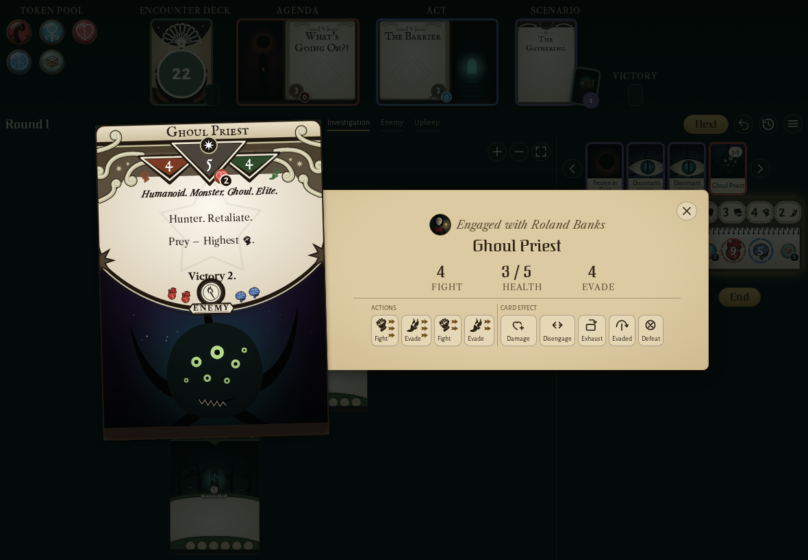</td><td>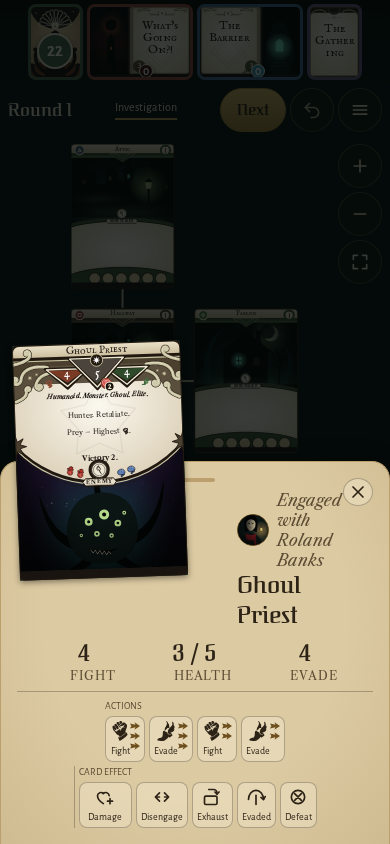</td></tr>
<tr><th>After</th><td></td><td></td></tr>
</table>

### the Ghoul Priest's details with Handcuffs attached, Discard beside it

<table>
<tr><th></th><th>Desktop</th><th>Phone</th></tr>
<tr><th>Before</th><td>New</td><td>New</td></tr>
<tr><th>After</th><td>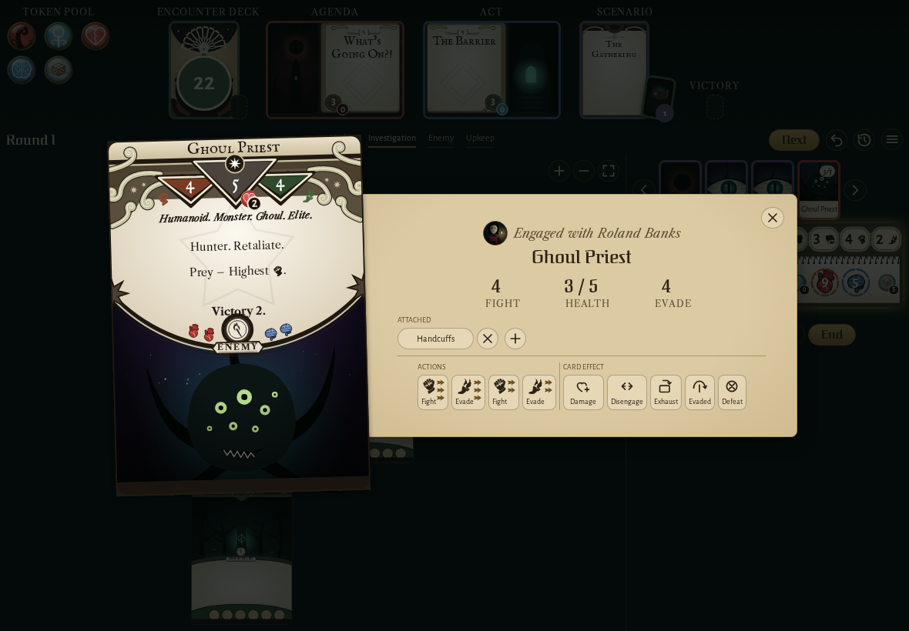</td><td>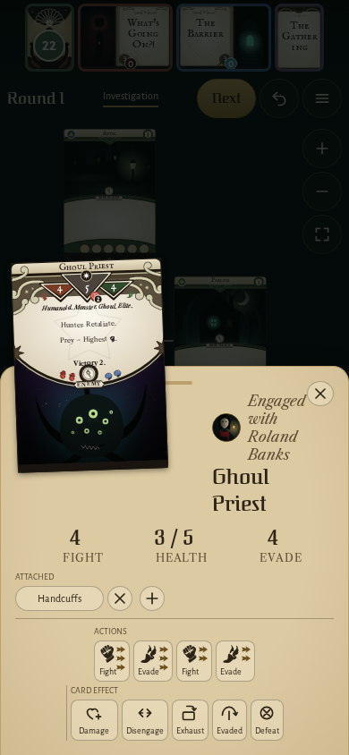</td></tr>
</table>

### the Hallway’s details, its card with Roland Banks on it, on Roland Banks’ turn

<table>
<tr><th></th><th>Desktop</th><th>Phone</th></tr>
<tr><th>Before</th><td>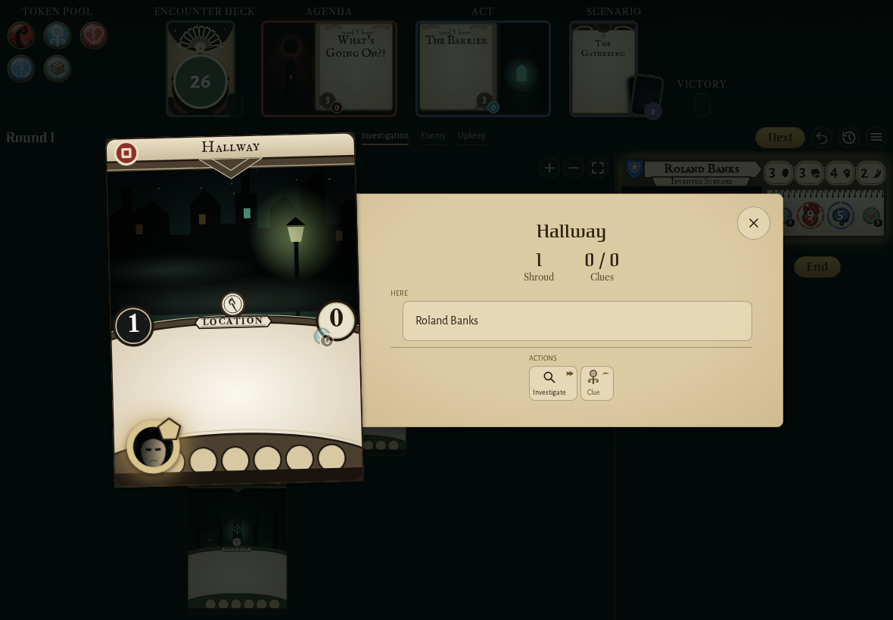</td><td>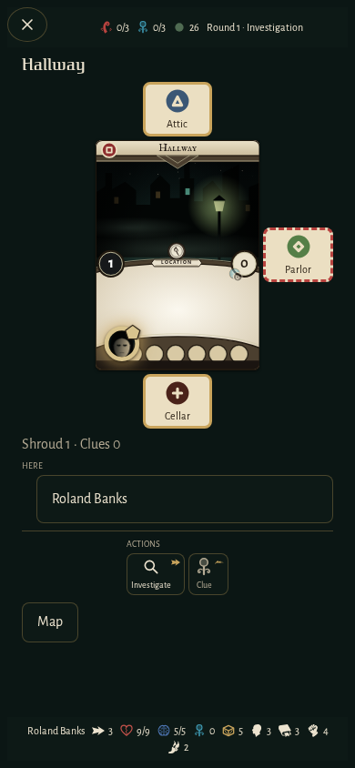</td></tr>
<tr><th>After</th><td>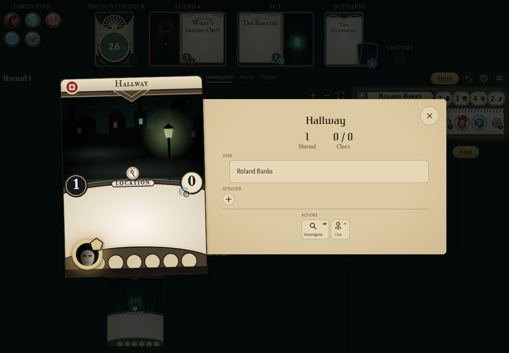</td><td>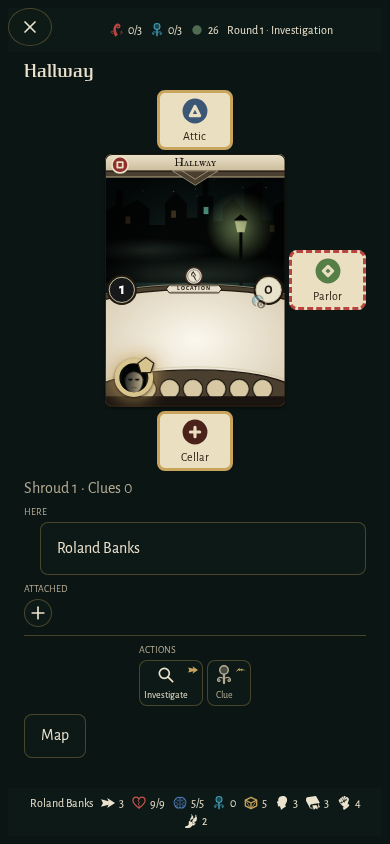</td></tr>
</table>

### the decision dialog asking for the result of an investigation, a token drawn

<table>
<tr><th></th><th>Desktop</th><th>Phone</th></tr>
<tr><th>Before</th><td>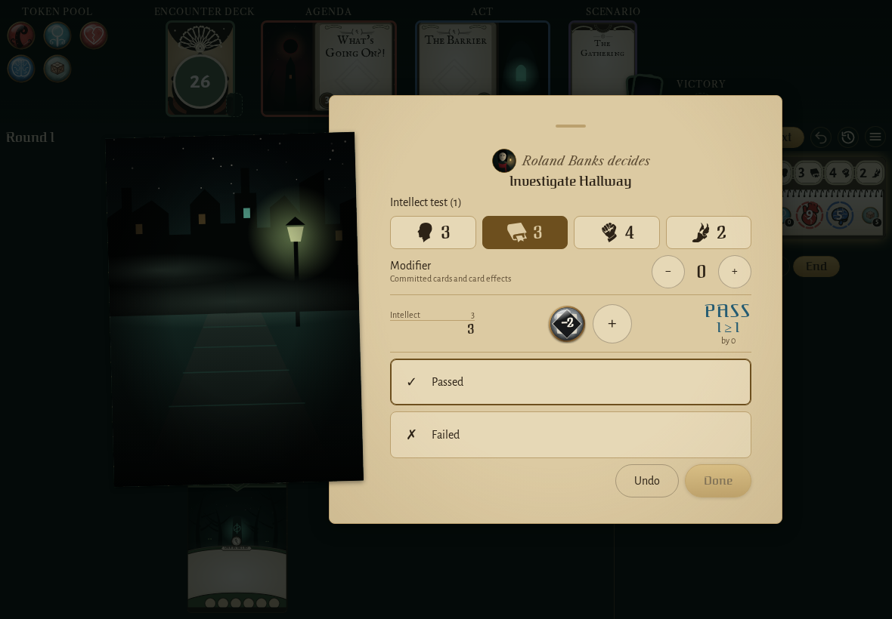</td><td>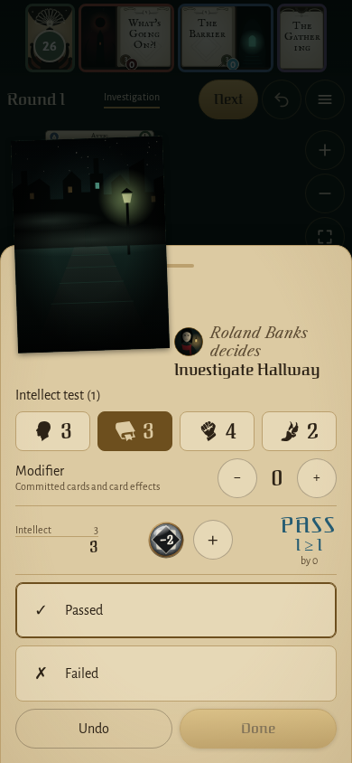</td></tr>
<tr><th>After</th><td></td><td>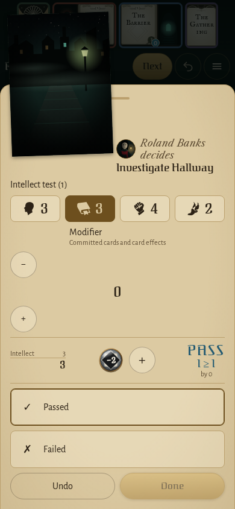</td></tr>
</table>

### Roland Banks’ willpower test before a token is drawn, the draw button in its place

<table>
<tr><th></th><th>Desktop</th><th>Phone</th></tr>
<tr><th>Before</th><td>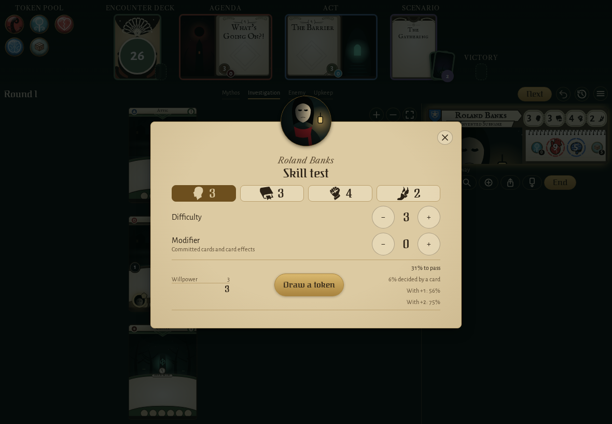</td><td>Unchanged</td></tr>
<tr><th>After</th><td>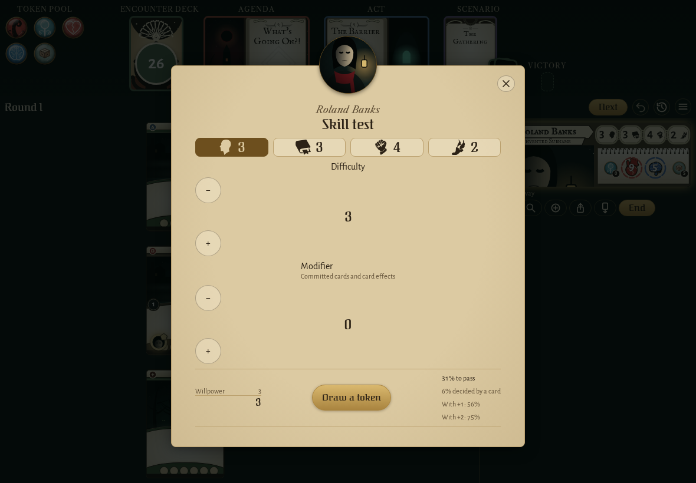</td><td>Unchanged</td></tr>
</table>

### The Gathering’s reference card opened to read

<table>
<tr><th></th><th>Desktop</th><th>Phone</th></tr>
<tr><th>Before</th><td>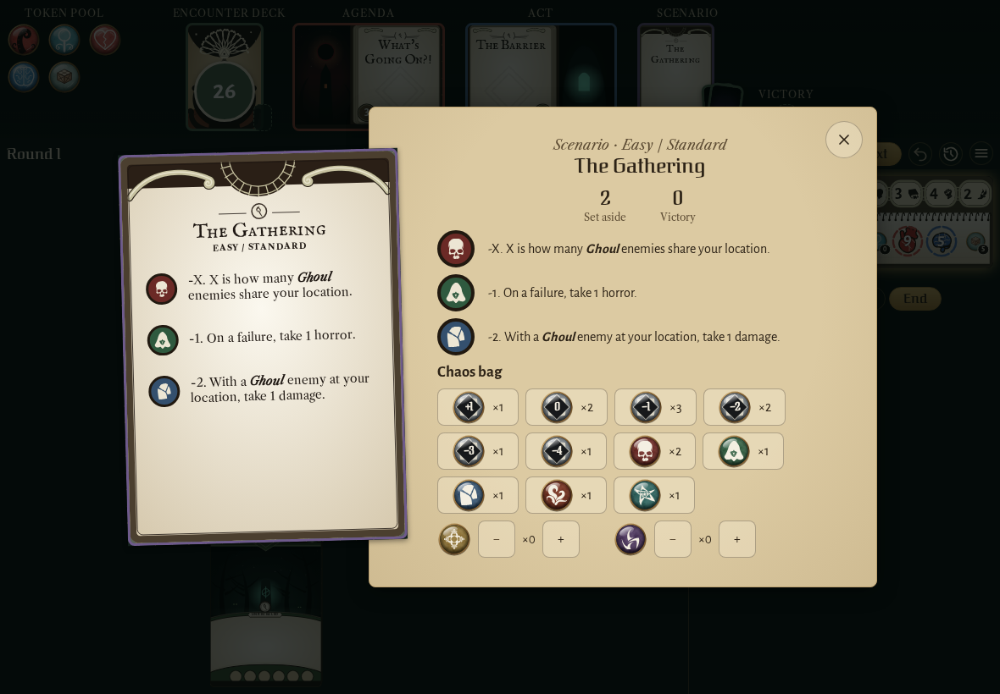</td><td>Unchanged</td></tr>
<tr><th>After</th><td>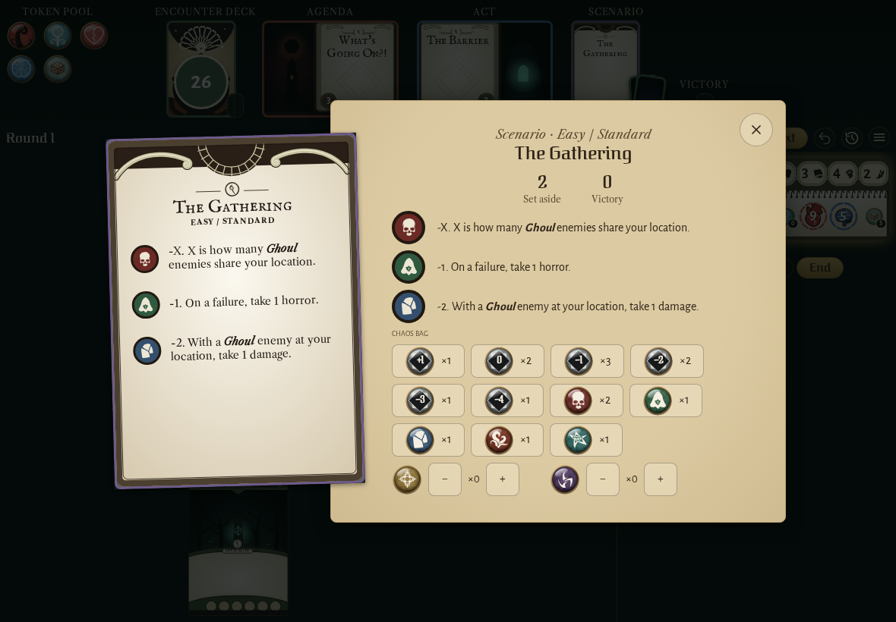</td><td>Unchanged</td></tr>
</table>

### the chaos bag in the cardboard token set

<table>
<tr><th></th><th>Desktop</th><th>Phone</th></tr>
<tr><th>Before</th><td>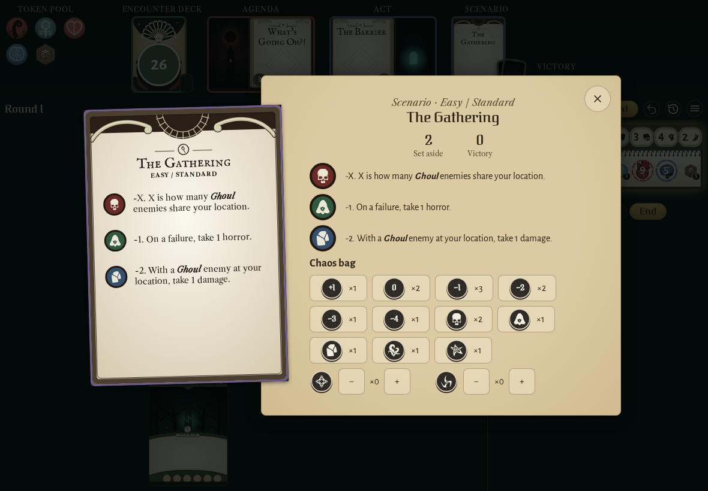</td><td>Unchanged</td></tr>
<tr><th>After</th><td></td><td>Unchanged</td></tr>
</table>

### the chaos bag on the reference card’s page, the elder sign sealed on Roland Banks

<table>
<tr><th></th><th>Desktop</th><th>Phone</th></tr>
<tr><th>Before</th><td></td><td>Unchanged</td></tr>
<tr><th>After</th><td>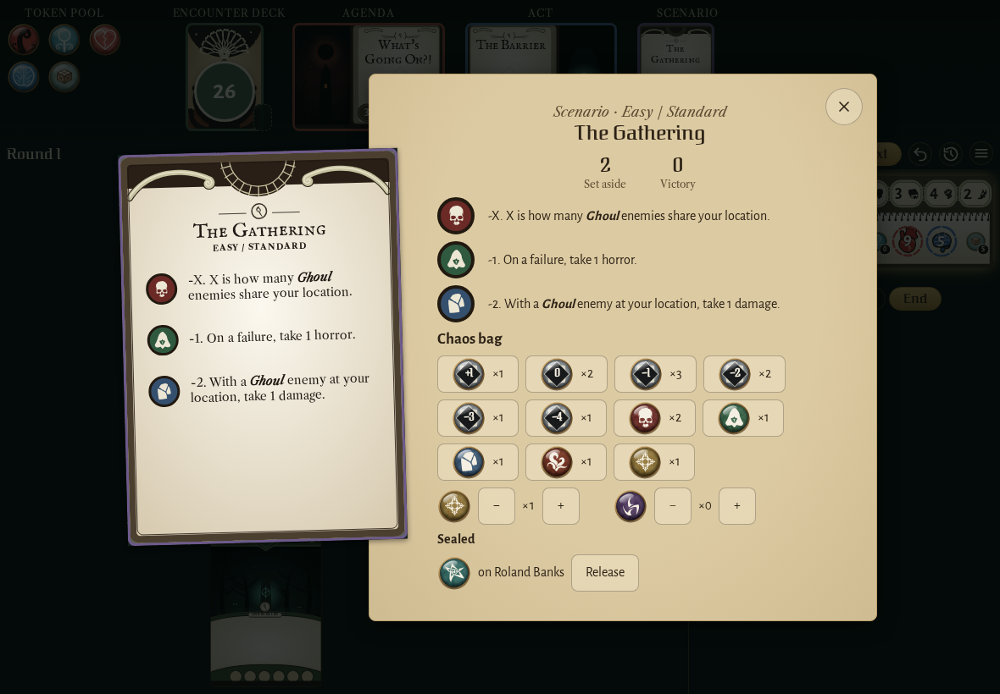</td><td>Unchanged</td></tr>
</table>

## Screencasts

### redraw a drawn token as a card says

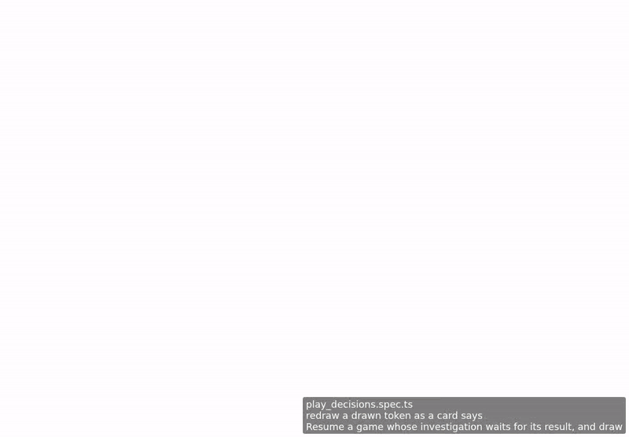

[Play with pause and speed controls](https://macandy13.github.io/arkham-companion/pr-preview/pr-1343/screencasts/player.html?flow=redraw-a-drawn-token-as-a-card-says&v=9502daf&speed=0.25)

### fight an enemy from the map

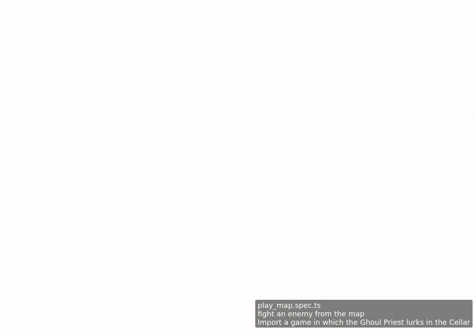

[Play with pause and speed controls](https://macandy13.github.io/arkham-companion/pr-preview/pr-1343/screencasts/player.html?flow=fight-an-enemy-from-the-map&v=9502daf&speed=0.25)

<!-- screencasts:end -->