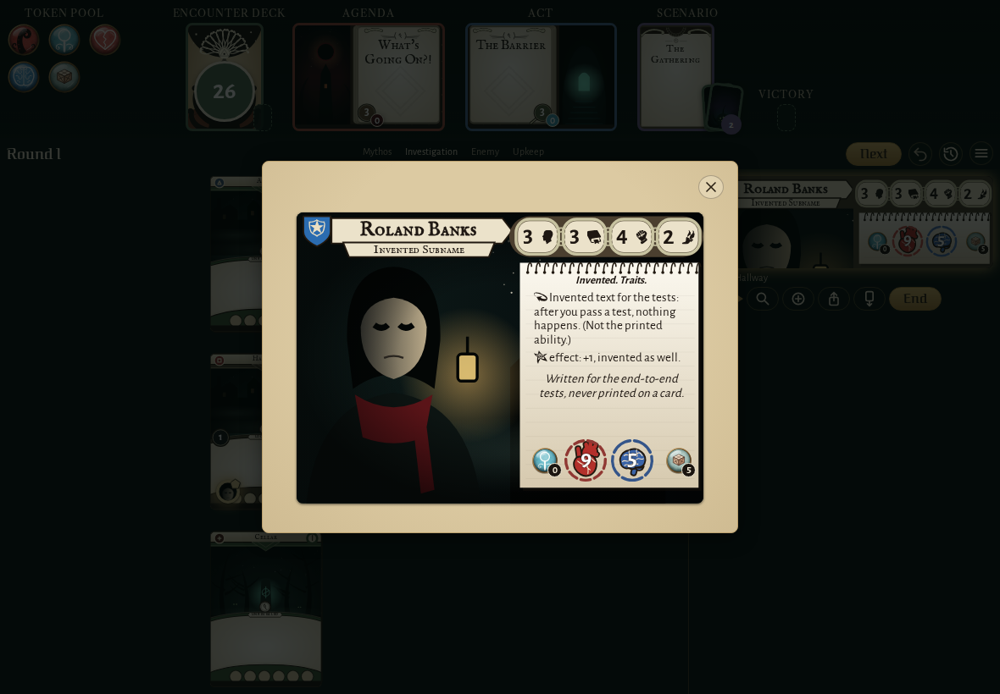
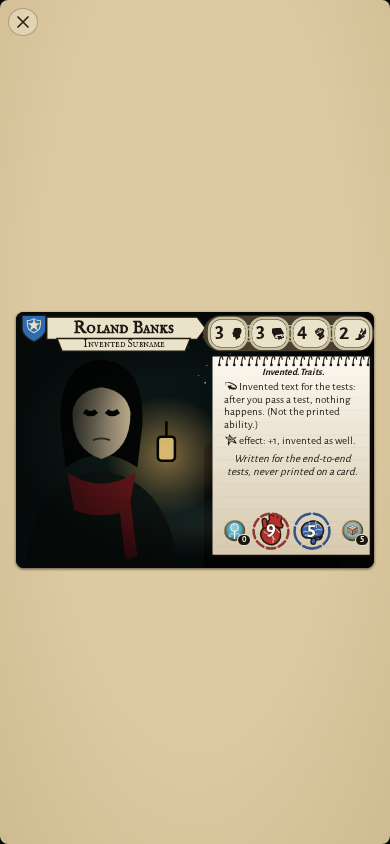
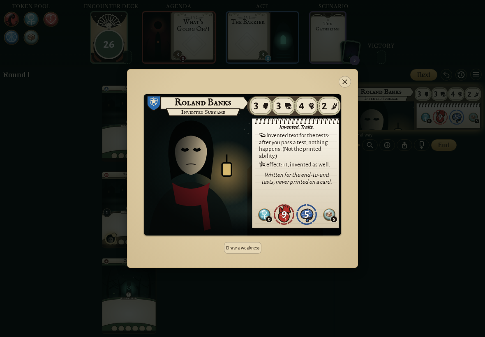
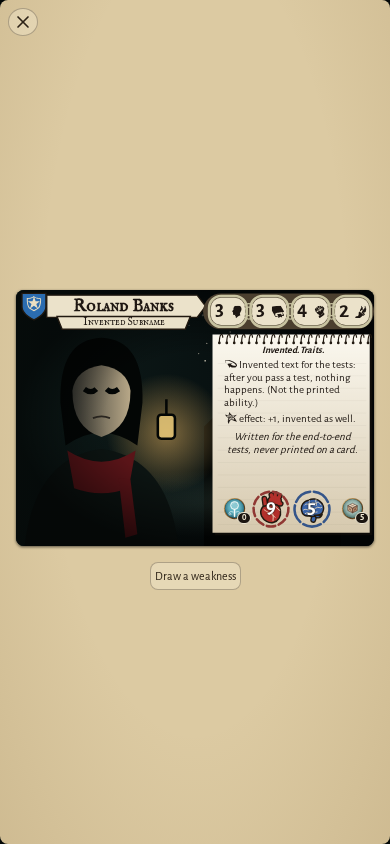

<!-- screencasts:start -->

_The goldens this PR changes, as of 071f14c, from the PR preview workflow; updated on every push that changes `apps/web`._

## Screenshots

### Roland Banks’ card opened whole from its art, to read its abilities

<table>
<tr><th></th><th>Desktop</th><th>Phone</th></tr>
<tr><th>Before</th><td></td><td></td></tr>
<tr><th>After</th><td></td><td></td></tr>
</table>

## Screencasts

### draw a weakness enemy from the deck

[Play with pause and speed controls](https://macandy13.github.io/arkham-companion/pr-preview/pr-1367/screencasts/player.html?flow=draw-a-weakness-enemy-from-the-deck&v=071f14c&speed=0.25)

### expand the investigators in place and swipe sideways between them on a phone

[Play with pause and speed controls](https://macandy13.github.io/arkham-companion/pr-preview/pr-1367/screencasts/player.html?flow=expand-the-investigators-in-place-and-swipe-sideways-between-them-on-a-phone&v=071f14c&speed=0.25)

<!-- screencasts:end -->