<!-- screencasts:start -->

_The goldens this PR changes, as of 95c3d22, from the PR preview workflow; updated on every push that changes `apps/web`._

## Screenshots

### the Ghoul Priest's details opened from its card on Roland Banks' turn, both Frozen in Fear raising the fight to 3 actions

<table>
<tr><th></th><th>Desktop</th><th>Phone</th></tr>
<tr><th>Before</th><td></td><td></td></tr>
<tr><th>After</th><td>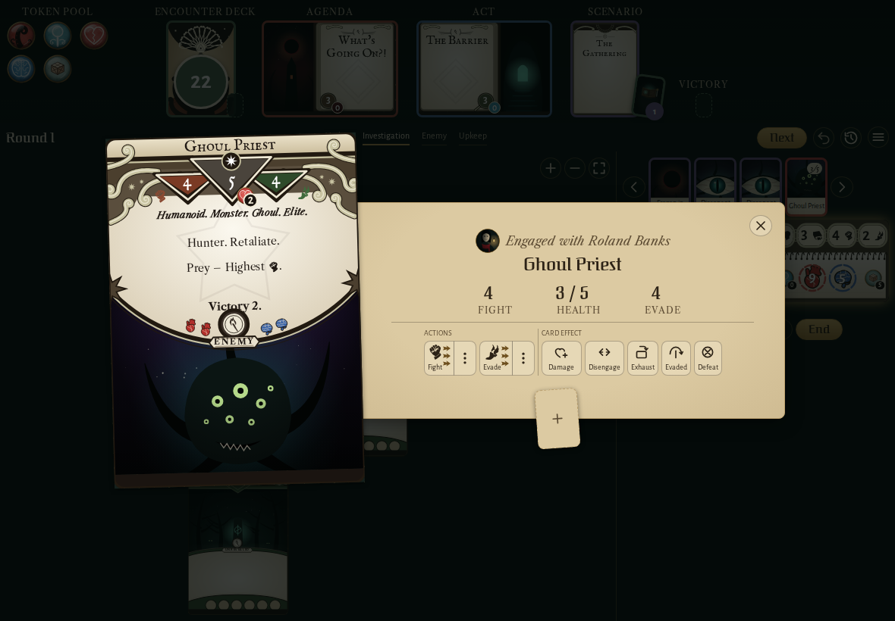</td><td>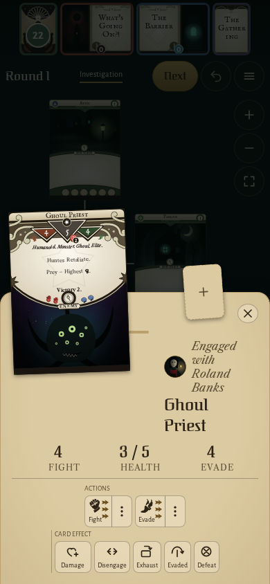</td></tr>
</table>

### the Ghoul Priest s details with Handcuffs attached Discard beside it

<table>
<tr><th></th><th>Desktop</th><th>Phone</th></tr>
<tr><th>Before</th><td>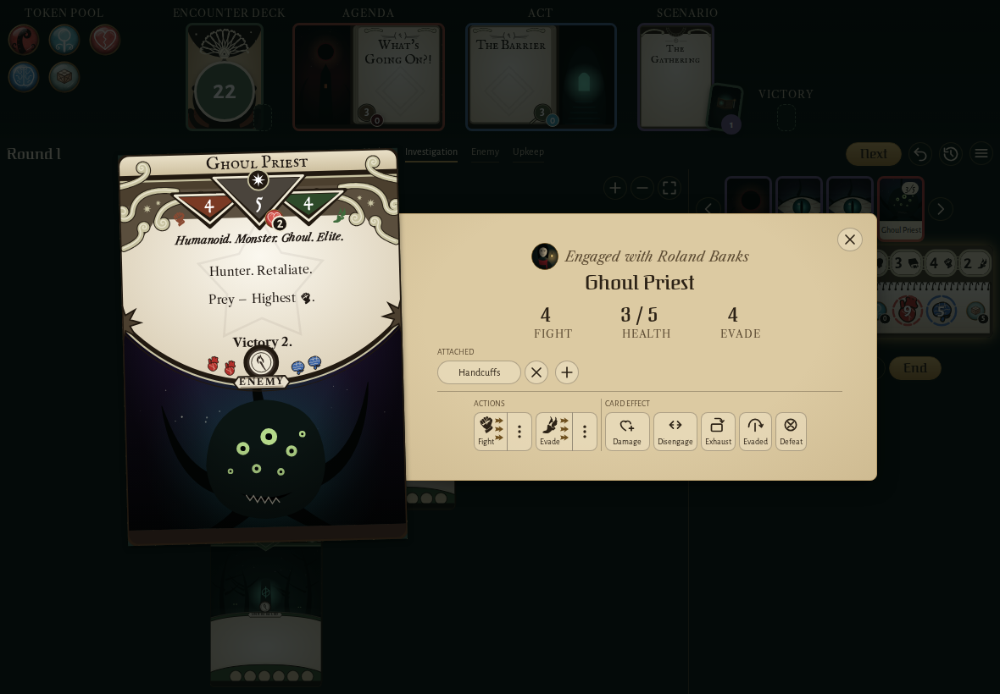</td><td>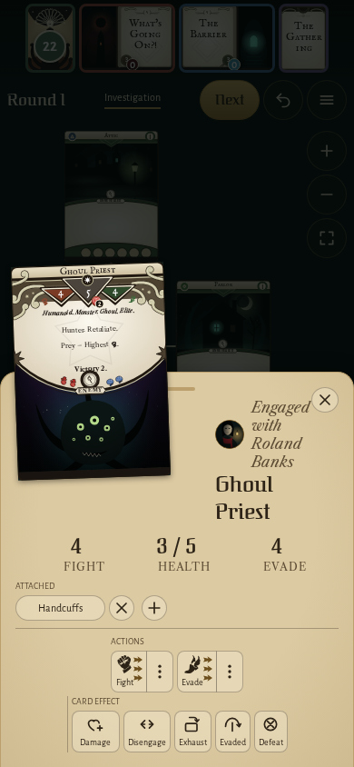</td></tr>
<tr><th>After</th><td>Removed</td><td>Removed</td></tr>
</table>

### the Ghoul Priest's details with Handcuffs attached, fanned over the page's bottom edge

<table>
<tr><th></th><th>Desktop</th><th>Phone</th></tr>
<tr><th>Before</th><td>New</td><td>New</td></tr>
<tr><th>After</th><td>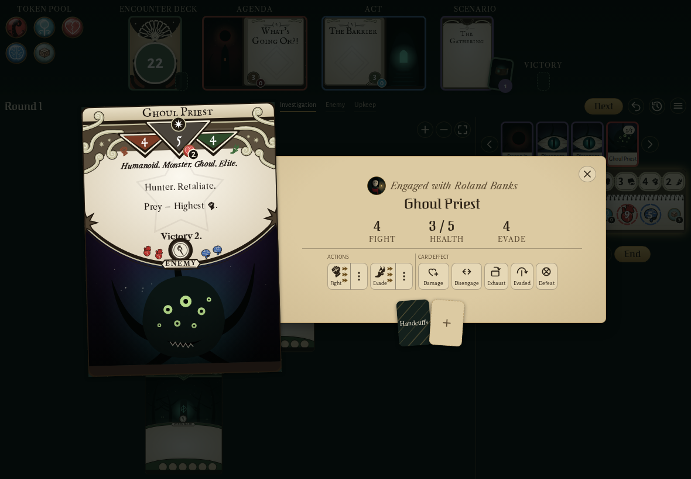</td><td>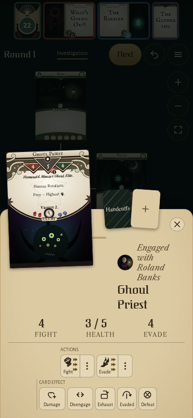</td></tr>
</table>

### the Ghoul Priest's ways to fight opened from its details: as an action, without one, or by card effect

<table>
<tr><th></th><th>Desktop</th><th>Phone</th></tr>
<tr><th>Before</th><td>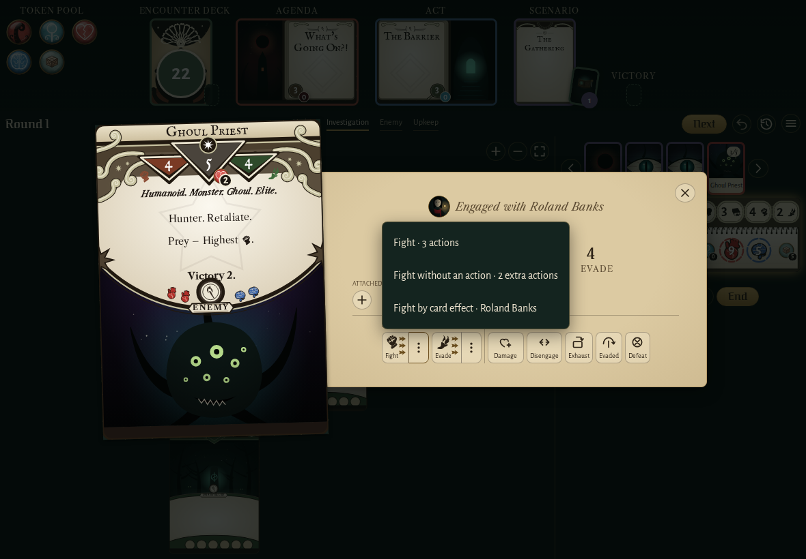</td><td>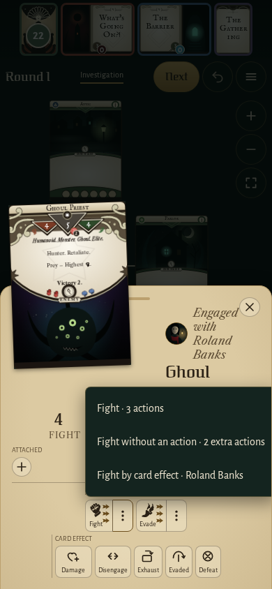</td></tr>
<tr><th>After</th><td>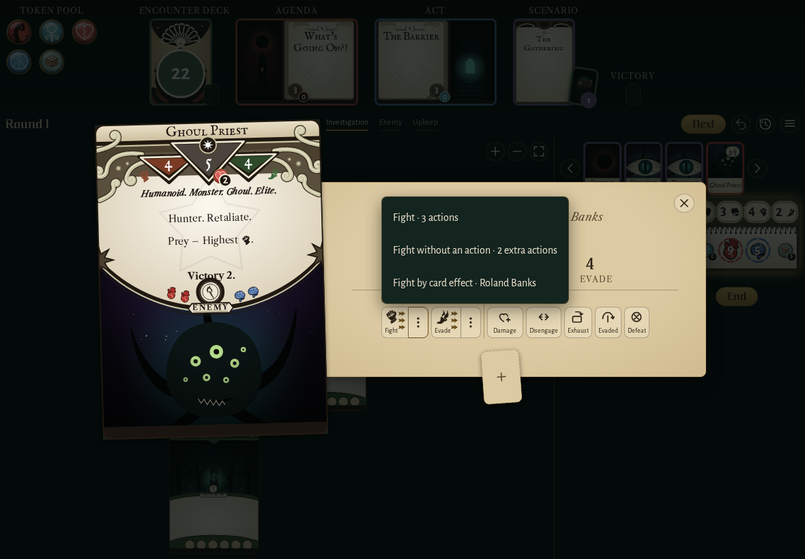</td><td>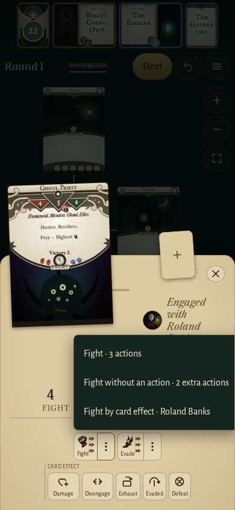</td></tr>
</table>

### the Hallway’s details, its card with Roland Banks on it, on Roland Banks’ turn

<table>
<tr><th></th><th>Desktop</th><th>Phone</th></tr>
<tr><th>Before</th><td>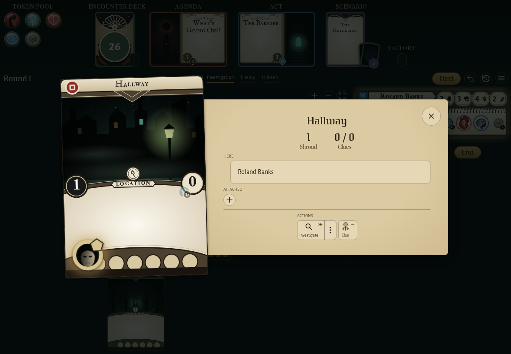</td><td>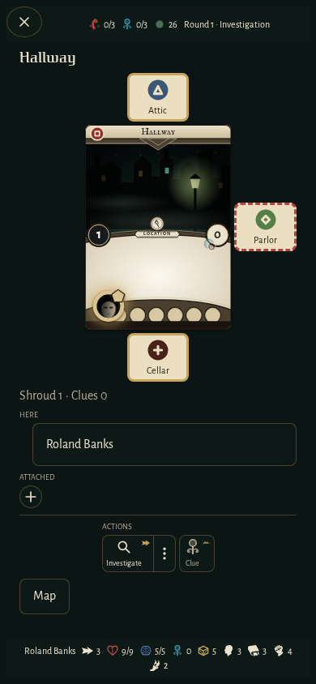</td></tr>
<tr><th>After</th><td>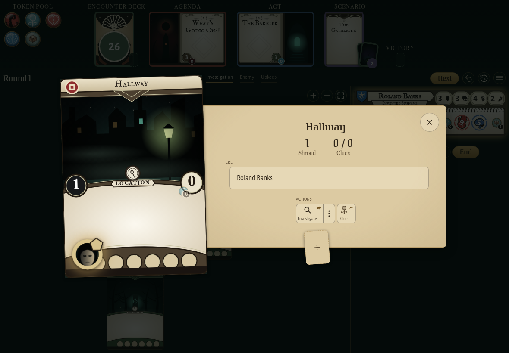</td><td>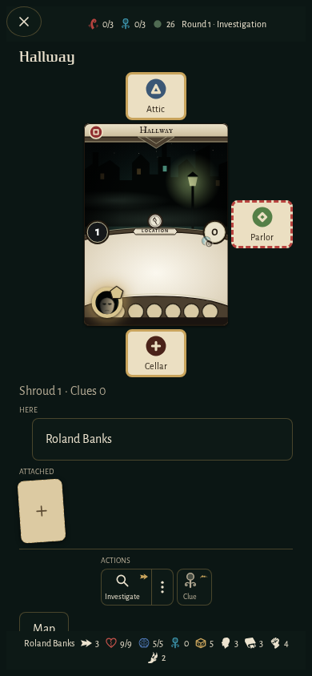</td></tr>
</table>

## Screencasts

### investigate another location by a card effect

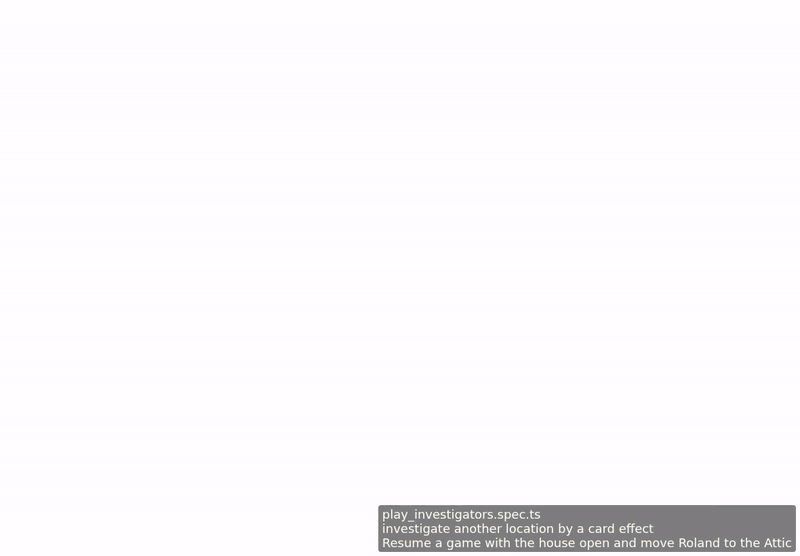

[Play with pause and speed controls](https://macandy13.github.io/arkham-companion/pr-preview/pr-1418/screencasts/player.html?flow=investigate-another-location-by-a-card-effect&v=95c3d22&speed=0.25)

### fight an enemy from the map

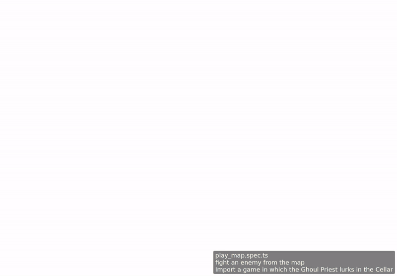

[Play with pause and speed controls](https://macandy13.github.io/arkham-companion/pr-preview/pr-1418/screencasts/player.html?flow=fight-an-enemy-from-the-map&v=95c3d22&speed=0.25)

<!-- screencasts:end -->