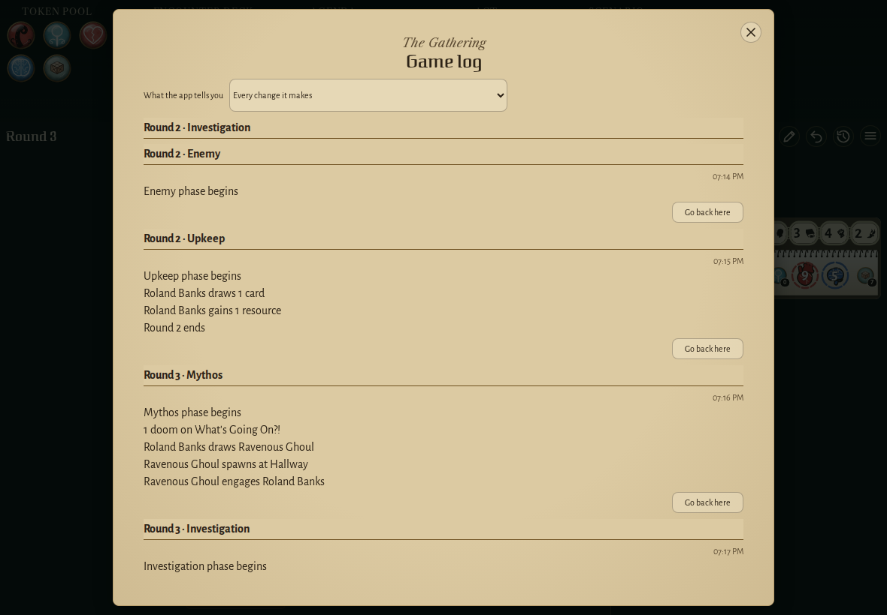
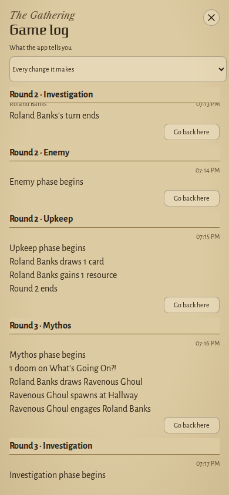
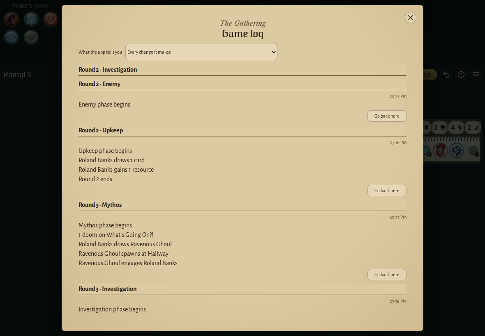
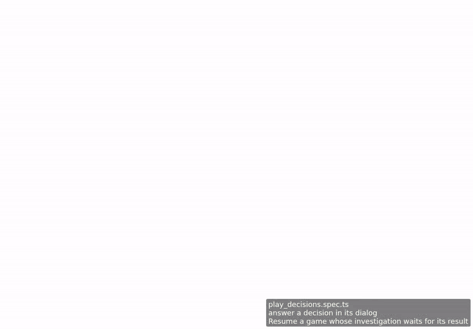

<!-- screencasts:start -->

_The goldens this PR changes, as of 658d2dc, from the PR preview workflow; updated on every push that changes `apps/web`._

## Screenshots

### the game log after two rounds, scrolled to the newest step under its round and phase, what the app tells the players above

<table>
<tr><th></th><th>Desktop</th><th>Phone</th></tr>
<tr><th>Before</th><td></td><td></td></tr>
<tr><th>After</th><td></td><td></td></tr>
</table>

## Screencasts

### answer a decision in its dialog

[Play with pause and speed controls](https://macandy13.github.io/arkham-companion/pr-preview/pr-1445/screencasts/player.html?flow=answer-a-decision-in-its-dialog&v=658d2dc&speed=0.25)

<!-- screencasts:end -->