<!-- screencasts:start -->

_The goldens this PR changes, as of c4e69c0, from the PR preview workflow; updated on every push that changes `apps/web`._

## Screenshots

### the chaos bag in its own dialog, the elder sign sealed on Roland Banks

<table>
<tr><th></th><th>Desktop</th><th>Phone</th></tr>
<tr><th>Before</th><td>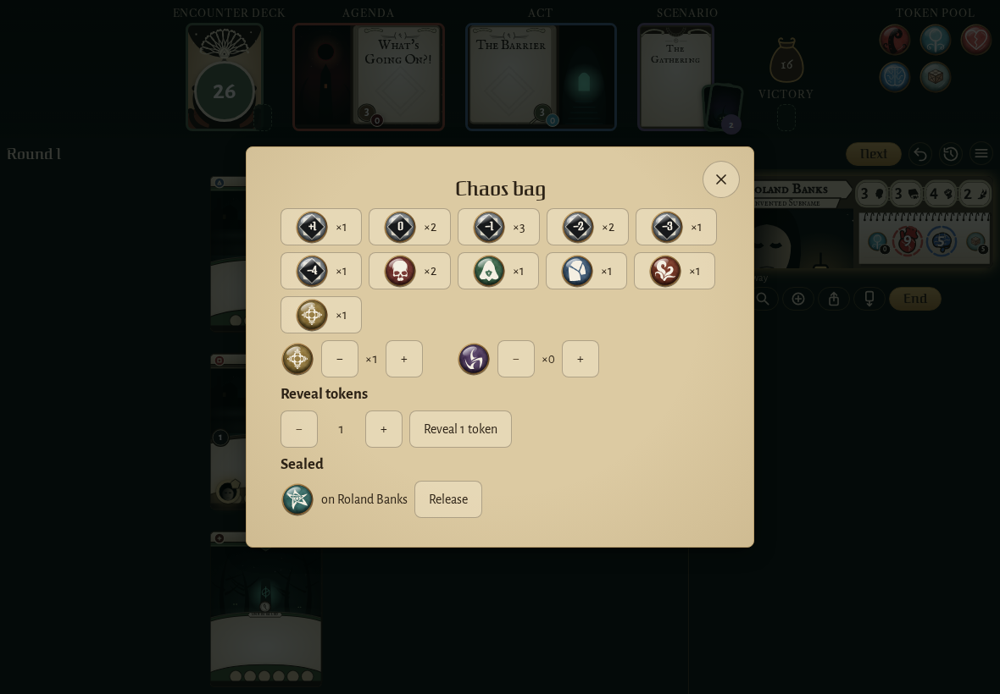</td><td>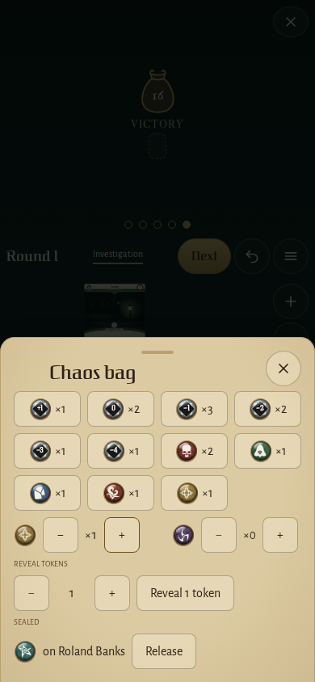</td></tr>
<tr><th>After</th><td>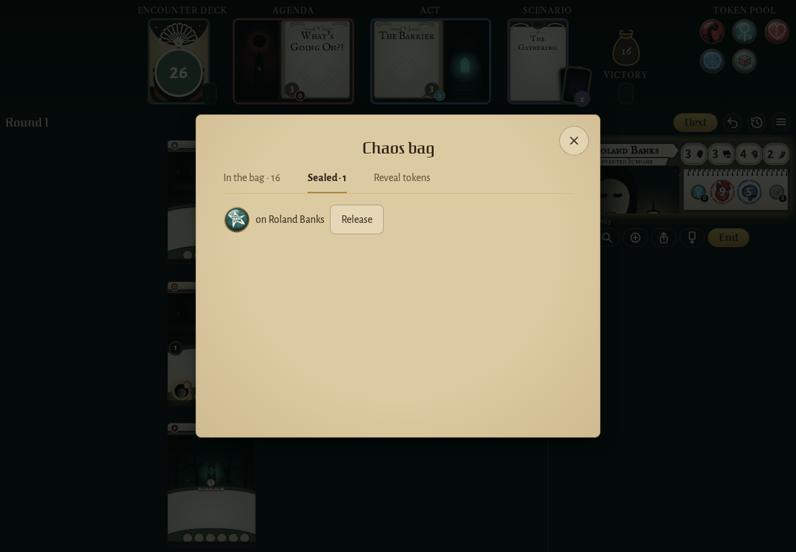</td><td>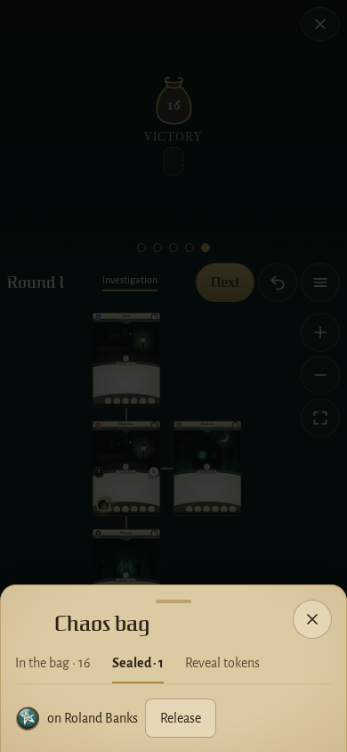</td></tr>
</table>

### the chaos bag in the cardboard token set

<table>
<tr><th></th><th>Desktop</th><th>Phone</th></tr>
<tr><th>Before</th><td>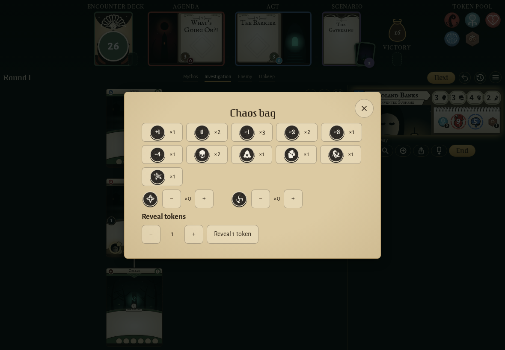</td><td>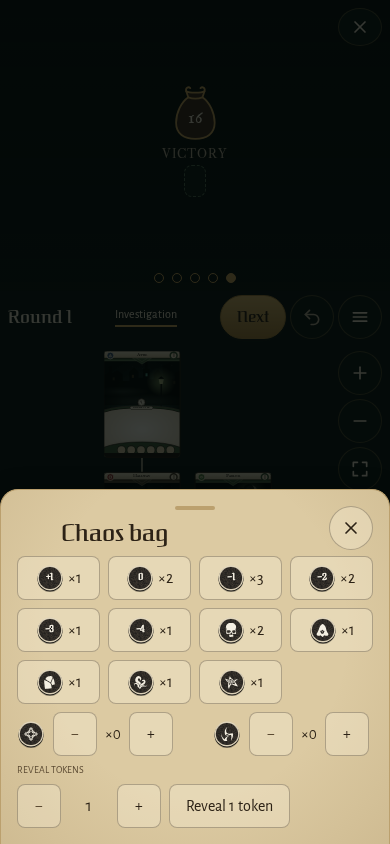</td></tr>
<tr><th>After</th><td>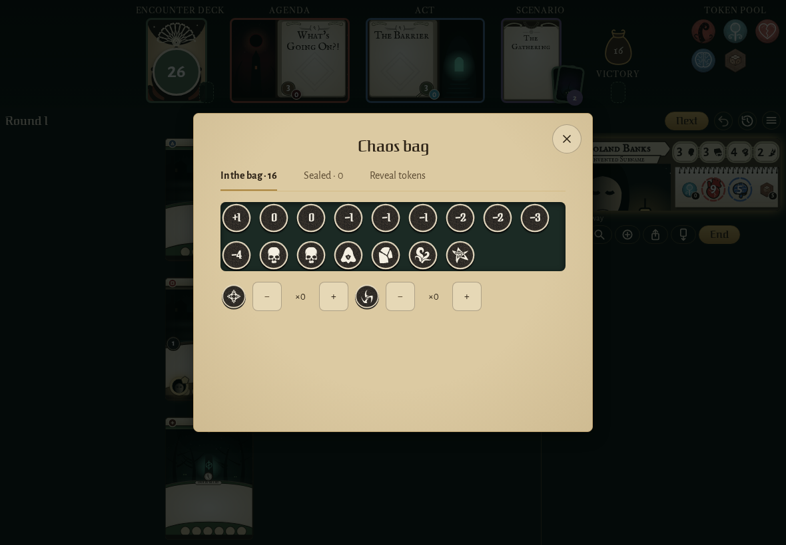</td><td>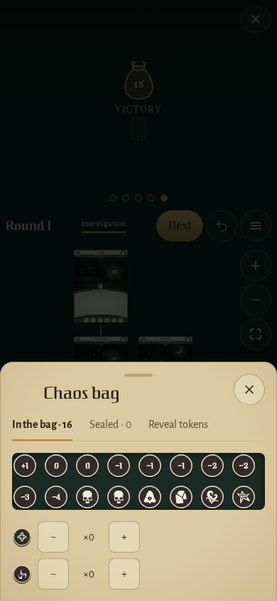</td></tr>
</table>

### three chaos tokens revealed from the bag outside a skill test, still in the bag

<table>
<tr><th></th><th>Desktop</th><th>Phone</th></tr>
<tr><th>Before</th><td>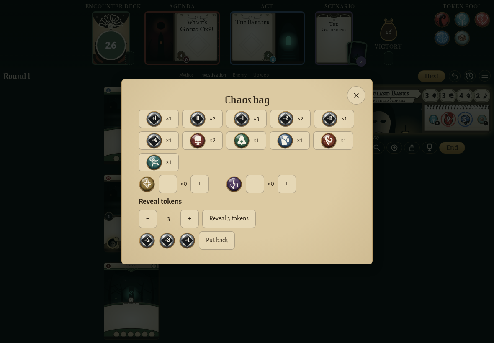</td><td>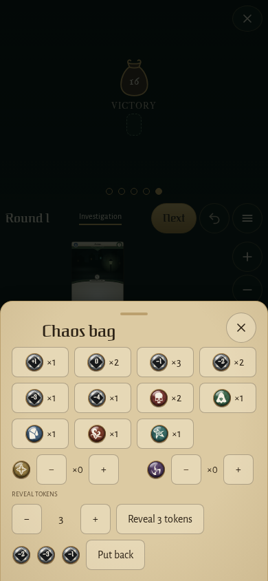</td></tr>
<tr><th>After</th><td>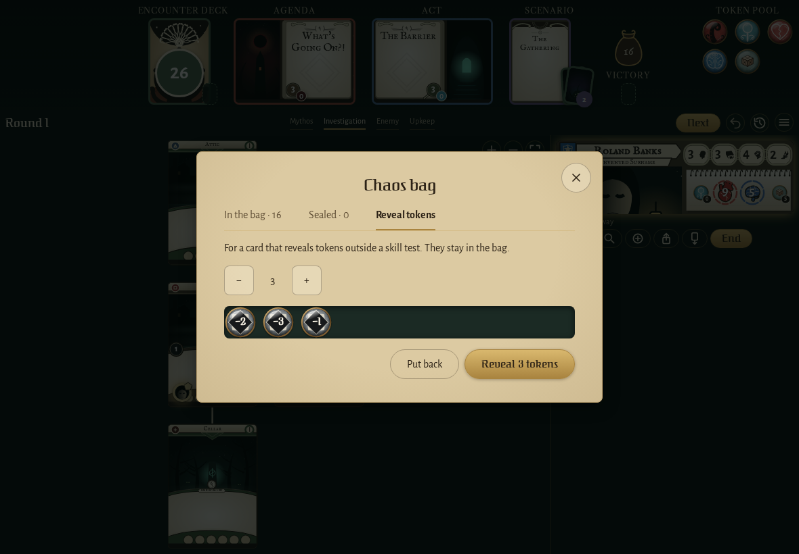</td><td>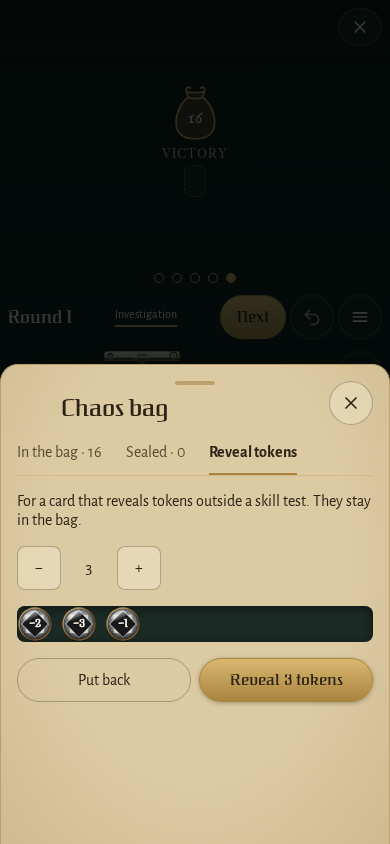</td></tr>
</table>

<!-- screencasts:end -->