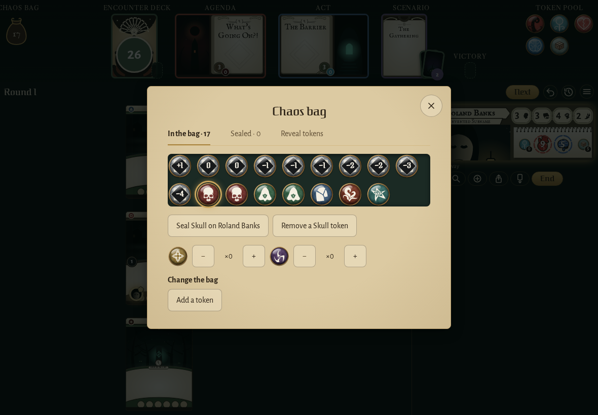
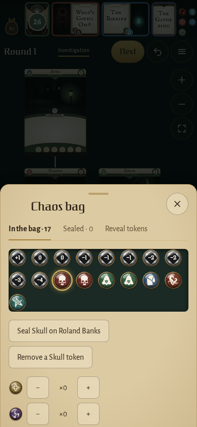
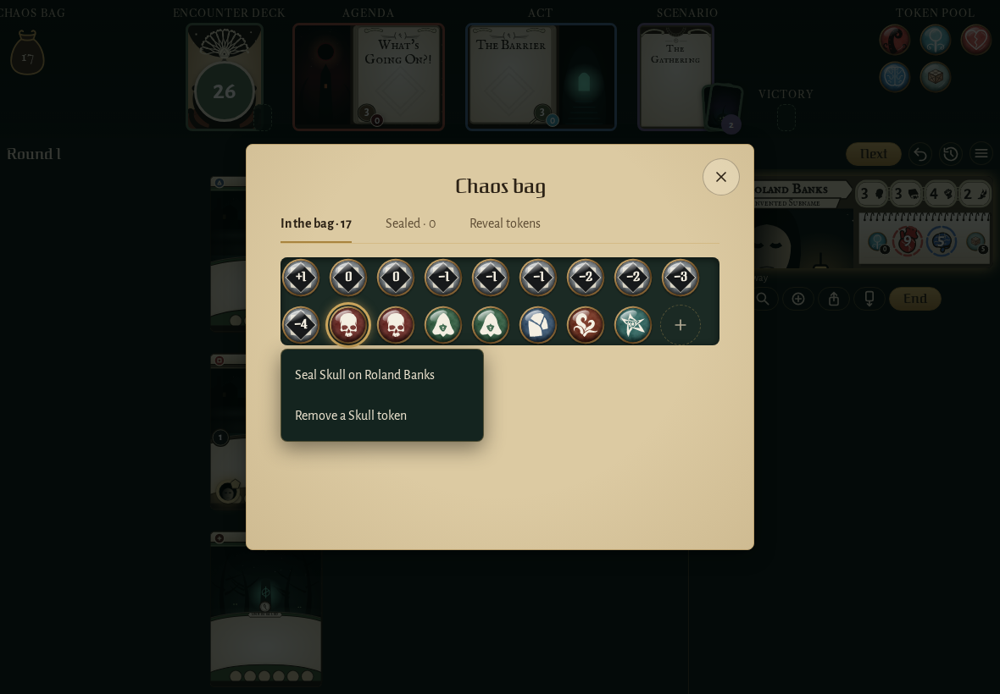
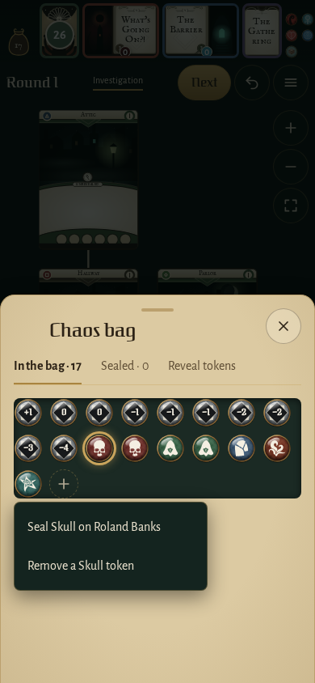
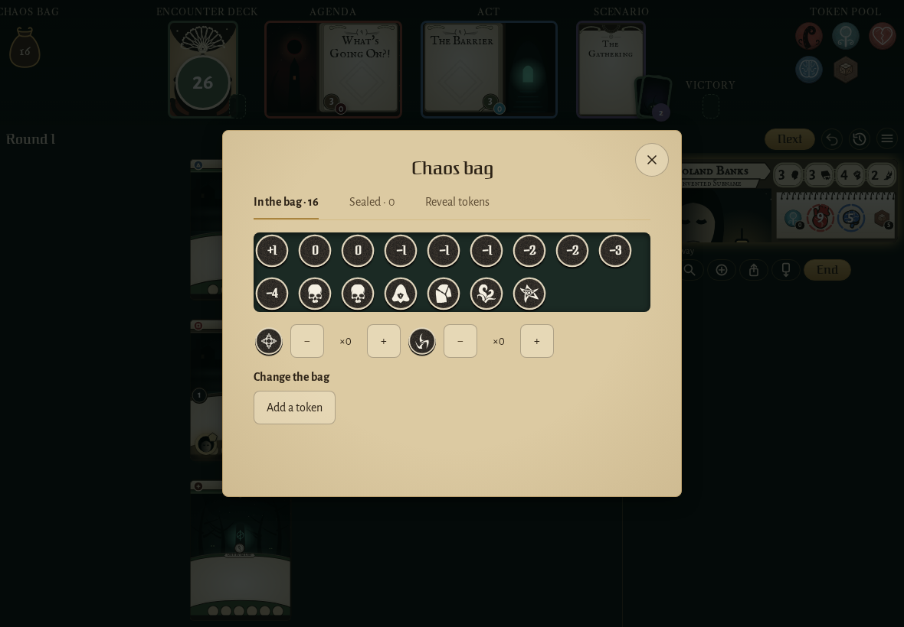
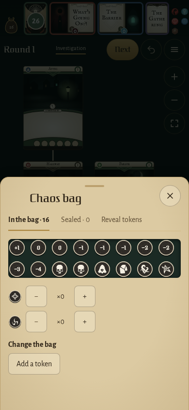
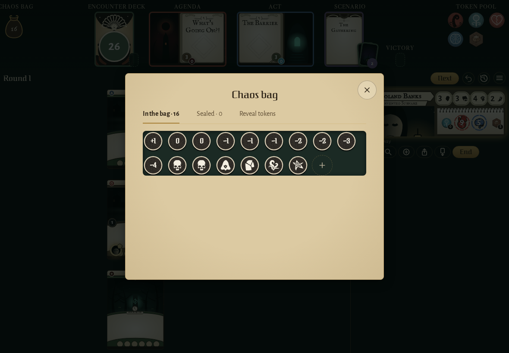
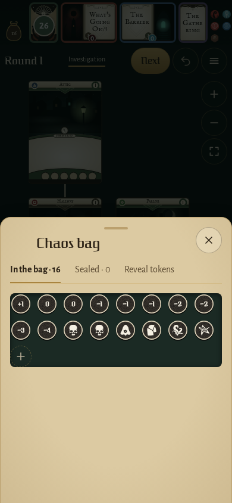
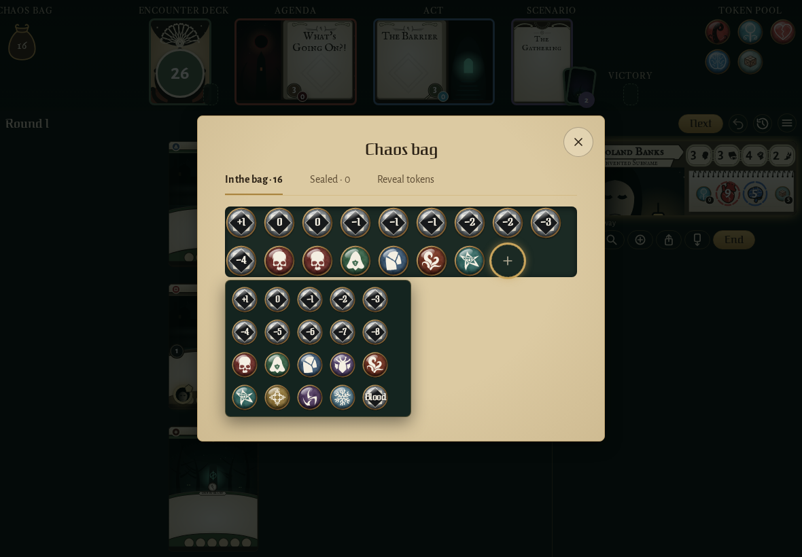
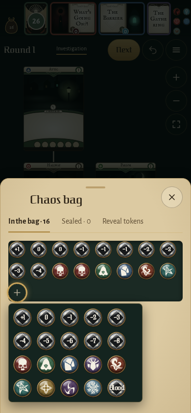

<!-- screencasts:start -->

_The goldens this PR changes, as of 8821ab3, from the PR preview workflow; updated on every push that changes `apps/web`._

## Screenshots

### a Cultist token added to the chaos bag as a card says, the Skull tapped to seal or remove it

<table>
<tr><th></th><th>Desktop</th><th>Phone</th></tr>
<tr><th>Before</th><td></td><td></td></tr>
<tr><th>After</th><td></td><td></td></tr>
</table>

### the chaos bag in the cardboard token set

<table>
<tr><th></th><th>Desktop</th><th>Phone</th></tr>
<tr><th>Before</th><td></td><td></td></tr>
<tr><th>After</th><td></td><td></td></tr>
</table>

### the dashed token at the end of the chaos bag tray opened, the tokens to add in its menu

<table>
<tr><th></th><th>Desktop</th><th>Phone</th></tr>
<tr><th>Before</th><td>New</td><td>New</td></tr>
<tr><th>After</th><td></td><td></td></tr>
</table>

<!-- screencasts:end -->