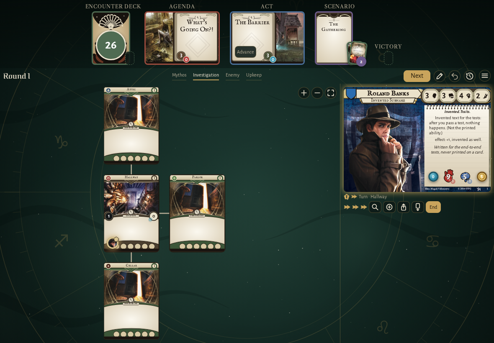
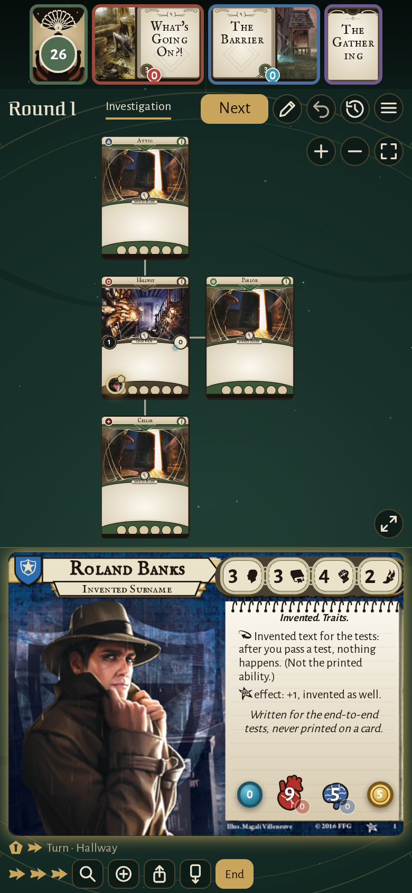
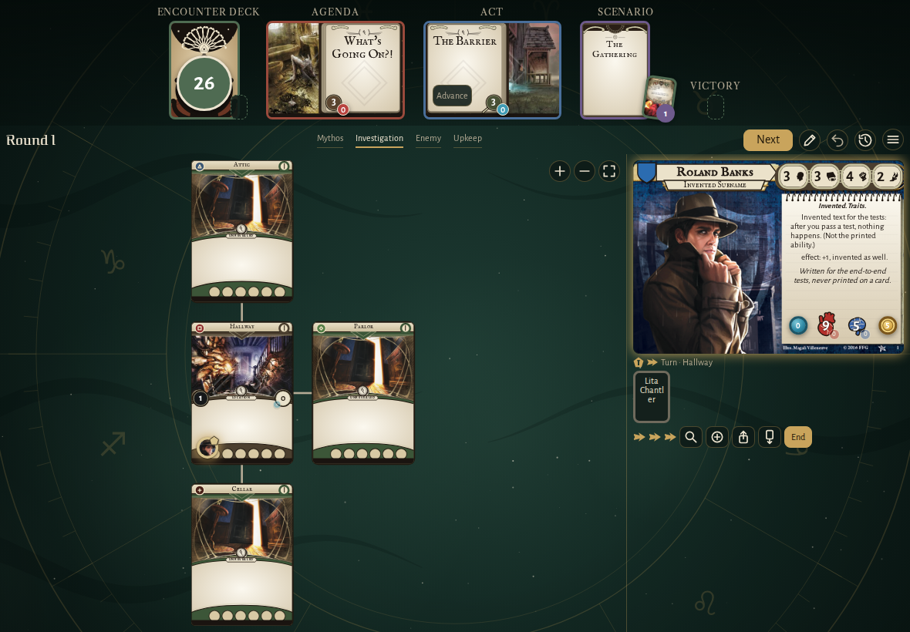
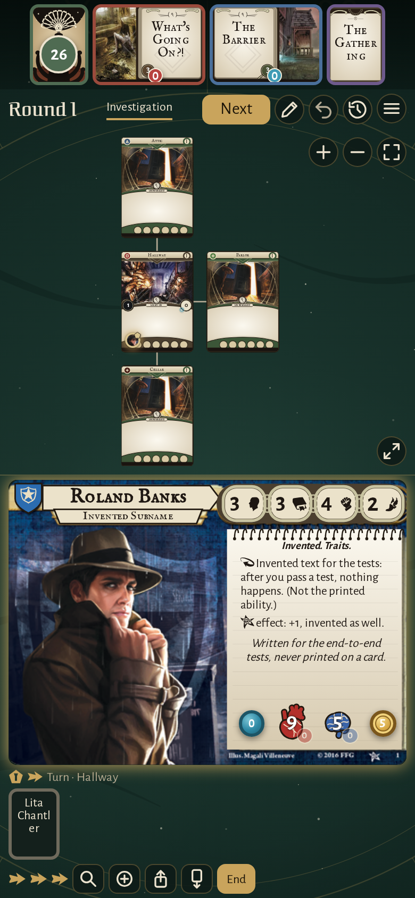
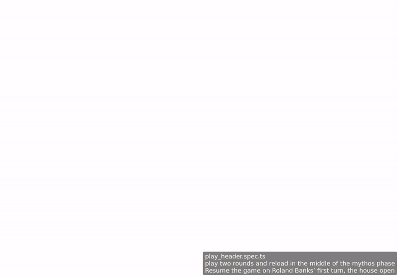

<!-- screencasts:start -->

_Recorded from dfed2d7 by the PR preview workflow; updated on every push that changes `apps/web`._

## Screenshots

### the house map with Roland Banks in the Hallway

<table>
<tr><th>Desktop</th><th>Phone</th></tr>
<tr><td></td><td></td></tr>
</table>

### Lita Chantler under Roland Banks’ card, in their control

<table>
<tr><th>Desktop</th><th>Phone</th></tr>
<tr><td></td><td></td></tr>
</table>

## Screencasts

### draw an encounter card for Roland Banks on his turn

[Play with pause and speed controls](https://macandy13.github.io/arkham-companion/pr-preview/pr-838/screencasts/player.html?flow=draw-an-encounter-card-for-roland-banks-on-his-turn&v=dfed2d7&speed=0.25)

### play two rounds and reload in the middle of the mythos phase

[Play with pause and speed controls](https://macandy13.github.io/arkham-companion/pr-preview/pr-838/screencasts/player.html?flow=play-two-rounds-and-reload-in-the-middle-of-the-mythos-phase&v=dfed2d7&speed=0.25)

<!-- screencasts:end -->