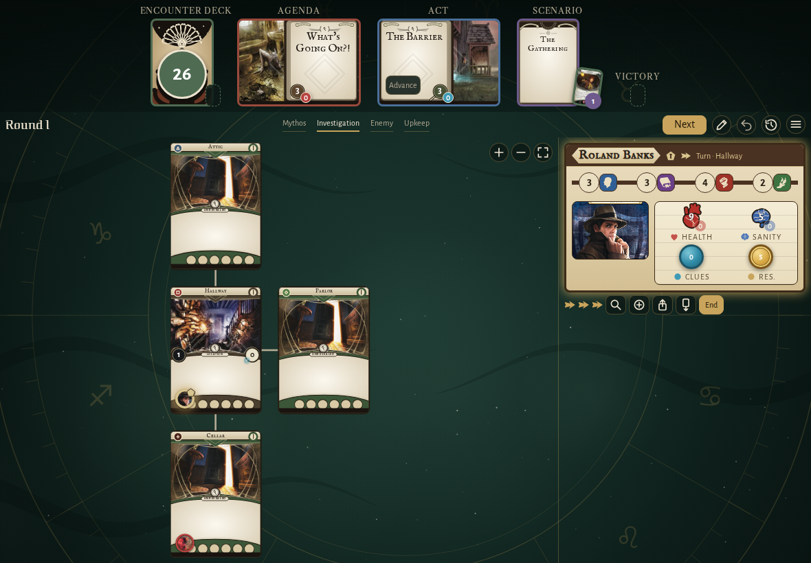
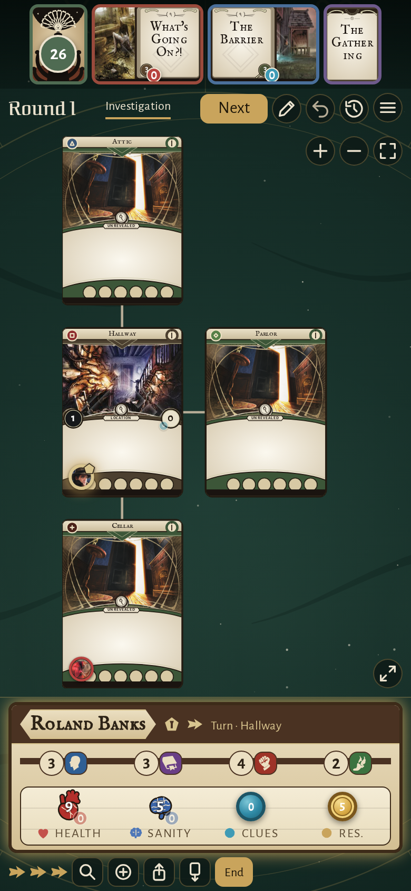
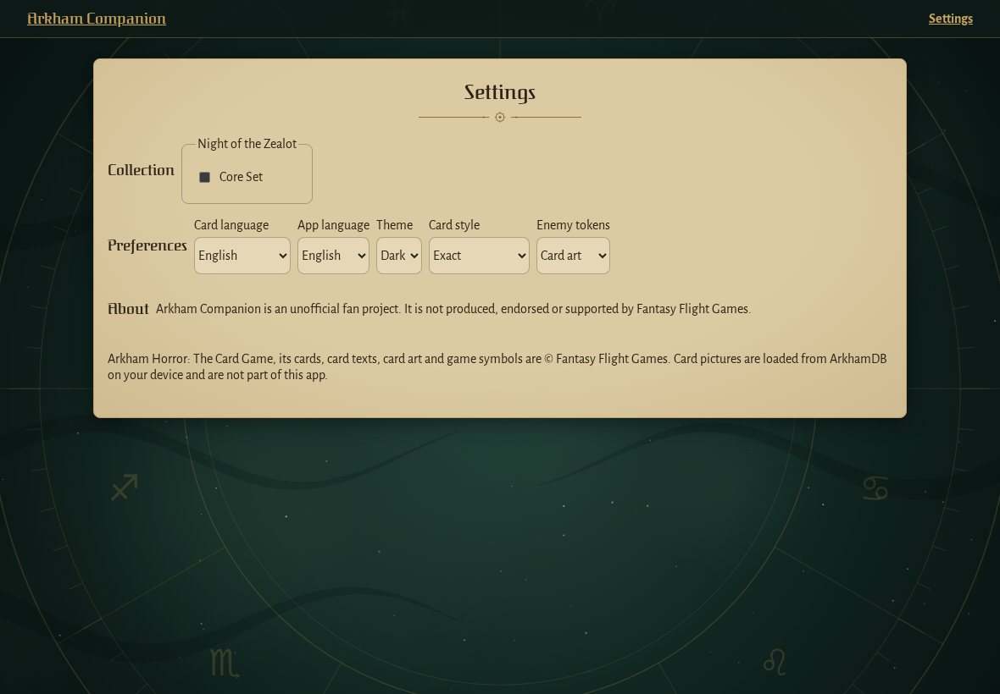
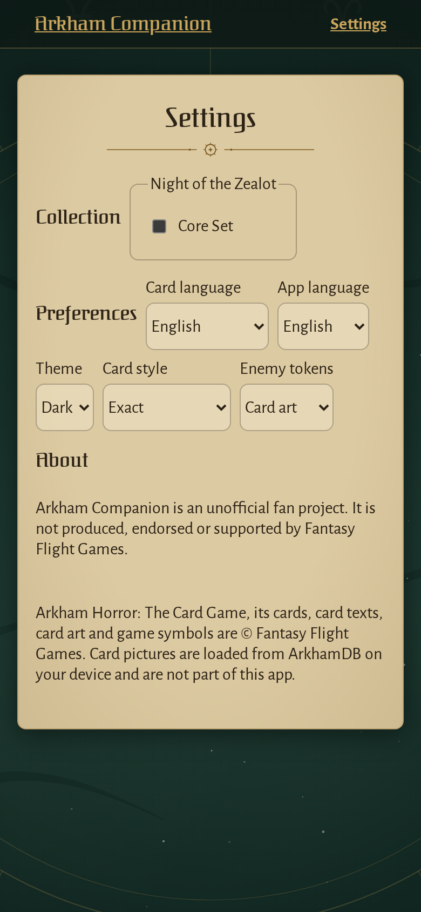
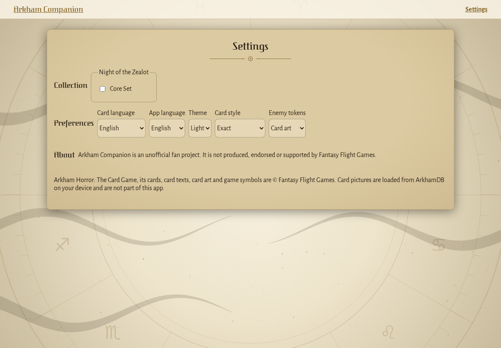
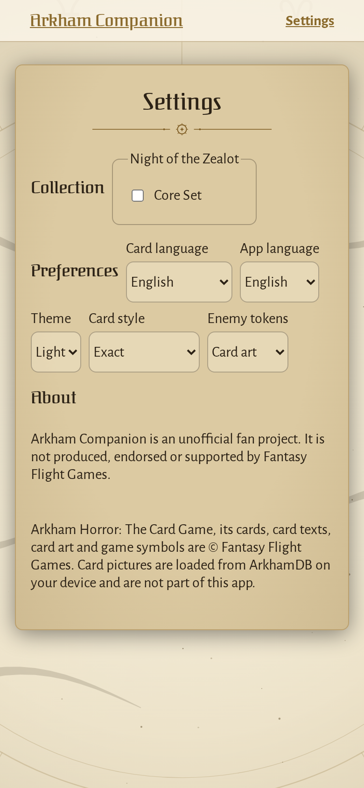

<!-- screencasts:start -->

_Recorded from c23b27f by the PR preview workflow; updated on every push that changes `apps/web`._

## Screenshots

### the Ghoul Priest in the Cellar, its token cut from the card art

<table>
<tr><th>Desktop</th><th>Phone</th></tr>
<tr><td></td><td></td></tr>
</table>

### the Ghoul Priest in the Cellar, its token showing its initial as the settings ask

<table>
<tr><th>Desktop</th><th>Phone</th></tr>
<tr><td></td><td></td></tr>
</table>

### the settings with the unofficial fan project notice

<table>
<tr><th>Desktop</th><th>Phone</th></tr>
<tr><td></td><td></td></tr>
</table>

### the settings by day, on parchment

<table>
<tr><th>Desktop</th><th>Phone</th></tr>
<tr><td></td><td></td></tr>
</table>

<!-- screencasts:end -->