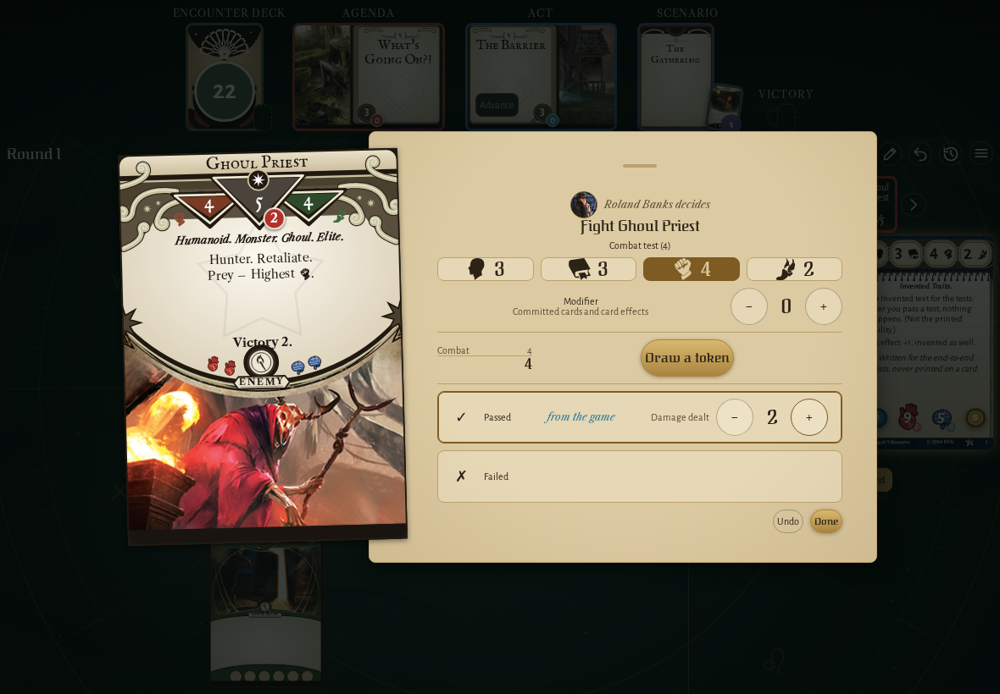
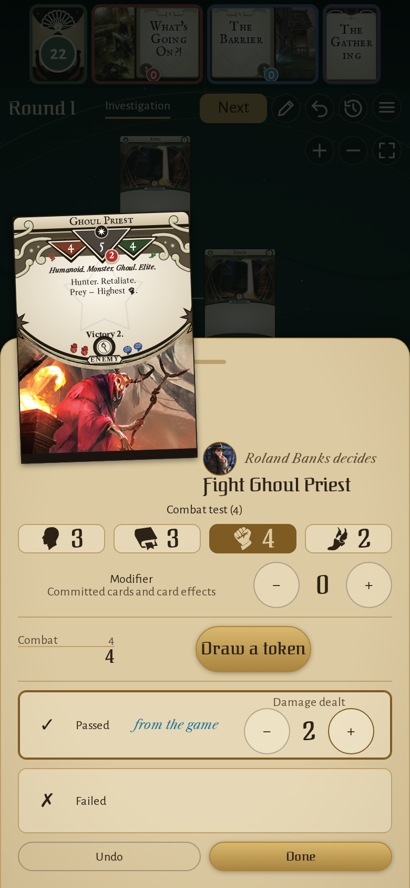
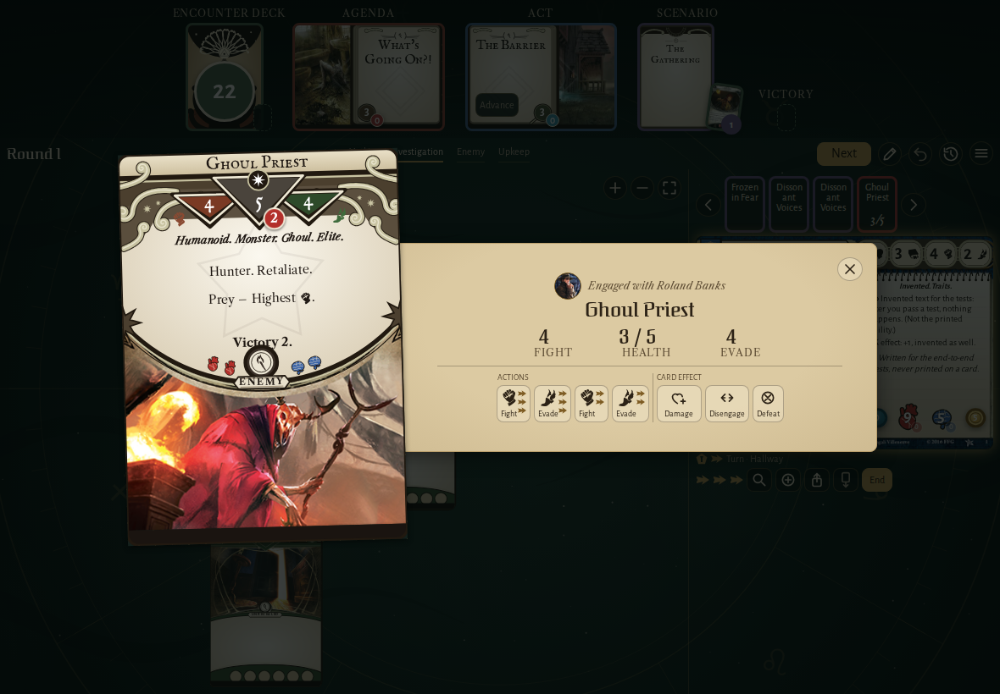
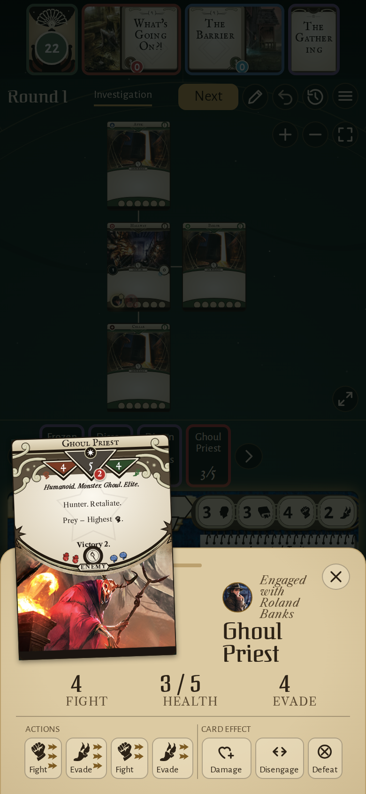

<!-- screencasts:start -->

_Recorded from cf1dcda by the PR preview workflow; updated on every push that changes `apps/web`._

## Screenshots

### Roland Banks' fight against the Ghoul Priest, the damage raised to 2

<table>
<tr><th>Desktop</th><th>Phone</th></tr>
<tr><td></td><td></td></tr>
</table>

### the Ghoul Priest's details opened from its card on Roland Banks' turn, both Frozen in Fear raising the fight to 3 actions

<table>
<tr><th>Desktop</th><th>Phone</th></tr>
<tr><td></td><td></td></tr>
</table>

<!-- screencasts:end -->