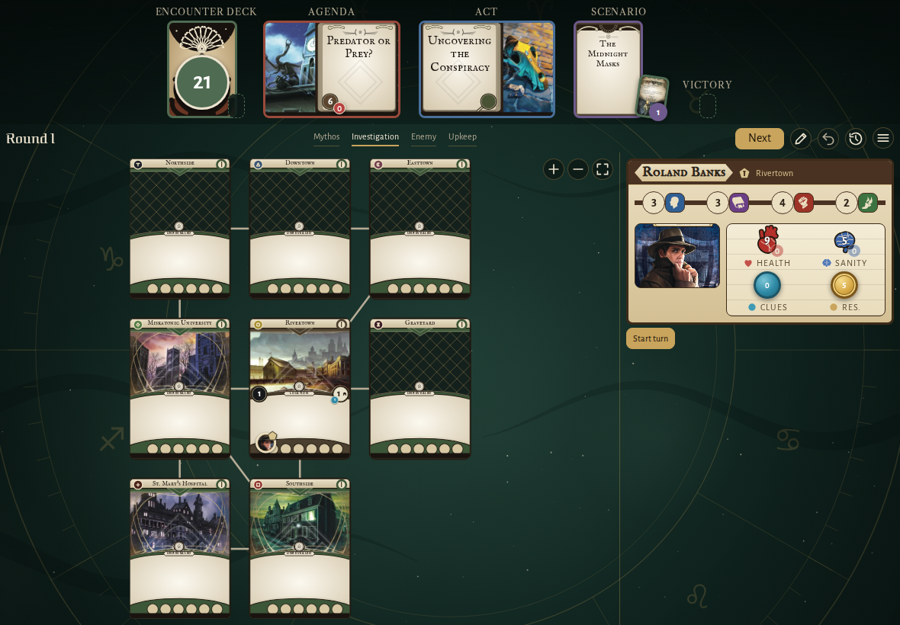
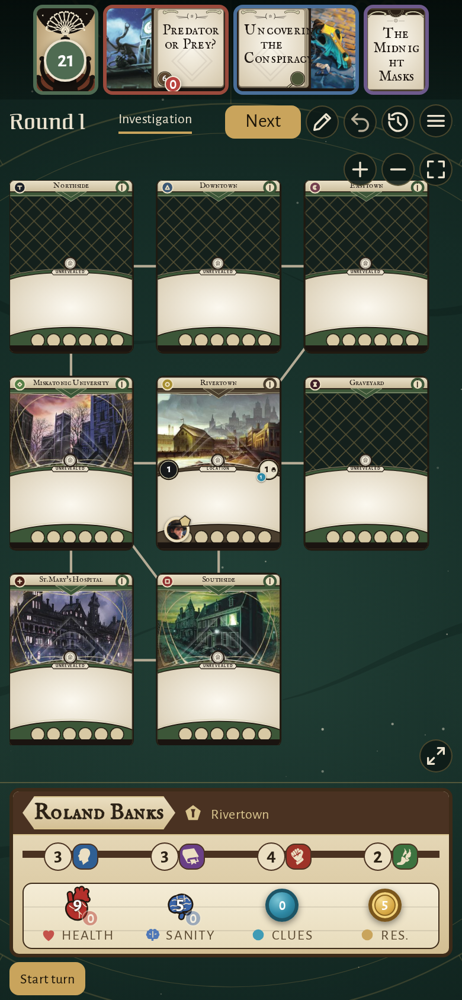

<!-- screencasts:start -->

_Recorded from 41f2b03 by the PR preview workflow; updated on every push that changes `apps/web`._

## Screenshots

### Arkham in The Midnight Masks, Easttown, the Graveyard and Northside with their new symbols

<table>
<tr><th>Desktop</th><th>Phone</th></tr>
<tr><td></td><td></td></tr>
</table>

<!-- screencasts:end -->