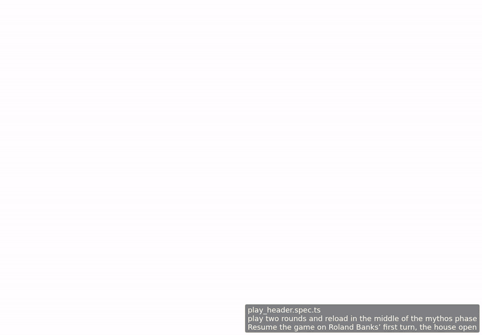

<!-- screencasts:start -->

_Recorded from dbd45ec by the PR preview workflow; updated on every push that changes `apps/web`._

## Screencasts

### play two rounds and reload in the middle of the mythos phase

[Play with pause and speed controls](https://macandy13.github.io/arkham-companion/pr-preview/pr-877/screencasts/player.html?flow=play-two-rounds-and-reload-in-the-middle-of-the-mythos-phase&v=dbd45ec&speed=0.25)

<!-- screencasts:end -->