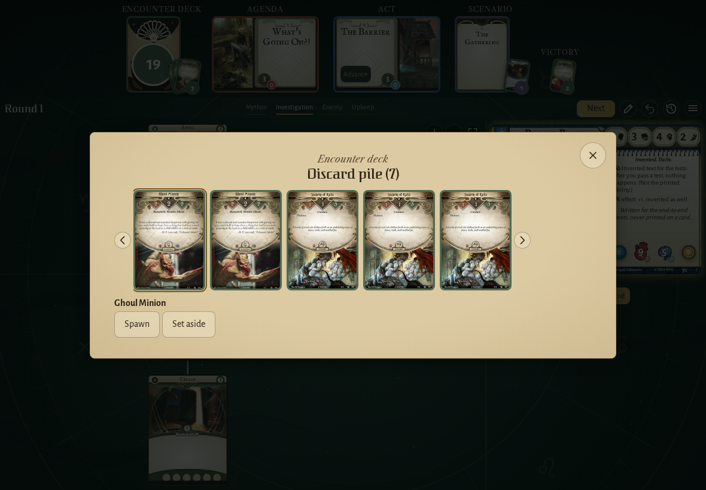
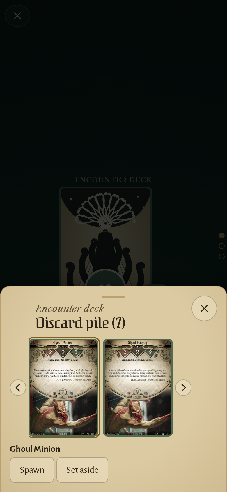
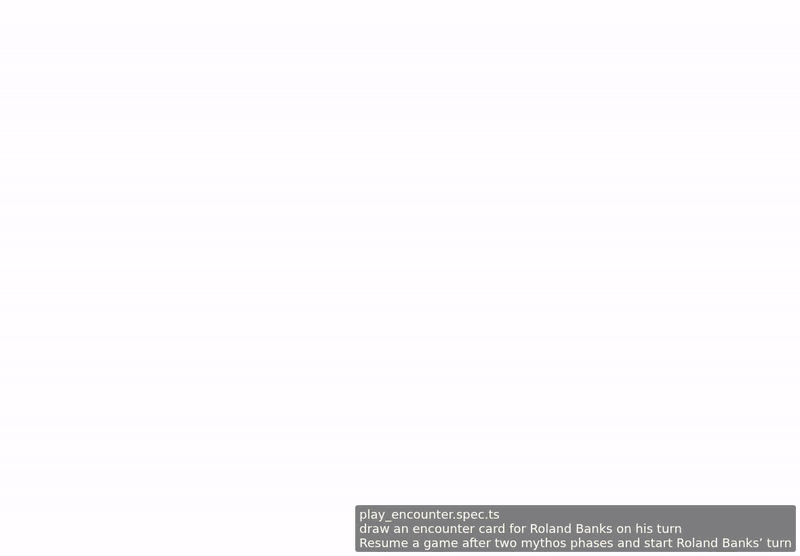

<!-- screencasts:start -->

_Recorded from ef5a2b7 by the PR preview workflow; updated on every push that changes `apps/web`._

## Screenshots

### the discard pile of seven cards on its wide page, the top card chosen, scroll arrows beside the row

<table>
<tr><th>Desktop</th><th>Phone</th></tr>
<tr><td></td><td></td></tr>
</table>

## Screencasts

### draw an encounter card for Roland Banks on his turn

[Play with pause and speed controls](https://macandy13.github.io/arkham-companion/pr-preview/pr-888/screencasts/player.html?flow=draw-an-encounter-card-for-roland-banks-on-his-turn&v=ef5a2b7&speed=0.25)

<!-- screencasts:end -->