<!-- screencasts:start -->

_Recorded from 449354f by the PR preview workflow; updated on every push that changes `apps/web`._

## Screenshots

### the house map with Roland Banks in the Hallway

<table>
<tr><th>Desktop</th><th>Phone</th></tr>
<tr><td></td><td>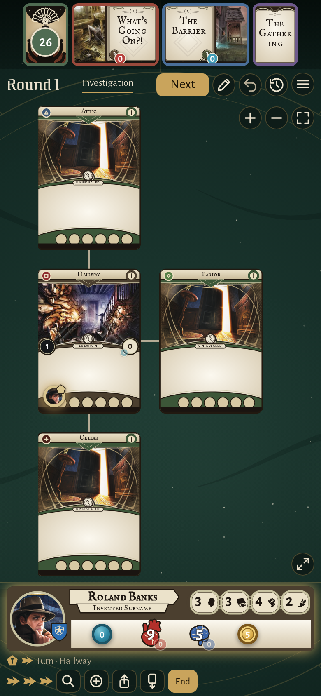</td></tr>
</table>

### Roland Banks’ card opened whole from its art, to read its abilities

<table>
<tr><th>Desktop</th><th>Phone</th></tr>
<tr><td>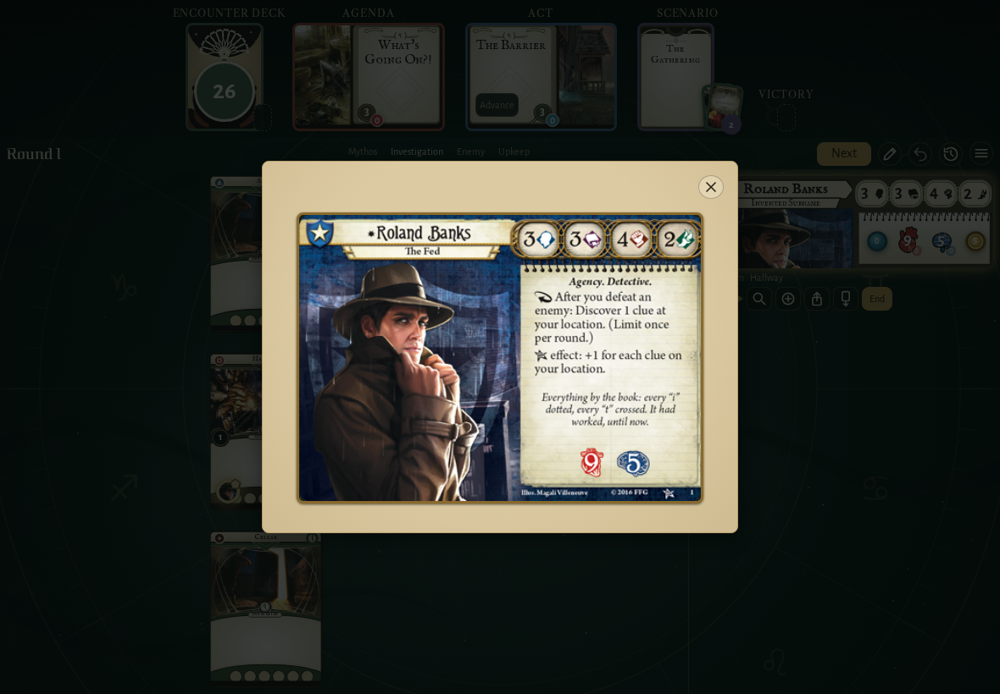</td><td>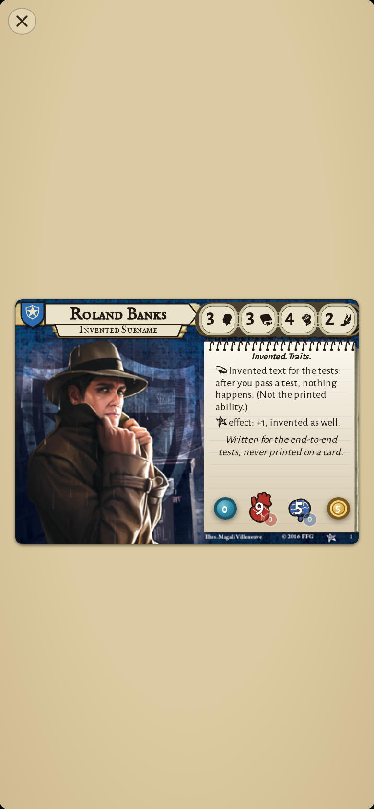</td></tr>
</table>

### Roland Banks with four treacheries and the Ghoul Priest, scrolled on to the Ghoul Priest

<table>
<tr><th>Desktop</th><th>Phone</th></tr>
<tr><td>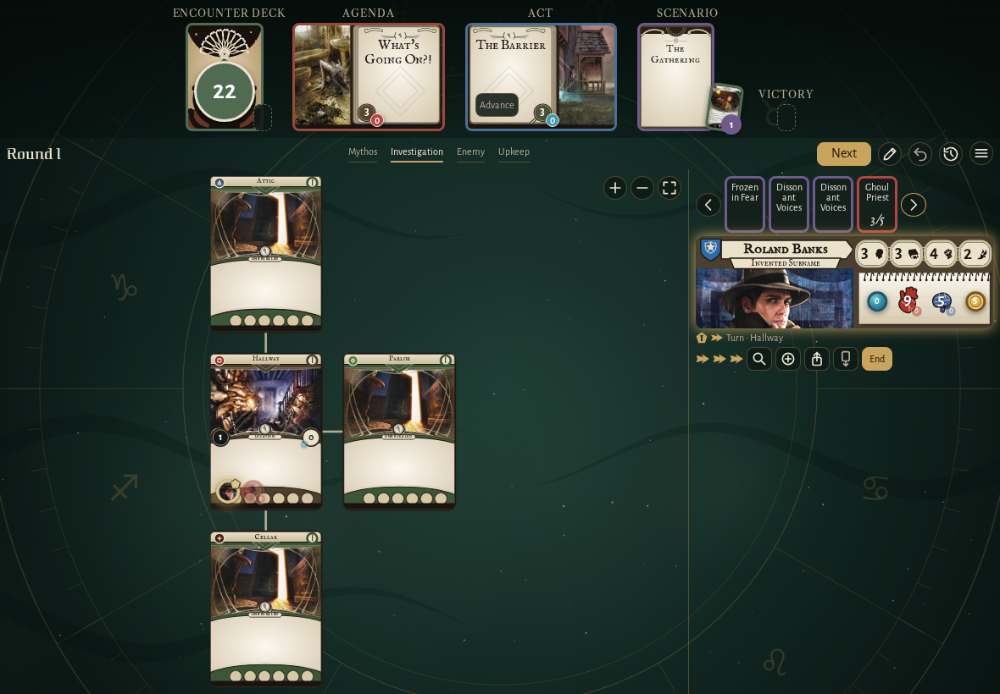</td><td>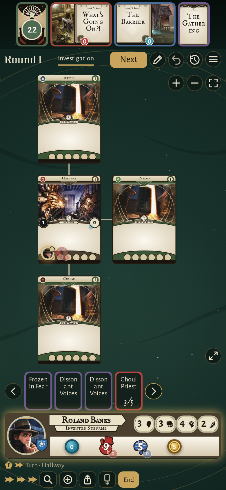</td></tr>
</table>

### the house map by day

<table>
<tr><th>Desktop</th><th>Phone</th></tr>
<tr><td>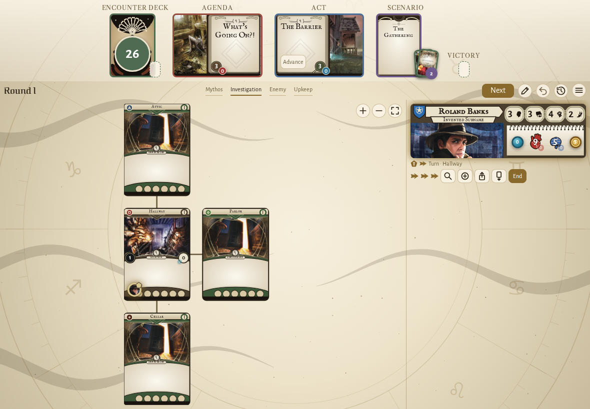</td><td>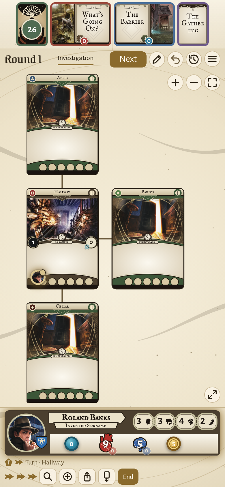</td></tr>
</table>

### the house map in the card pictures style, the clues left on each card

<table>
<tr><th>Desktop</th><th>Phone</th></tr>
<tr><td>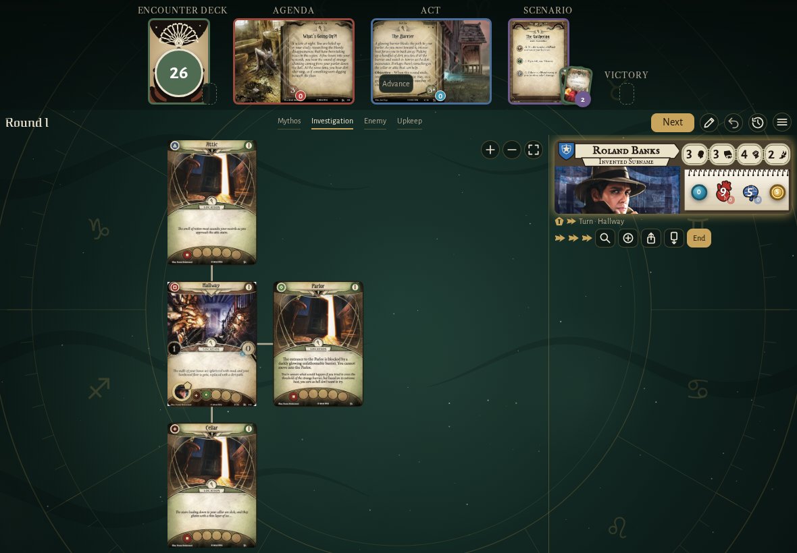</td><td>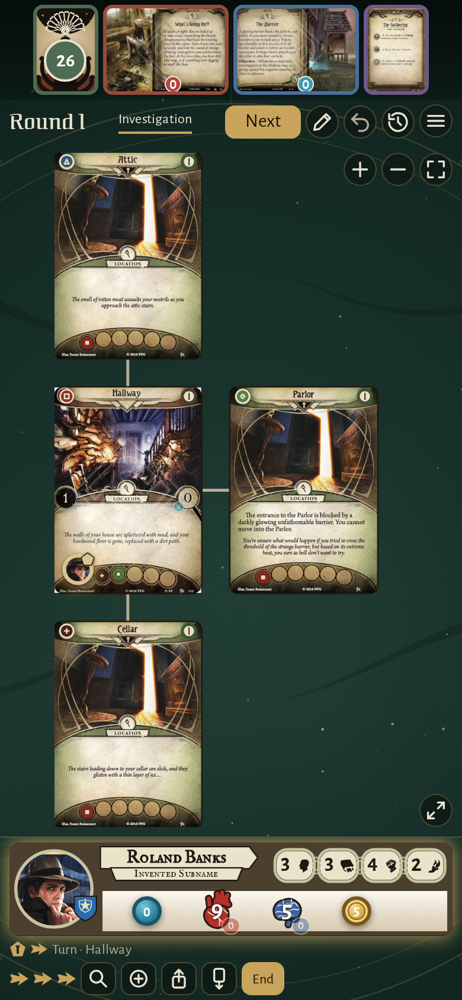</td></tr>
</table>

### the house map in the Eldritch card style

<table>
<tr><th>Desktop</th><th>Phone</th></tr>
<tr><td>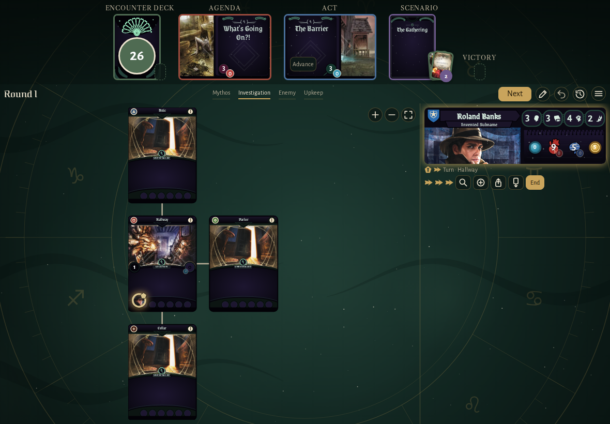</td><td>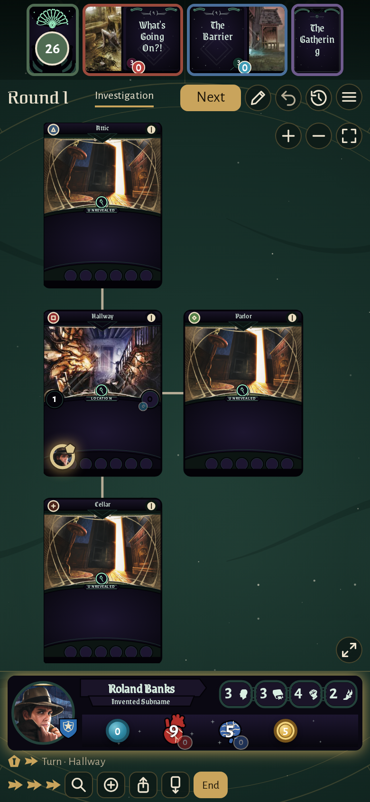</td></tr>
</table>

### the house map in the Night and brass card style

<table>
<tr><th>Desktop</th><th>Phone</th></tr>
<tr><td>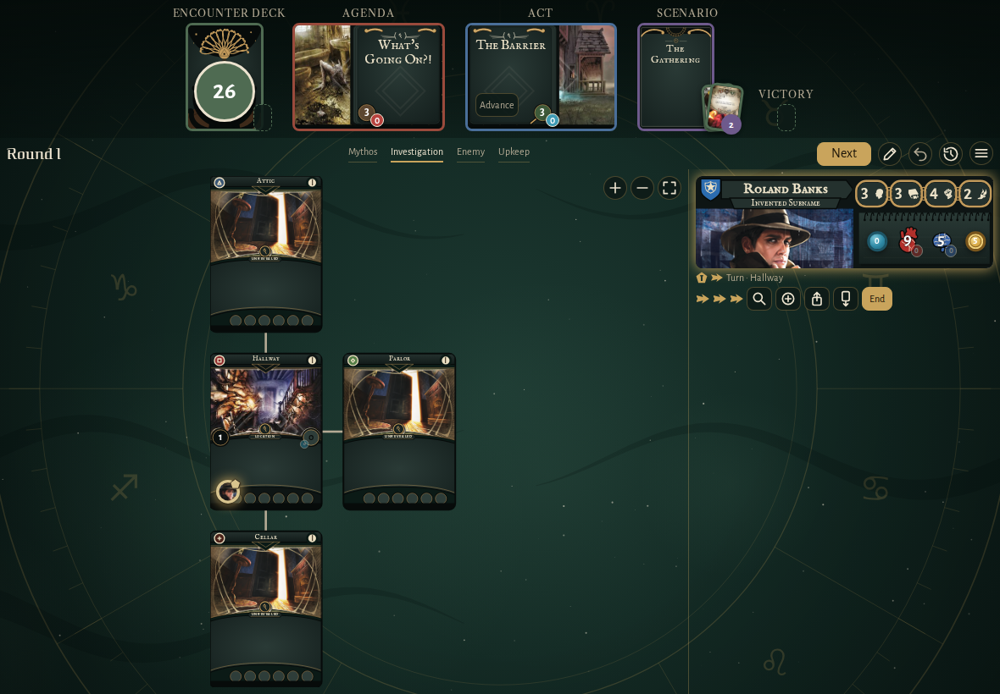</td><td>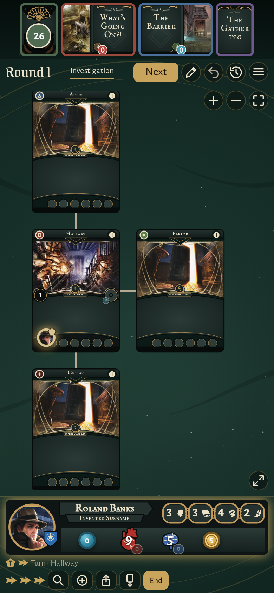</td></tr>
</table>

### Roland Banks’ combat boosted by 2, as an ally in play gives it

<table>
<tr><th>Desktop</th><th>Phone</th></tr>
<tr><td>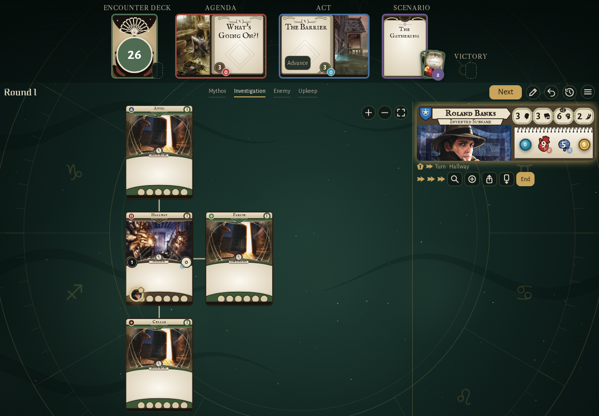</td><td>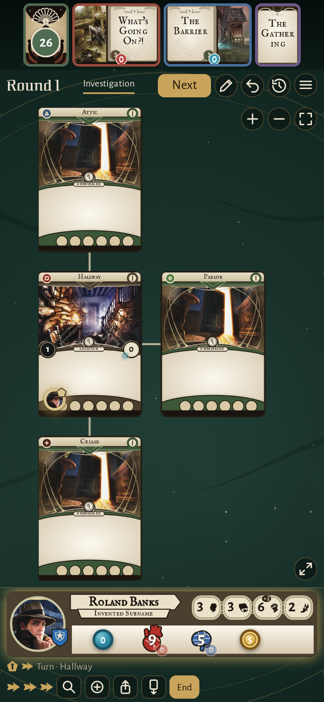</td></tr>
</table>

### Roland Banks’ card while the players adjust the board, its steppers out

<table>
<tr><th>Desktop</th><th>Phone</th></tr>
<tr><td>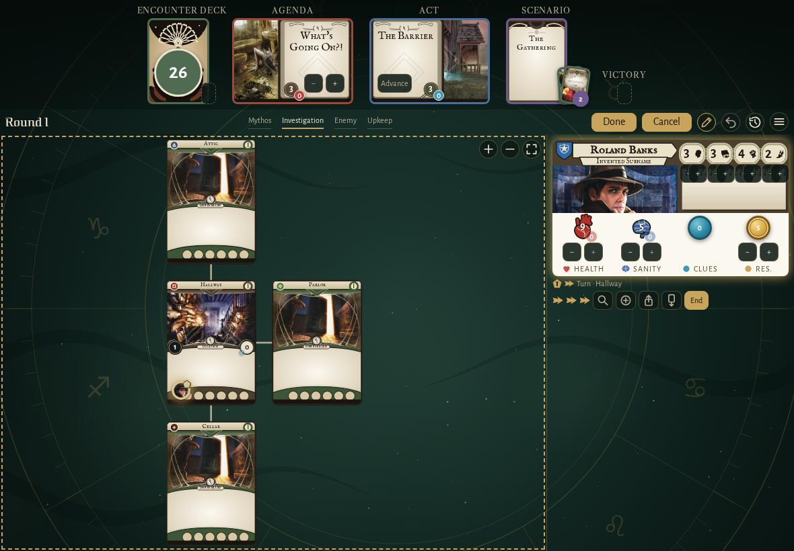</td><td>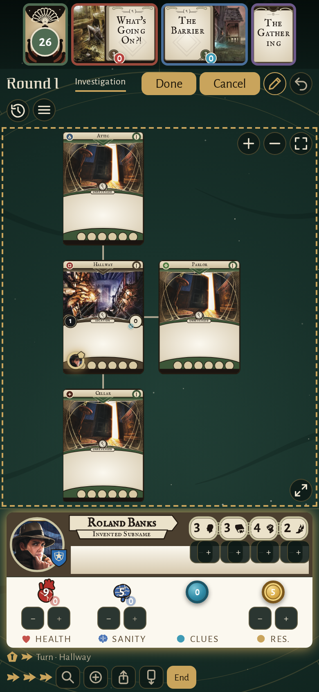</td></tr>
</table>

### Lita Chantler under Roland Banks’ card, in their control

<table>
<tr><th>Desktop</th><th>Phone</th></tr>
<tr><td></td><td>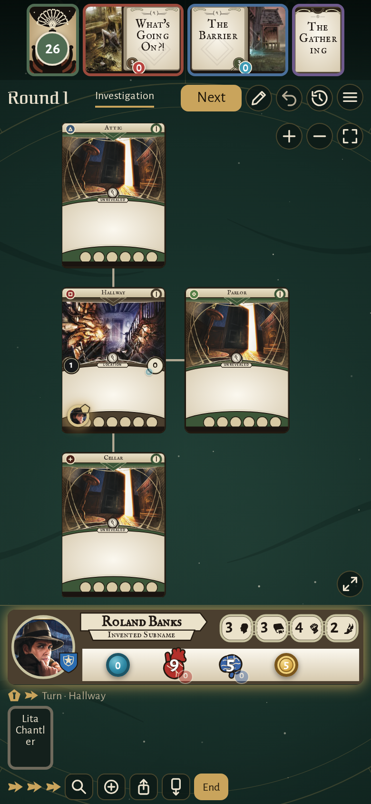</td></tr>
</table>

## Screencasts

### fight an enemy from the map

[Play with pause and speed controls](https://macandy13.github.io/arkham-companion/pr-preview/pr-895/screencasts/player.html?flow=fight-an-enemy-from-the-map&v=449354f&speed=0.25)

### move and take a clue from the location details

[Play with pause and speed controls](https://macandy13.github.io/arkham-companion/pr-preview/pr-895/screencasts/player.html?flow=move-and-take-a-clue-from-the-location-details&v=449354f&speed=0.25)

<!-- screencasts:end -->