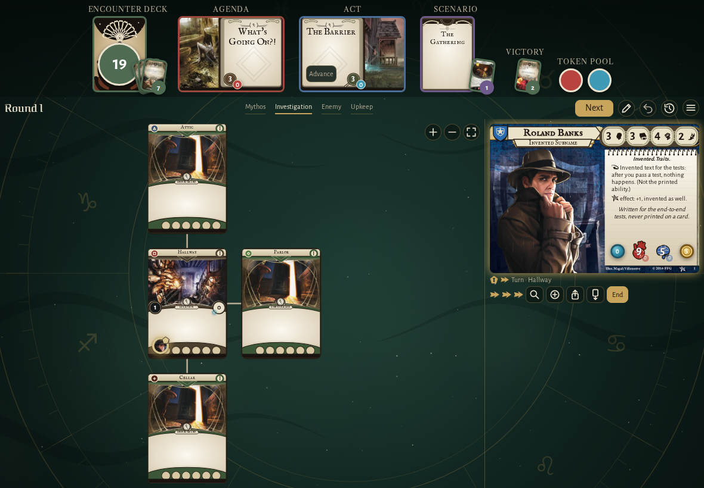
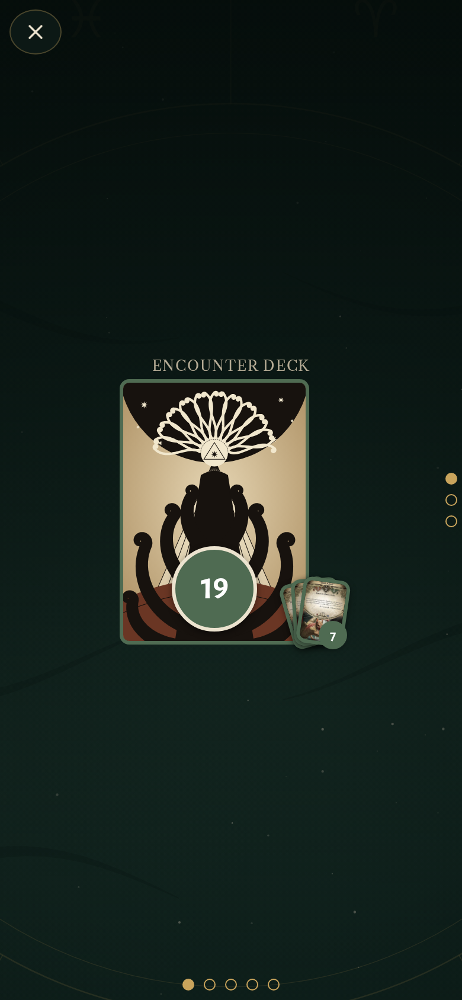

<!-- screencasts:start -->

_Recorded from dc92c60 by the PR preview workflow; updated on every push that changes `apps/web`._

## Screenshots

### the header with its piles fanned: seven cards discarded, the set-aside cards on the scenario card, the Ghoul Priest in the victory display, the token pool beside it

<table>
<tr><th>Desktop</th><th>Phone</th></tr>
<tr><td></td><td></td></tr>
</table>

## Screencasts

### move doom between the token pool and the map

[Play with pause and speed controls](https://macandy13.github.io/arkham-companion/pr-preview/pr-903/screencasts/player.html?flow=move-doom-between-the-token-pool-and-the-map&v=dc92c60&speed=0.25)

<!-- screencasts:end -->