<!-- screencasts:start -->

_Recorded from c90aead by the PR preview workflow; updated on every push that changes `apps/web`._

## Screenshots

### the house map with Roland Banks in the Hallway

<table>
<tr><th>Desktop</th><th>Phone</th></tr>
<tr><td></td><td></td></tr>
</table>

### Roland Banks’ card opened whole from its art, to read its abilities

<table>
<tr><th>Desktop</th><th>Phone</th></tr>
<tr><td>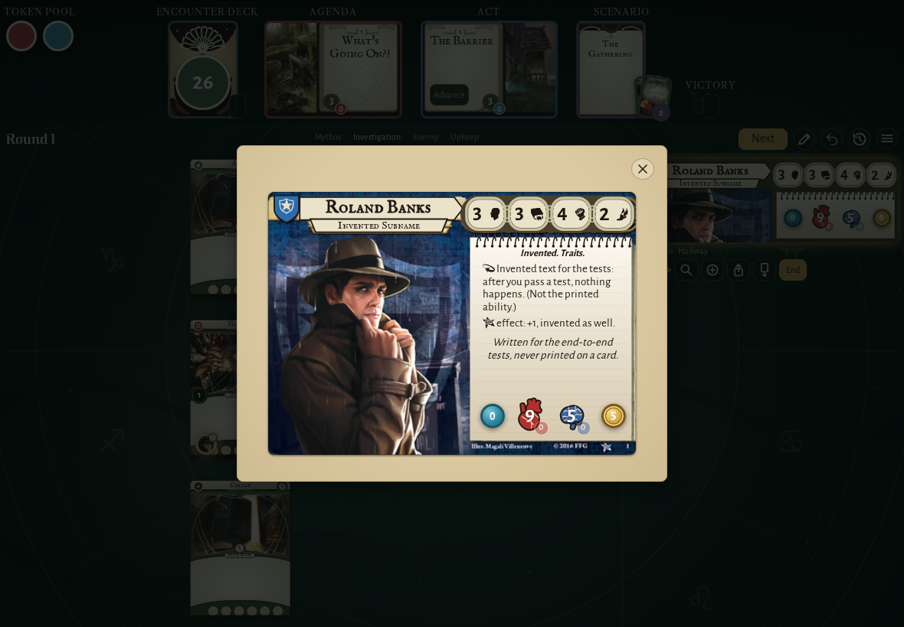</td><td>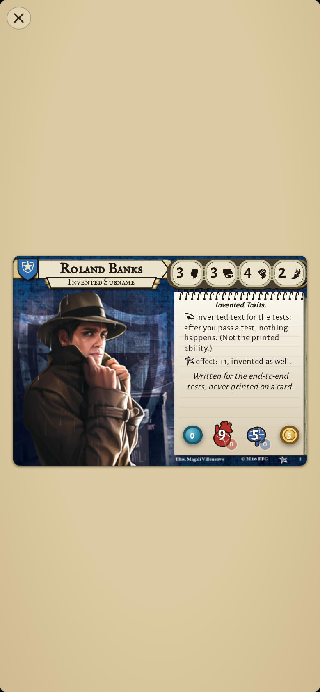</td></tr>
</table>

### Roland Banks with four treacheries and the Ghoul Priest, scrolled on to the Ghoul Priest

<table>
<tr><th>Desktop</th><th>Phone</th></tr>
<tr><td>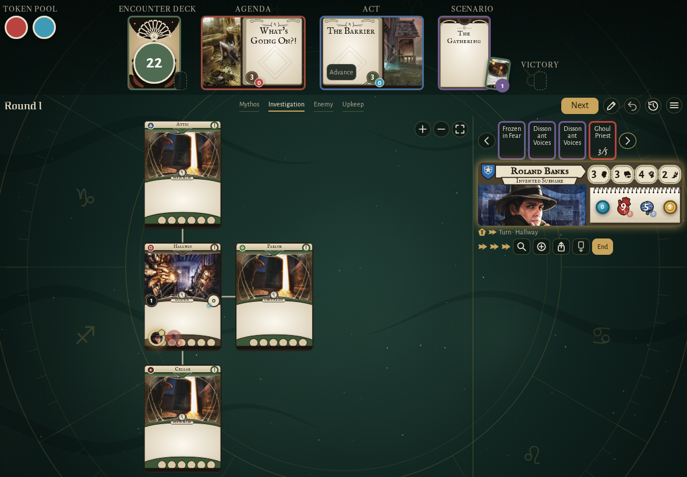</td><td>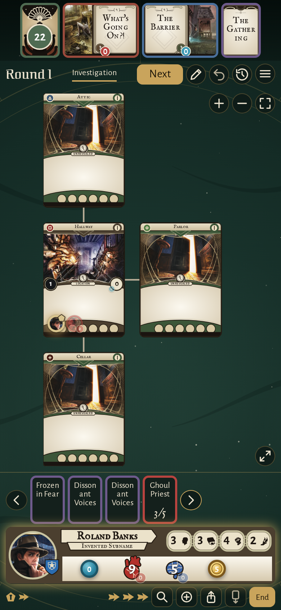</td></tr>
</table>

### the house map by day

<table>
<tr><th>Desktop</th><th>Phone</th></tr>
<tr><td>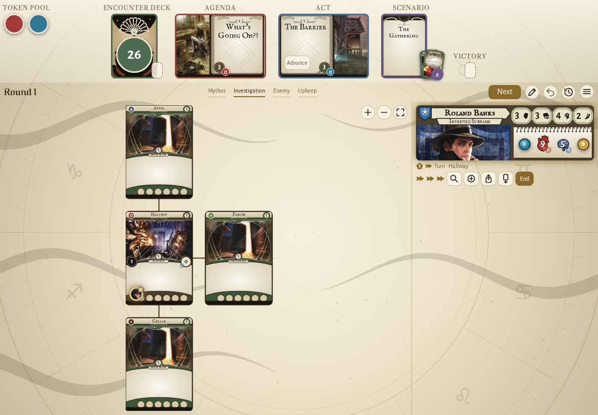</td><td>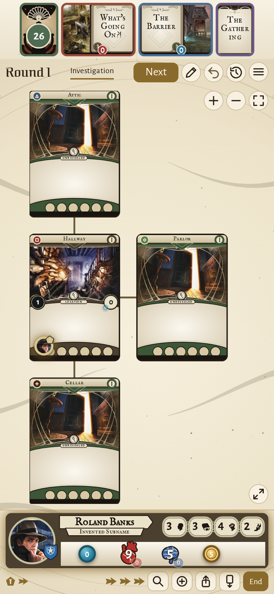</td></tr>
</table>

### the house map in the card pictures style, the clues left on each card

<table>
<tr><th>Desktop</th><th>Phone</th></tr>
<tr><td>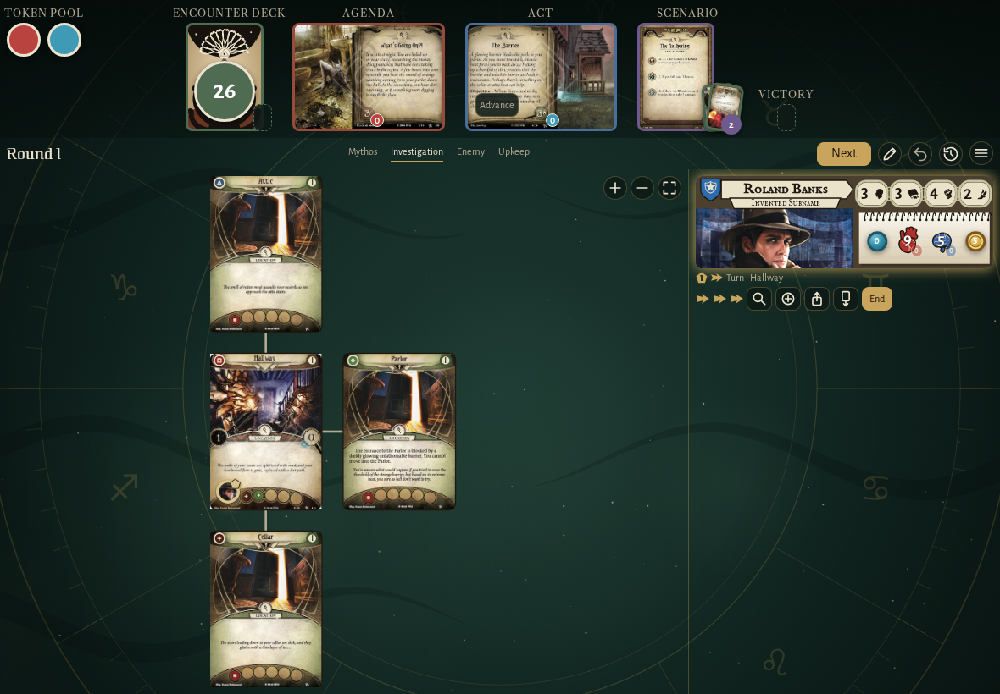</td><td>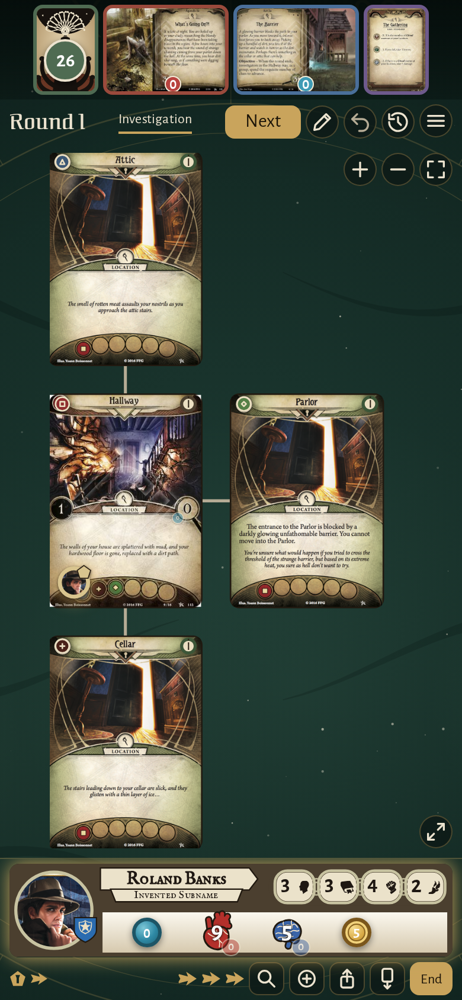</td></tr>
</table>

### the house map in the Eldritch card style

<table>
<tr><th>Desktop</th><th>Phone</th></tr>
<tr><td>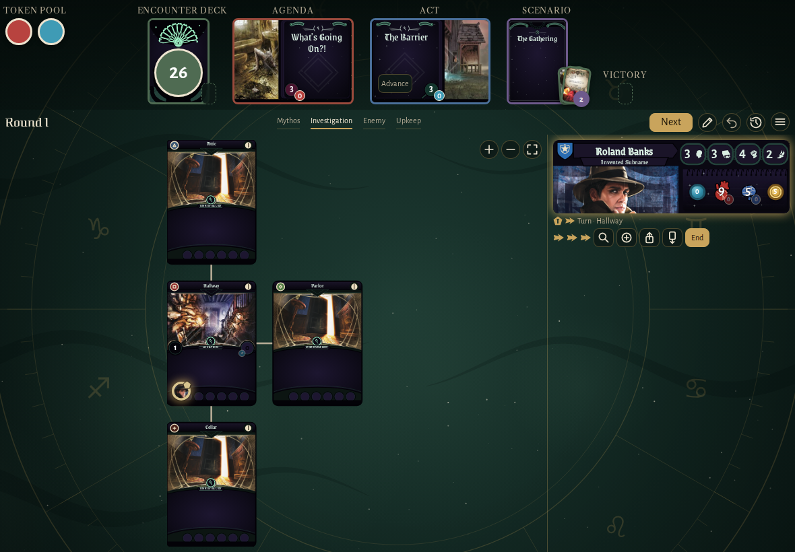</td><td>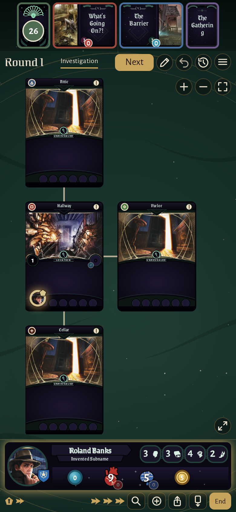</td></tr>
</table>

### the house map in the Night and brass card style

<table>
<tr><th>Desktop</th><th>Phone</th></tr>
<tr><td>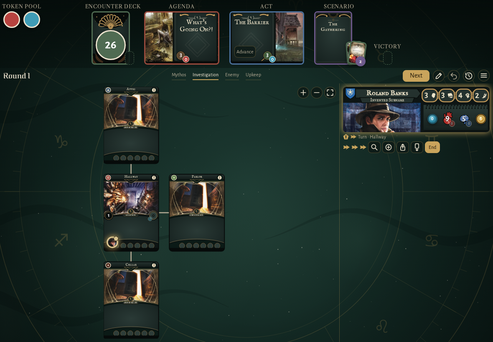</td><td>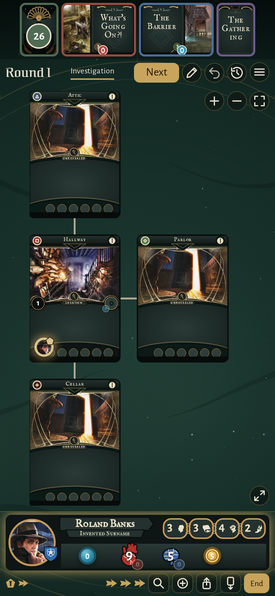</td></tr>
</table>

### Roland Banks’ combat boosted by 2, as an ally in play gives it

<table>
<tr><th>Desktop</th><th>Phone</th></tr>
<tr><td>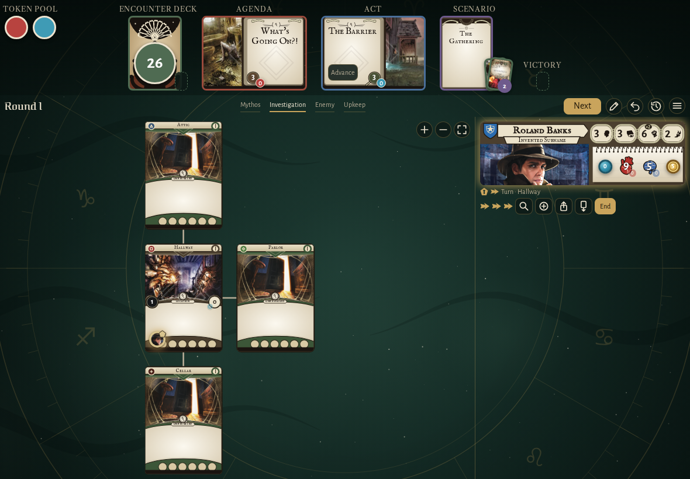</td><td>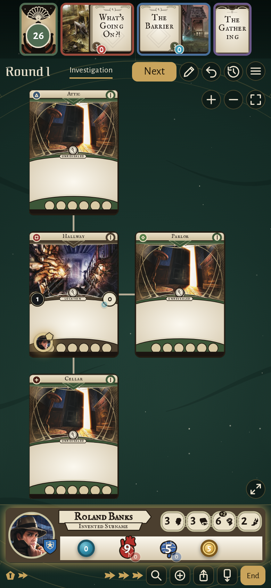</td></tr>
</table>

### Roland Banks’ card while the players adjust the board, its steppers out

<table>
<tr><th>Desktop</th><th>Phone</th></tr>
<tr><td>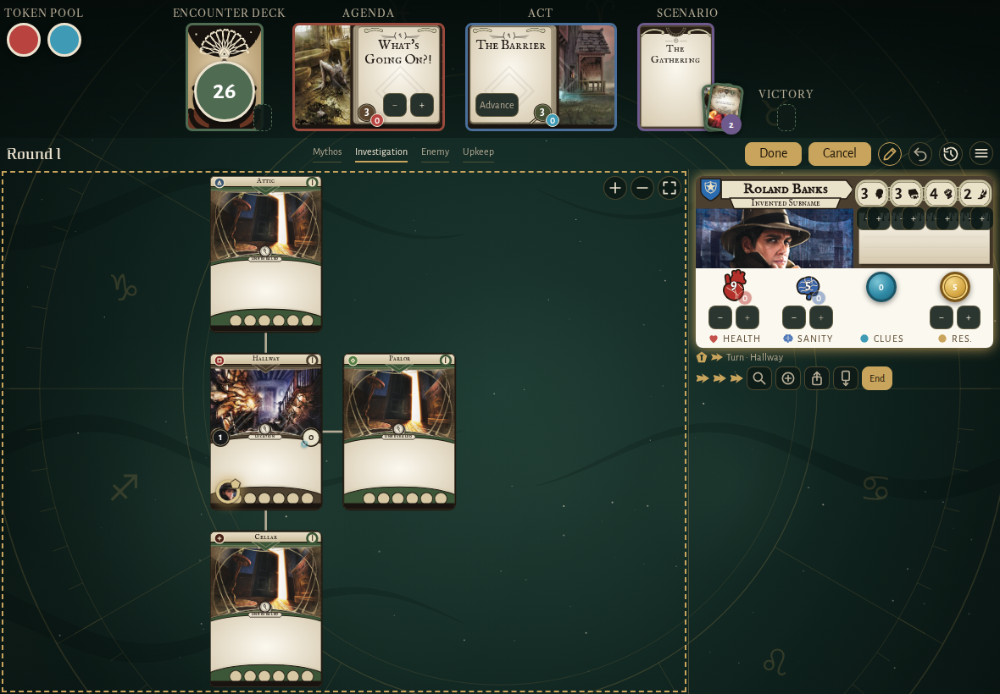</td><td>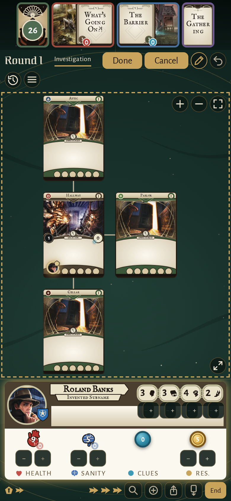</td></tr>
</table>

### the header with its piles fanned: seven cards discarded, the set-aside cards on the scenario card, the Ghoul Priest in the victory display, the token pool beside it

<table>
<tr><th>Desktop</th><th>Phone</th></tr>
<tr><td></td><td></td></tr>
</table>

### Lita Chantler under Roland Banks’ card, in their control

<table>
<tr><th>Desktop</th><th>Phone</th></tr>
<tr><td>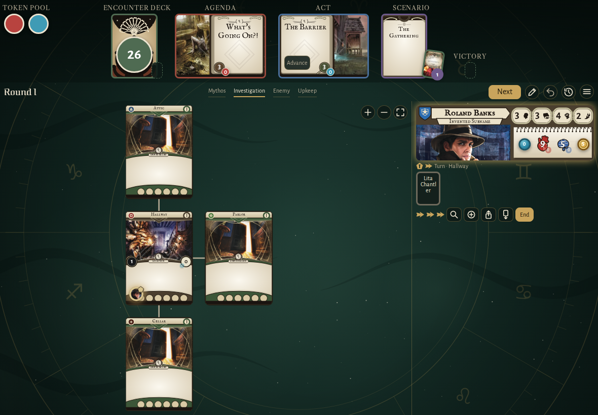</td><td>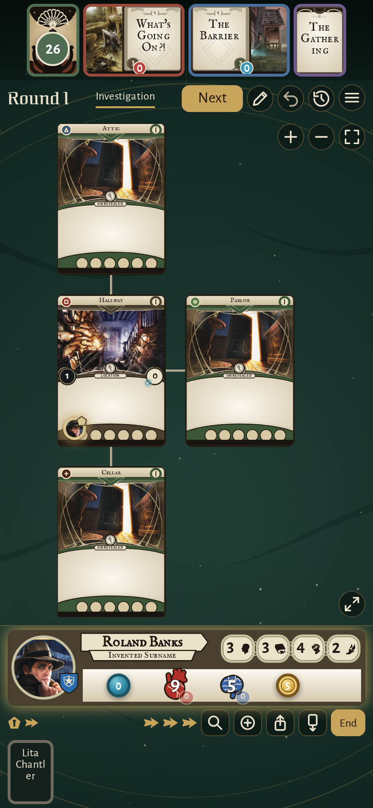</td></tr>
</table>

## Screencasts

### move doom between the token pool and the map

[Play with pause and speed controls](https://macandy13.github.io/arkham-companion/pr-preview/pr-903/screencasts/player.html?flow=move-doom-between-the-token-pool-and-the-map&v=c90aead&speed=0.25)

<!-- screencasts:end -->