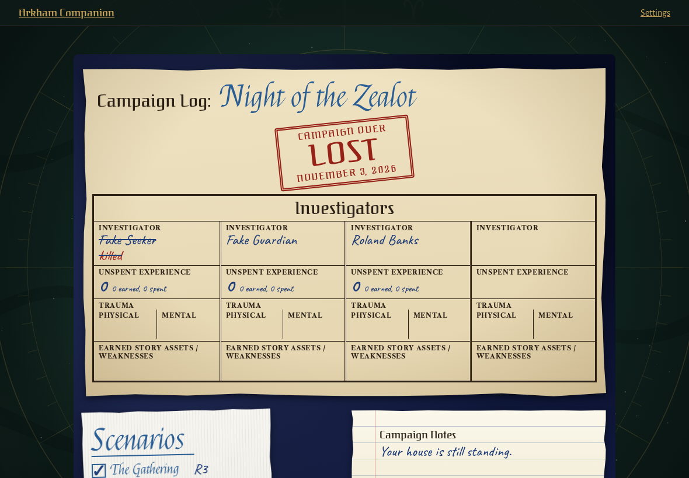
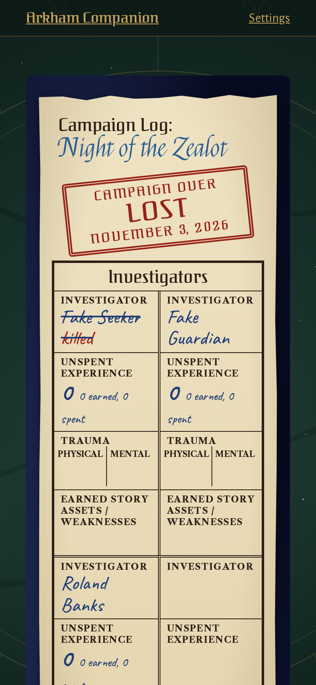
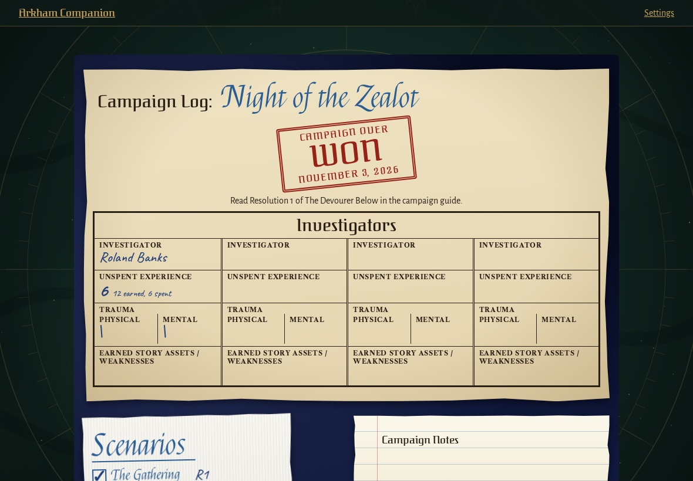
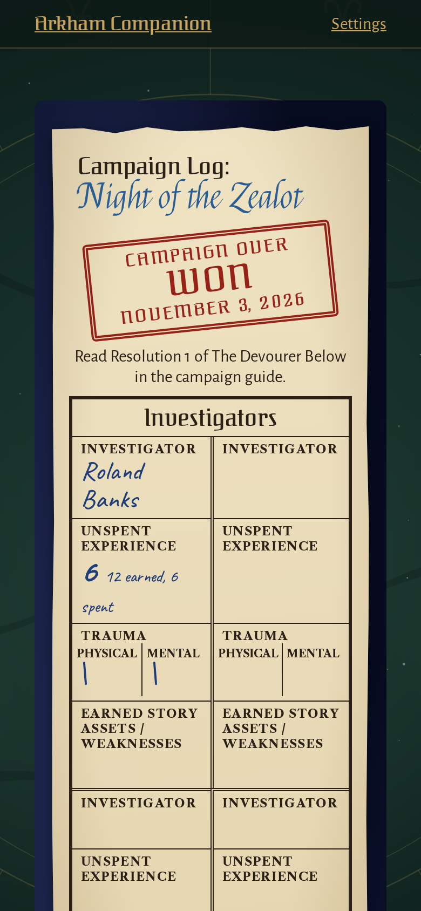

<!-- screencasts:start -->

_Recorded from d5659a5 by the PR preview workflow; updated on every push that changes `apps/web`._

## Screenshots

### the log of a campaign lost for want of investigators

<table>
<tr><th>Desktop</th><th>Phone</th></tr>
<tr><td></td><td></td></tr>
</table>

### the log of Night of the Zealot, won

<table>
<tr><th>Desktop</th><th>Phone</th></tr>
<tr><td></td><td></td></tr>
</table>

<!-- screencasts:end -->