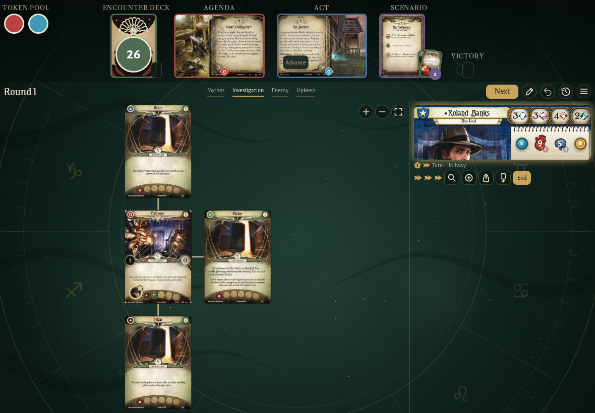
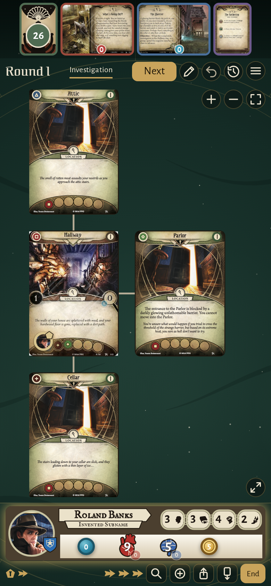
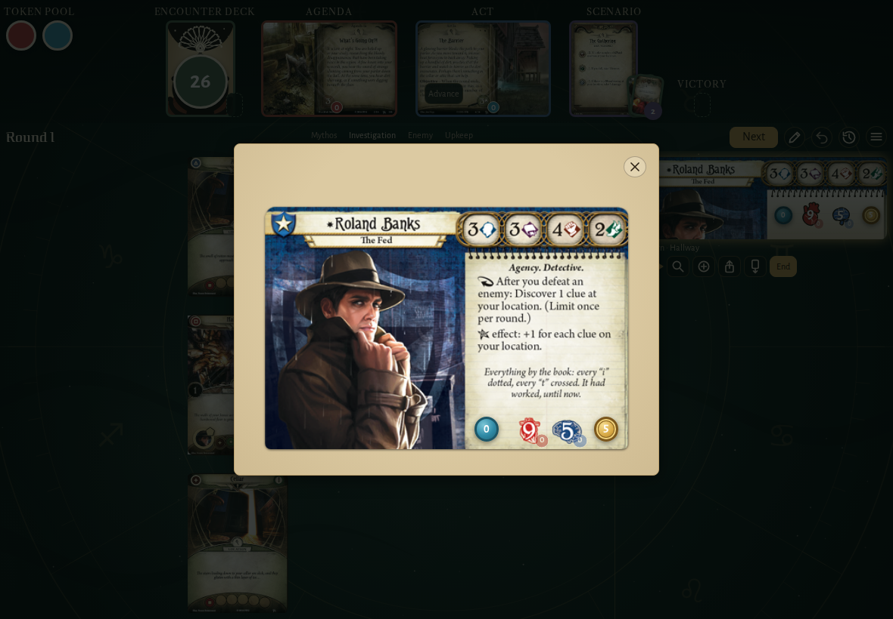
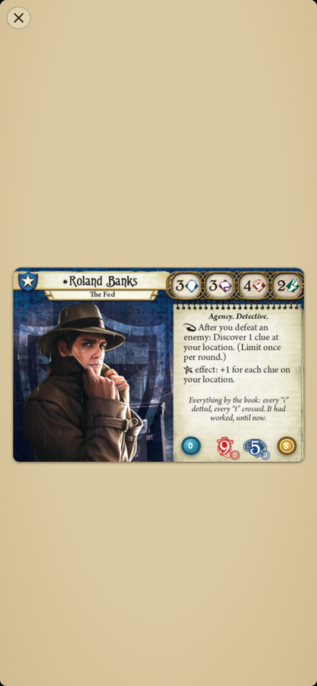
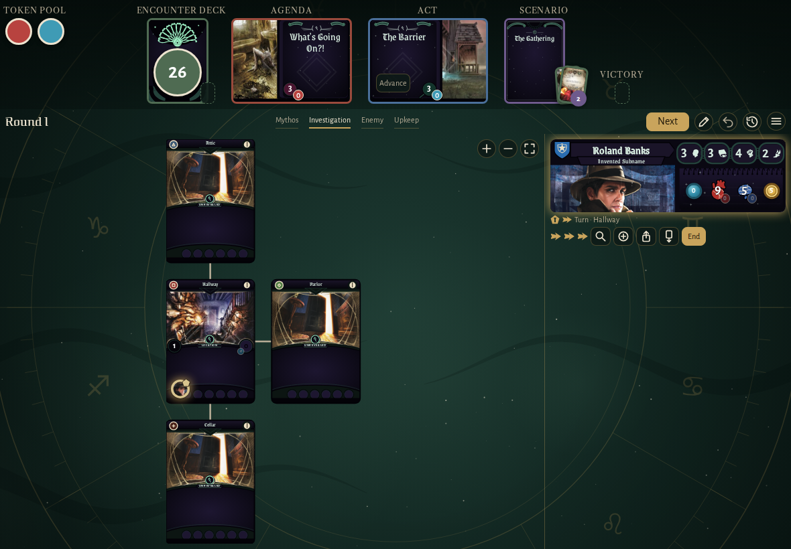
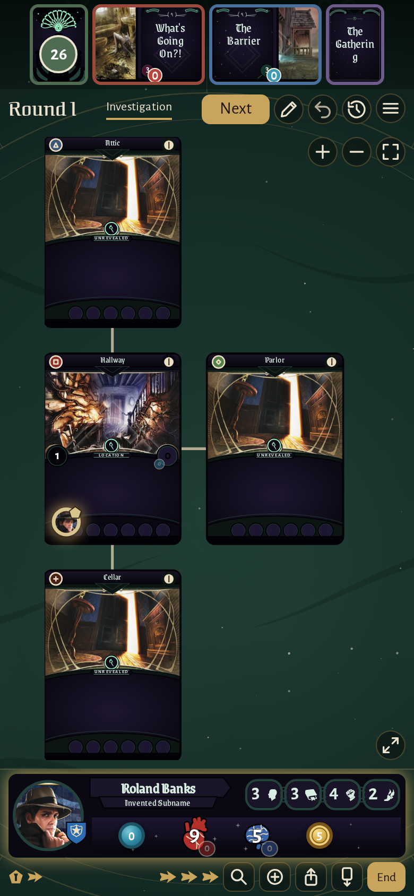
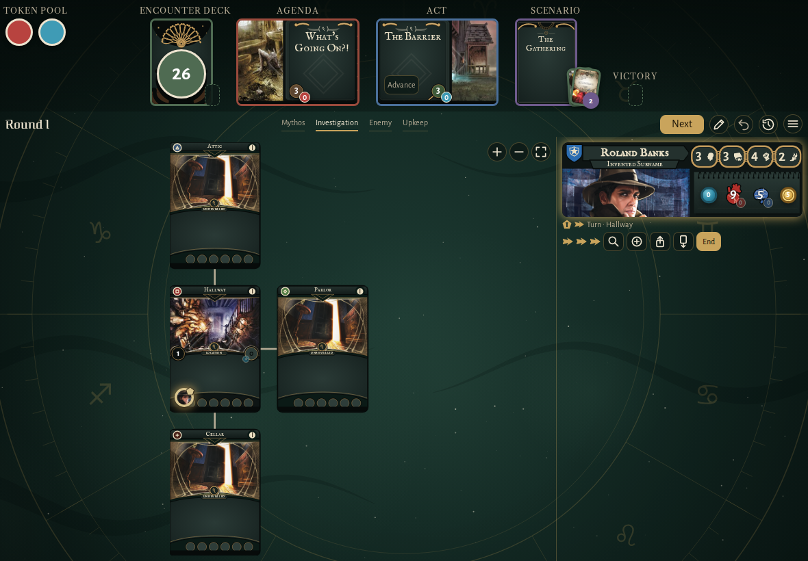
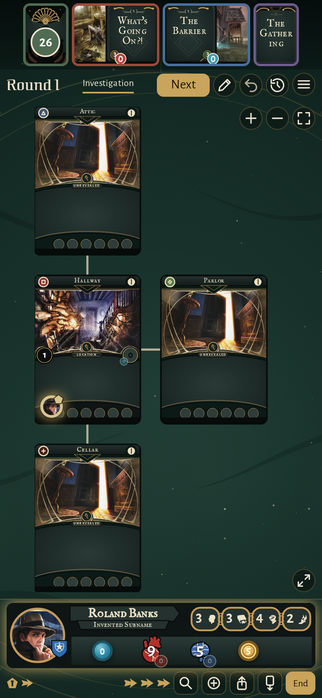

<!-- screencasts:start -->

_Recorded from b0ca90e by the PR preview workflow; updated on every push that changes `apps/web`._

## Screenshots

### the house map in the card pictures style, the clues left on each card

<table>
<tr><th>Desktop</th><th>Phone</th></tr>
<tr><td></td><td></td></tr>
</table>

### Roland Banks’ whole card in the card pictures style, his counters live on the printed card

<table>
<tr><th>Desktop</th><th>Phone</th></tr>
<tr><td></td><td></td></tr>
</table>

### the house map in the Eldritch card style

<table>
<tr><th>Desktop</th><th>Phone</th></tr>
<tr><td></td><td></td></tr>
</table>

### the house map in the Night and brass card style

<table>
<tr><th>Desktop</th><th>Phone</th></tr>
<tr><td></td><td></td></tr>
</table>

<!-- screencasts:end -->