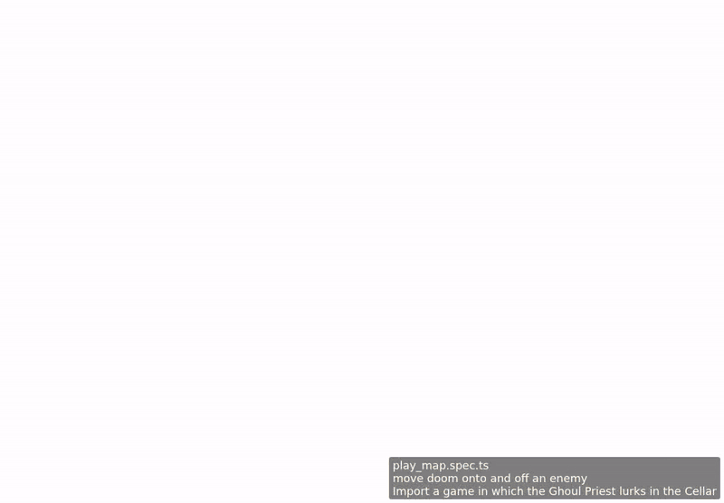

<!-- screencasts:start -->

_Recorded from f74b011 by the PR preview workflow; updated on every push that changes `apps/web`._

## Screencasts

### move doom onto and off an enemy

[Play with pause and speed controls](https://macandy13.github.io/arkham-companion/pr-preview/pr-909/screencasts/player.html?flow=move-doom-onto-and-off-an-enemy&v=f74b011&speed=0.25)

<!-- screencasts:end -->