<!-- screencasts:start -->

_Recorded from 0ed9bb7 by the PR preview workflow; updated on every push that changes `apps/web`._

## Screenshots

### the encounter deck after two mythos phases, Dissonant Voices on the discard pile

<table>
<tr><th>Desktop</th><th>Phone</th></tr>
<tr><td>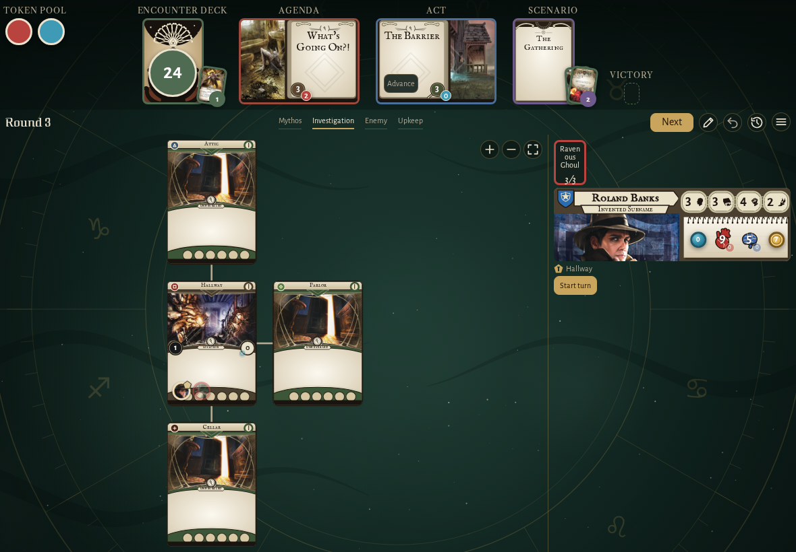</td><td>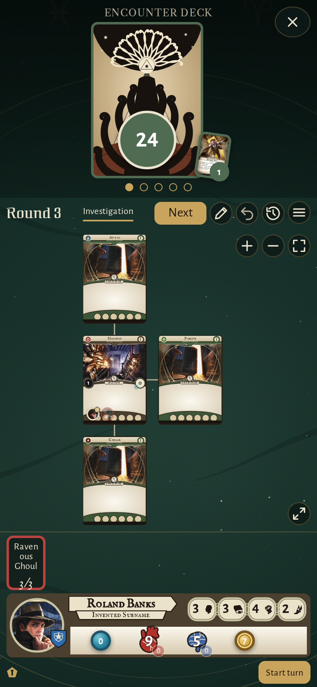</td></tr>
</table>

### the header with its piles fanned: seven cards discarded, the set-aside cards on the scenario card, the Ghoul Priest in the victory display, the token pool beside it

<table>
<tr><th>Desktop</th><th>Phone</th></tr>
<tr><td>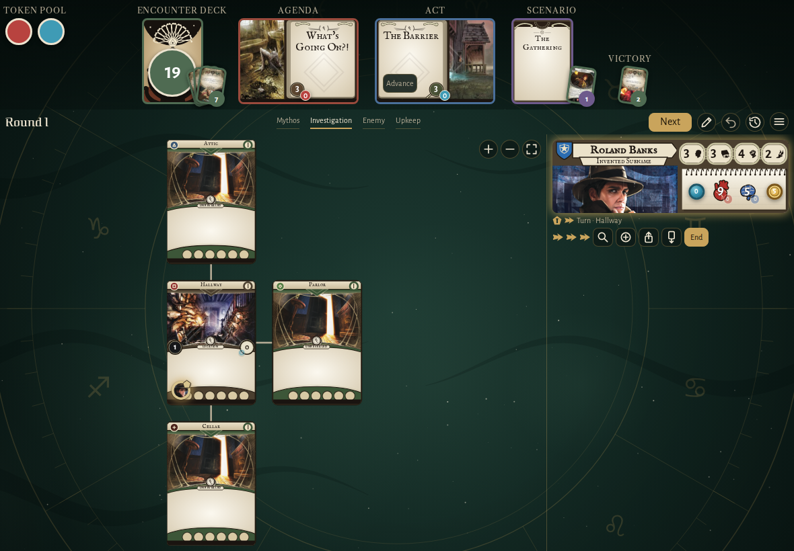</td><td>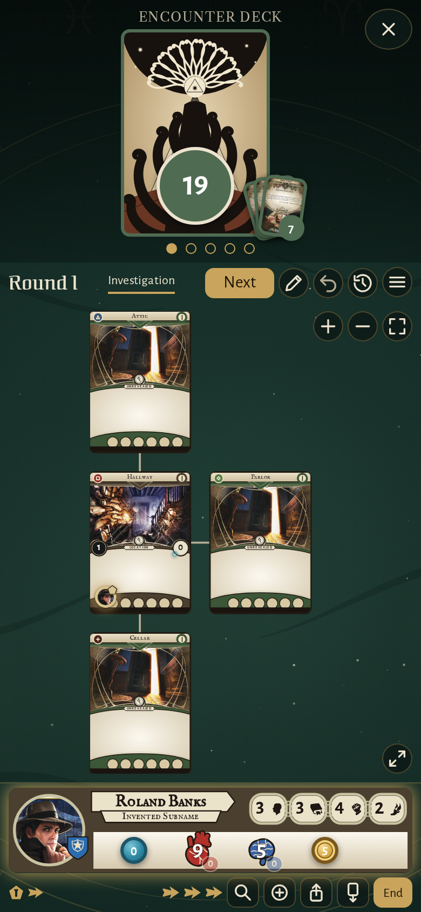</td></tr>
</table>

### the discard pile of seven cards on its wide page, the top card chosen, scroll arrows beside the row

<table>
<tr><th>Desktop</th><th>Phone</th></tr>
<tr><td>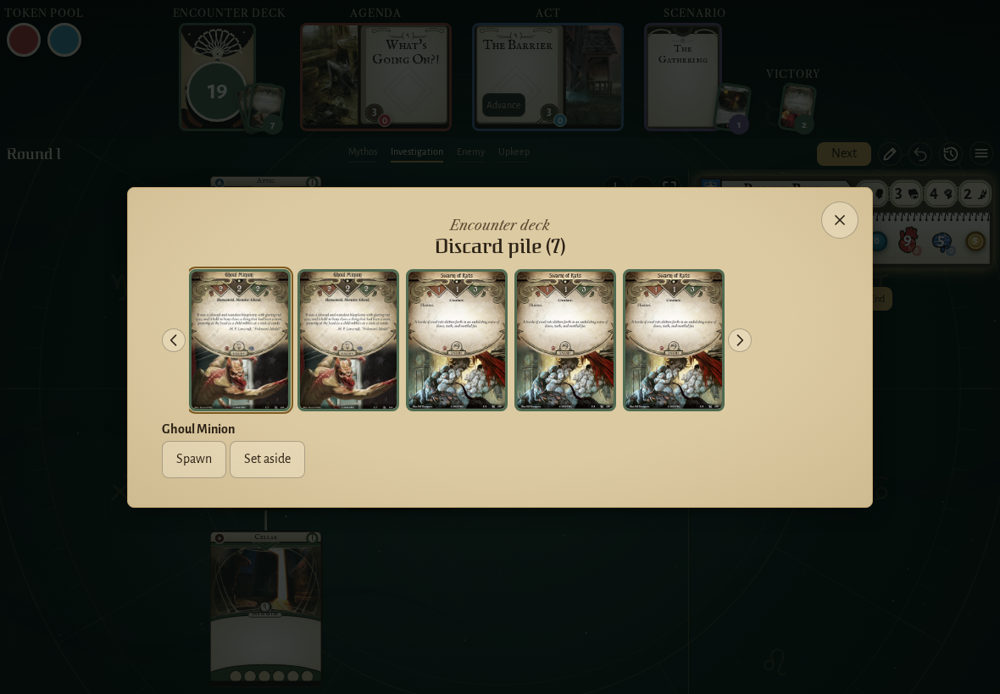</td><td>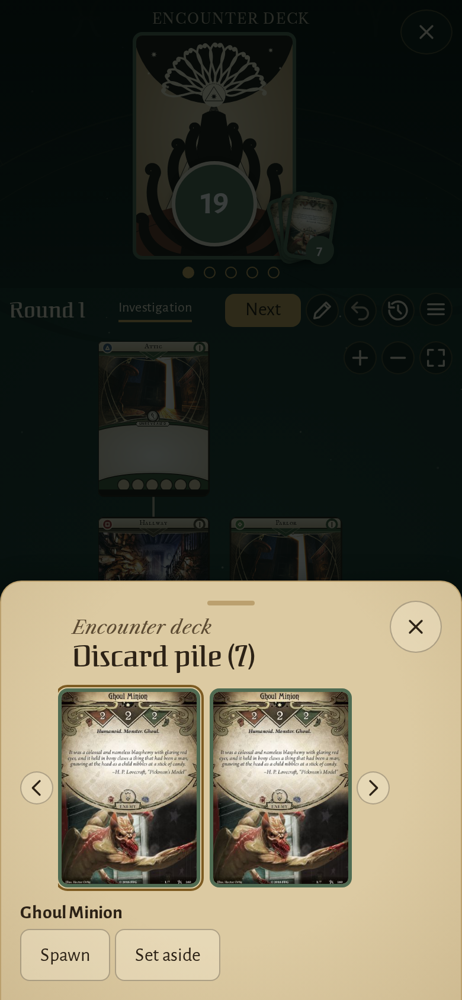</td></tr>
</table>

### Crypt Chill drawn for Roland Banks, its willpower test waiting

<table>
<tr><th>Desktop</th><th>Phone</th></tr>
<tr><td>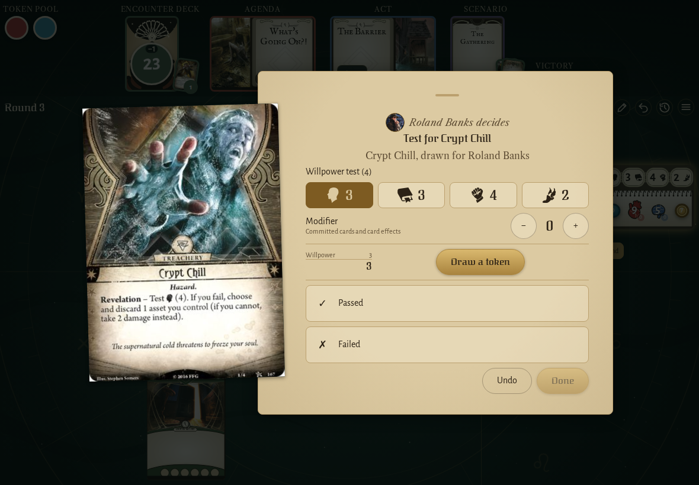</td><td>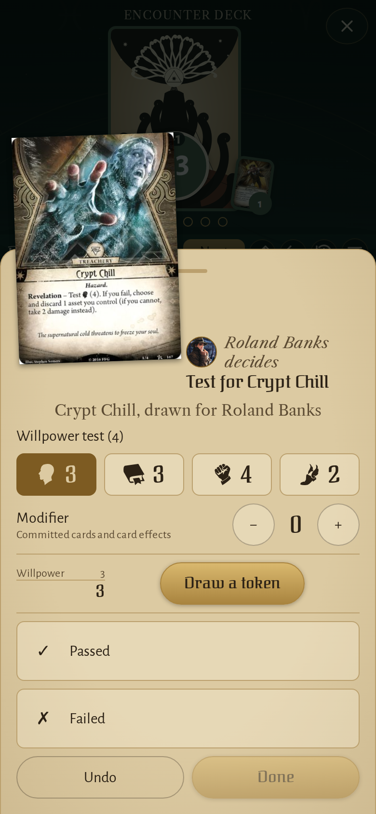</td></tr>
</table>

### The Barrier opened as a full card

<table>
<tr><th>Desktop</th><th>Phone</th></tr>
<tr><td>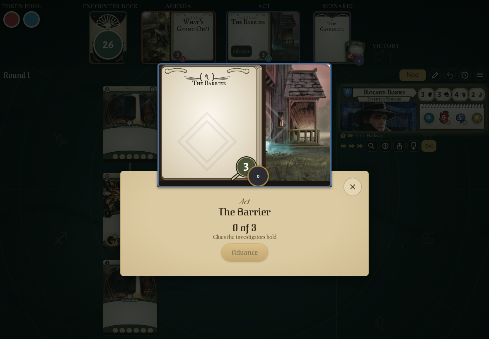</td><td>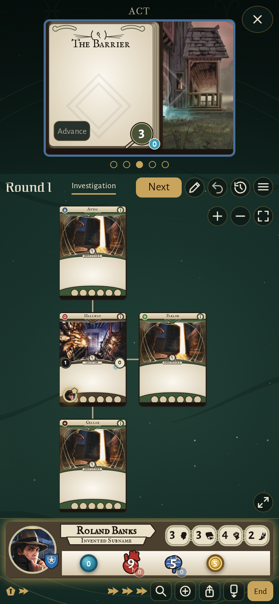</td></tr>
</table>

### The Gathering’s reference card opened to read

<table>
<tr><th>Desktop</th><th>Phone</th></tr>
<tr><td>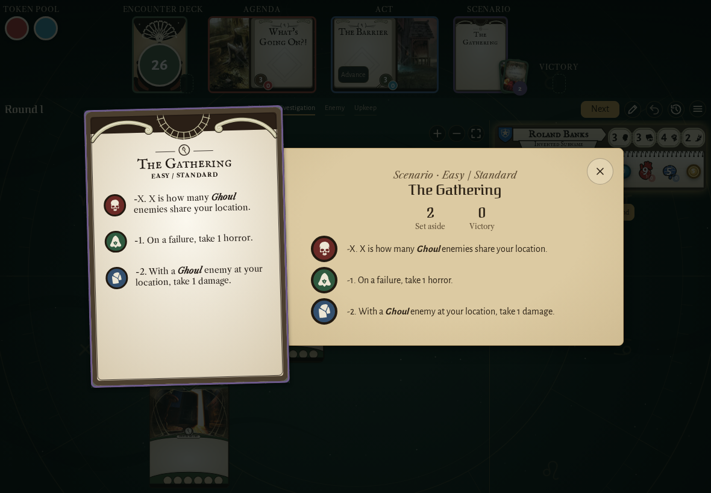</td><td>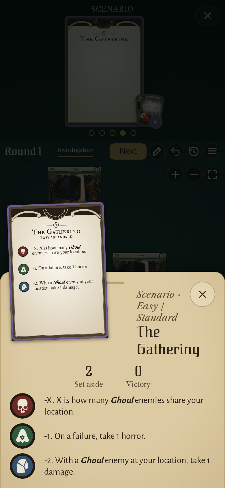</td></tr>
</table>

## Screencasts

### expand the header in place and swipe through its cards on a phone

[Play with pause and speed controls](https://macandy13.github.io/arkham-companion/pr-preview/pr-911/screencasts/player.html?flow=expand-the-header-in-place-and-swipe-through-its-cards-on-a-phone&v=0ed9bb7&speed=0.25)

### open the map on a phone and go on from its strips

[Play with pause and speed controls](https://macandy13.github.io/arkham-companion/pr-preview/pr-911/screencasts/player.html?flow=open-the-map-on-a-phone-and-go-on-from-its-strips&v=0ed9bb7&speed=0.25)

<!-- screencasts:end -->