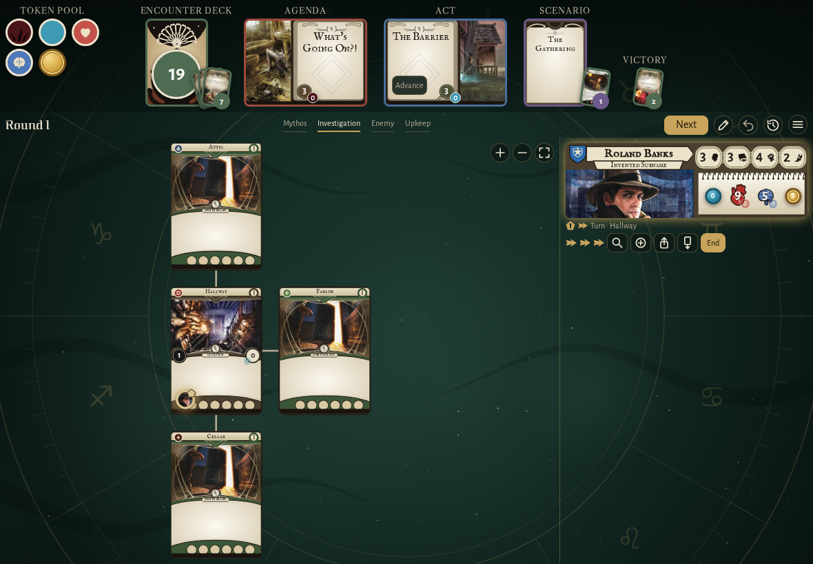
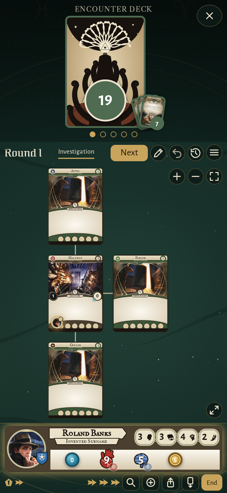
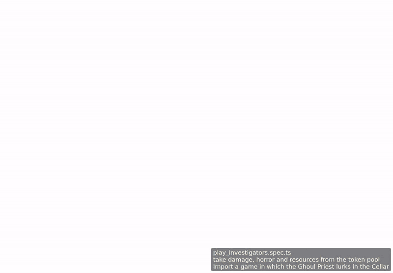

<!-- screencasts:start -->

_Recorded from 0f0df14 by the PR preview workflow; updated on every push that changes `apps/web`._

## Screenshots

### the header with its piles fanned: seven cards discarded, the set-aside cards on the scenario card, the Ghoul Priest in the victory display, the token pool beside it

<table>
<tr><th>Desktop</th><th>Phone</th></tr>
<tr><td></td><td></td></tr>
</table>

## Screencasts

### take damage, horror and resources from the token pool

[Play with pause and speed controls](https://macandy13.github.io/arkham-companion/pr-preview/pr-913/screencasts/player.html?flow=take-damage-horror-and-resources-from-the-token-pool&v=0f0df14&speed=0.25)

<!-- screencasts:end -->