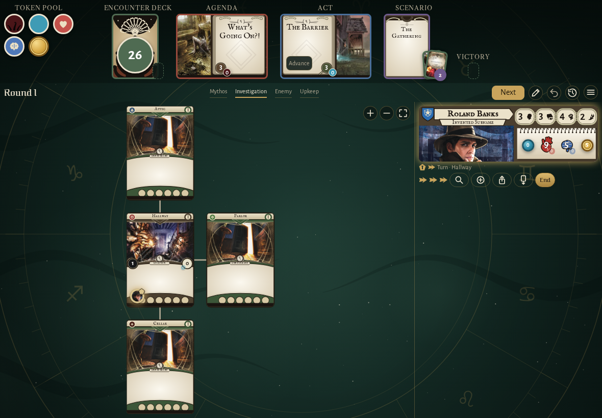
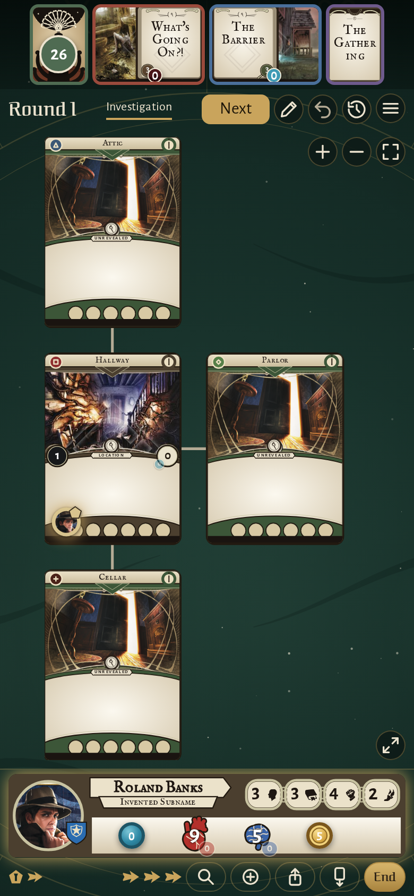
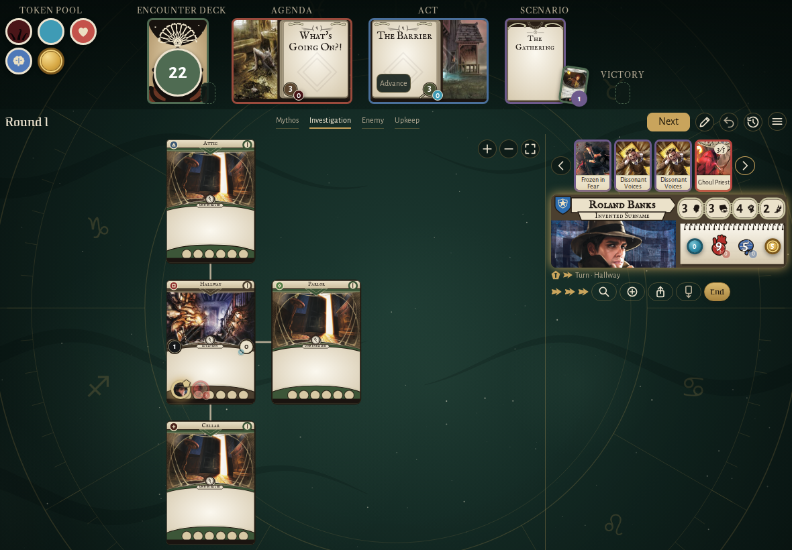
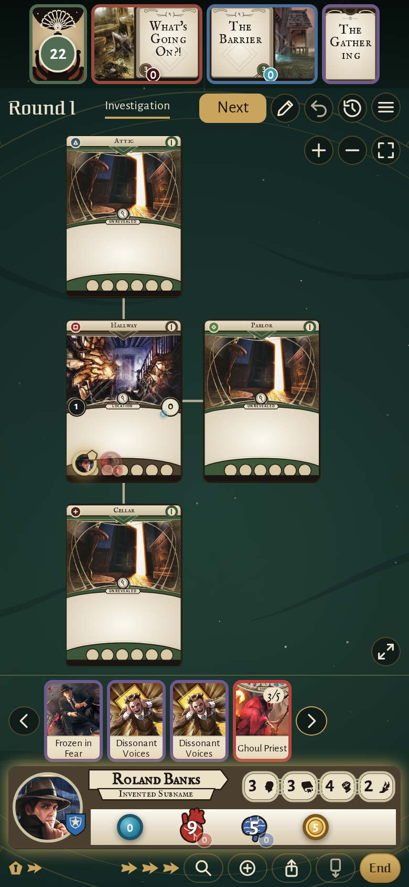
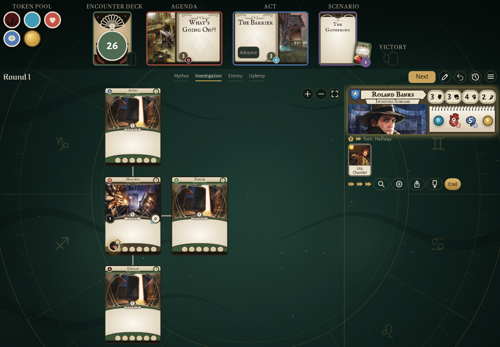
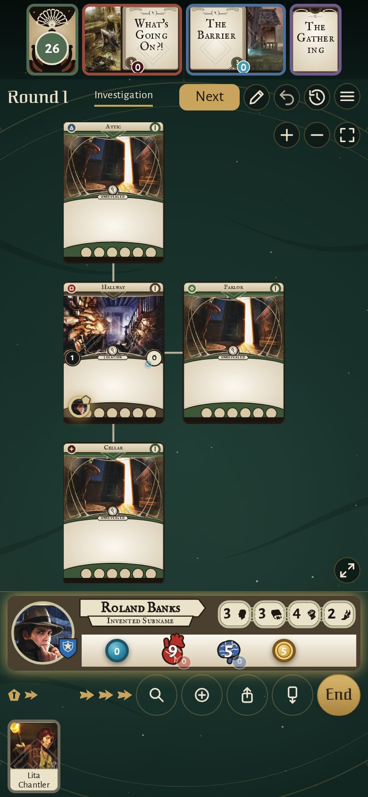
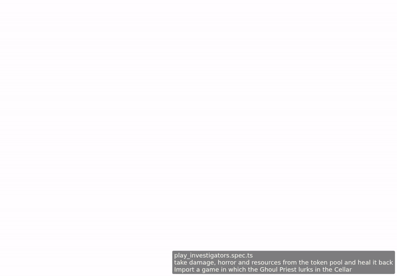

<!-- screencasts:start -->

_Recorded from d8f402b by the PR preview workflow; updated on every push that changes `apps/web`._

## Screenshots

### the house map with Roland Banks in the Hallway

<table>
<tr><th>Desktop</th><th>Phone</th></tr>
<tr><td></td><td></td></tr>
</table>

### Roland Banks with four treacheries and the Ghoul Priest, scrolled on to the Ghoul Priest

<table>
<tr><th>Desktop</th><th>Phone</th></tr>
<tr><td></td><td></td></tr>
</table>

### Lita Chantler under Roland Banks’ card, in their control

<table>
<tr><th>Desktop</th><th>Phone</th></tr>
<tr><td></td><td></td></tr>
</table>

## Screencasts

### take damage, horror and resources from the token pool and heal it back

[Play with pause and speed controls](https://macandy13.github.io/arkham-companion/pr-preview/pr-924/screencasts/player.html?flow=take-damage-horror-and-resources-from-the-token-pool-and-heal-it-back&v=d8f402b&speed=0.25)

### swipe the header and the investigator bigger and smaller on a phone

[Play with pause and speed controls](https://macandy13.github.io/arkham-companion/pr-preview/pr-924/screencasts/player.html?flow=swipe-the-header-and-the-investigator-bigger-and-smaller-on-a-phone&v=d8f402b&speed=0.25)

<!-- screencasts:end -->