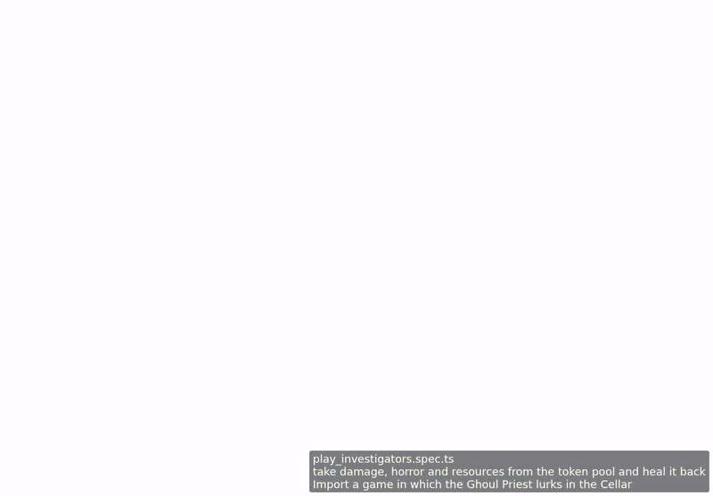

<!-- screencasts:start -->

_Recorded from 0739de0 by the PR preview workflow; updated on every push that changes `apps/web`._

## Screencasts

### take damage, horror and resources from the token pool and heal it back

[Play with pause and speed controls](https://macandy13.github.io/arkham-companion/pr-preview/pr-926/screencasts/player.html?flow=take-damage-horror-and-resources-from-the-token-pool-and-heal-it-back&v=0739de0&speed=0.25)

<!-- screencasts:end -->