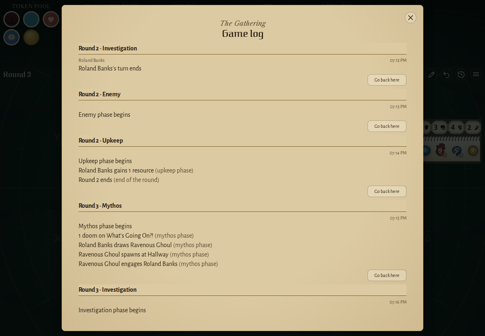
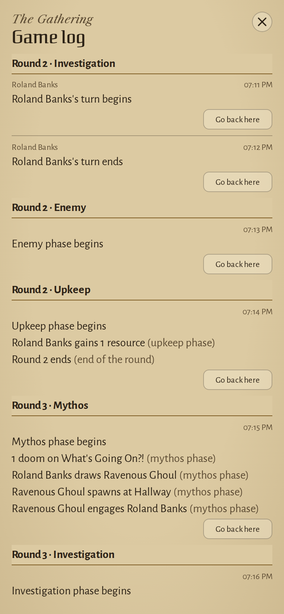
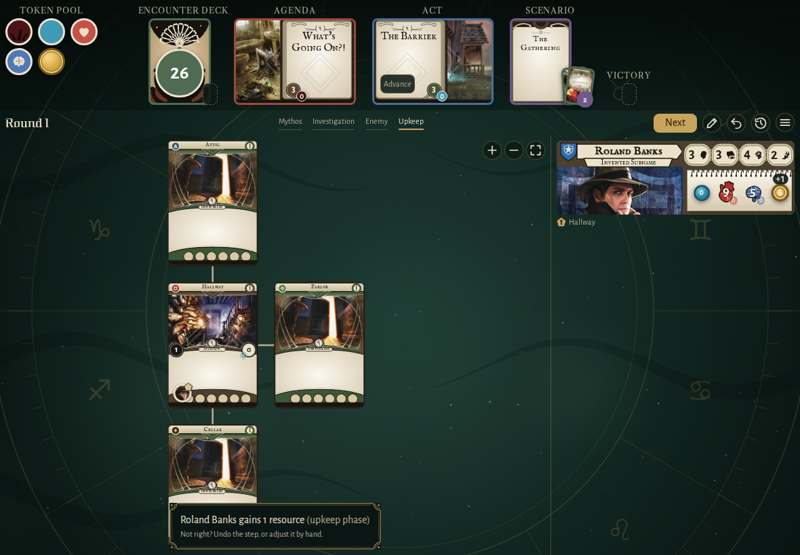
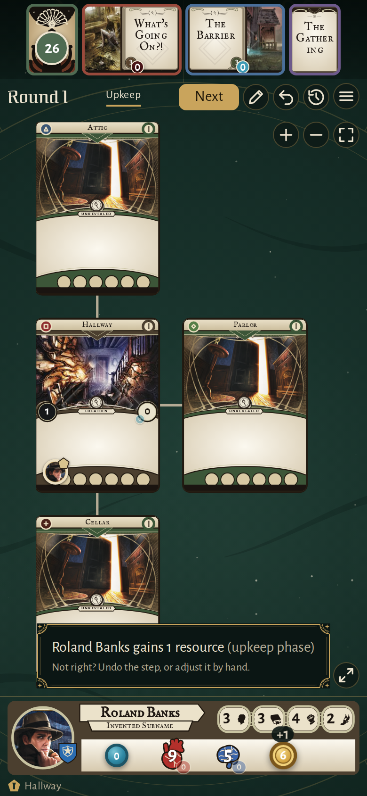
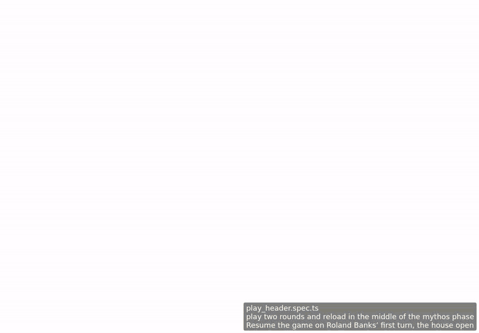

<!-- screencasts:start -->

_Recorded from 298541a by the PR preview workflow; updated on every push that changes `apps/web`._

## Screenshots

### the game log after two rounds, scrolled to the newest step under its round and phase, the game's own changes naming why

<table>
<tr><th>Desktop</th><th>Phone</th></tr>
<tr><td></td><td></td></tr>
</table>

### the upkeep's notice of what the game did, its cause and how to set it right

<table>
<tr><th>Desktop</th><th>Phone</th></tr>
<tr><td></td><td></td></tr>
</table>

## Screencasts

### play two rounds and reload in the middle of the mythos phase

[Play with pause and speed controls](https://macandy13.github.io/arkham-companion/pr-preview/pr-931/screencasts/player.html?flow=play-two-rounds-and-reload-in-the-middle-of-the-mythos-phase&v=298541a&speed=0.25)

<!-- screencasts:end -->