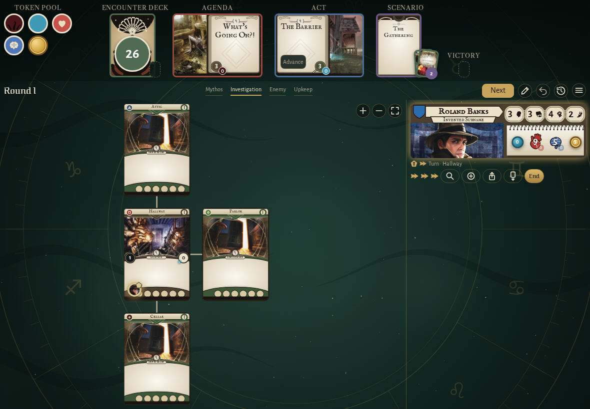
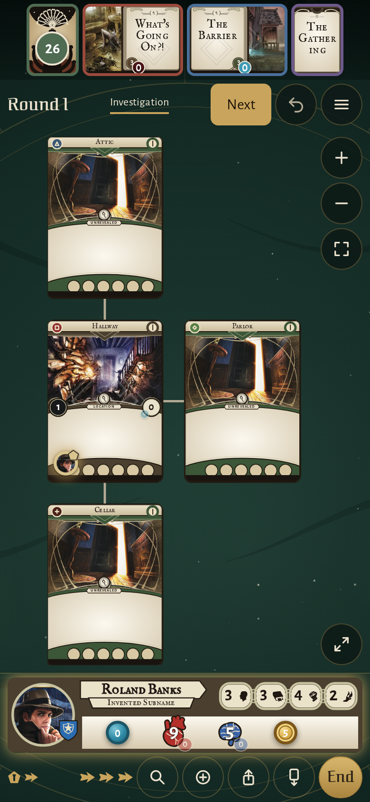
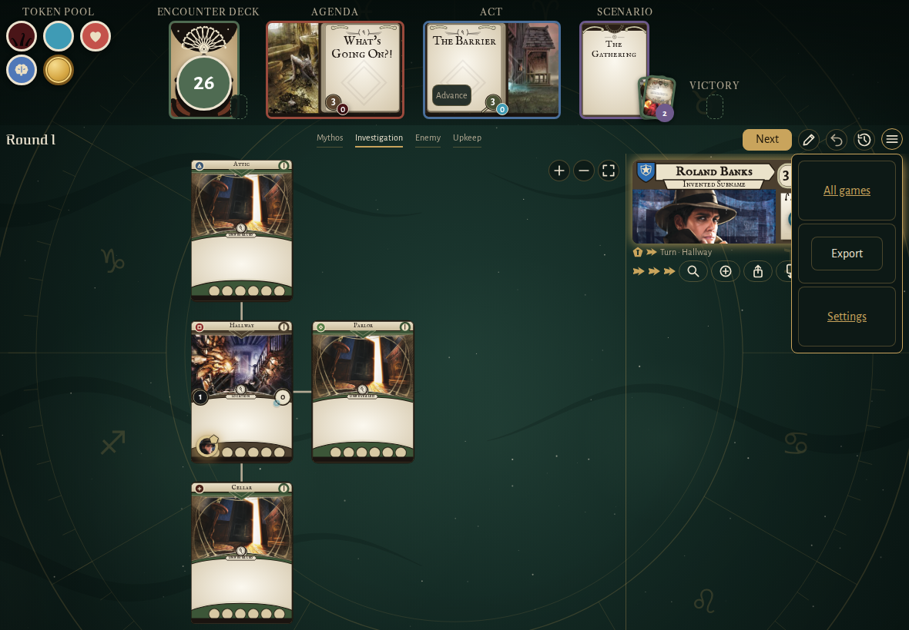
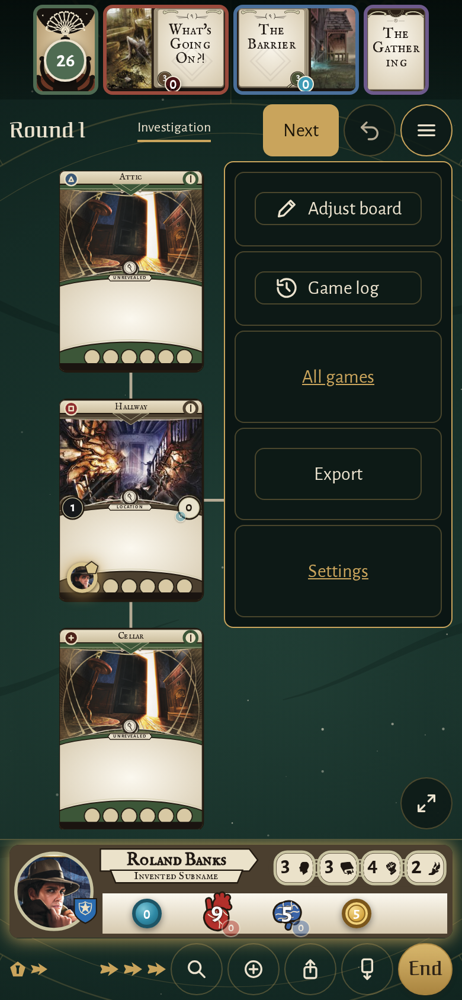
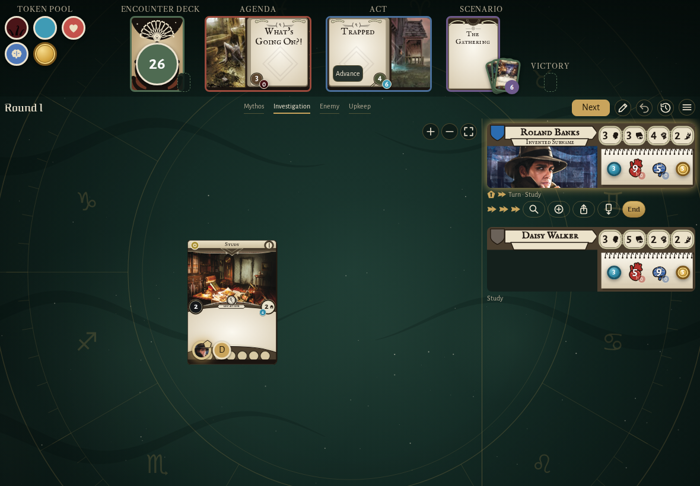
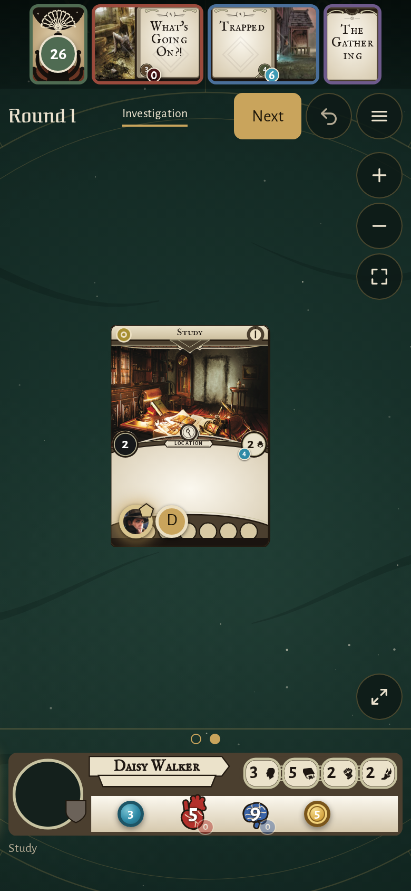

<!-- screencasts:start -->

_Recorded from b1a01ce by the PR preview workflow; updated on every push that changes `apps/web`._

## Screenshots

### the house map with Roland Banks in the Hallway

<table>
<tr><th>Desktop</th><th>Phone</th></tr>
<tr><td></td><td></td></tr>
</table>

### the menu open, holding "Adjust board" and the game log on a phone

<table>
<tr><th>Desktop</th><th>Phone</th></tr>
<tr><td></td><td></td></tr>
</table>

### Daisy Walker swiped into view on a phone, Roland Banks beside her

<table>
<tr><th>Desktop</th><th>Phone</th></tr>
<tr><td></td><td></td></tr>
</table>

## Screencasts

### expand the investigators in place and swipe sideways between them on a phone

[Play with pause and speed controls](https://macandy13.github.io/arkham-companion/pr-preview/pr-932/screencasts/player.html?flow=expand-the-investigators-in-place-and-swipe-sideways-between-them-on-a-phone&v=b1a01ce&speed=0.25)

### swipe the header and the investigator bigger and smaller on a phone

[Play with pause and speed controls](https://macandy13.github.io/arkham-companion/pr-preview/pr-932/screencasts/player.html?flow=swipe-the-header-and-the-investigator-bigger-and-smaller-on-a-phone&v=b1a01ce&speed=0.25)

<!-- screencasts:end -->