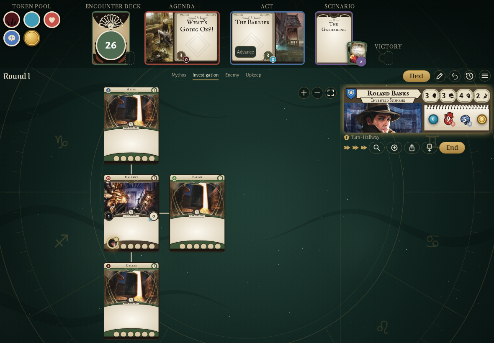
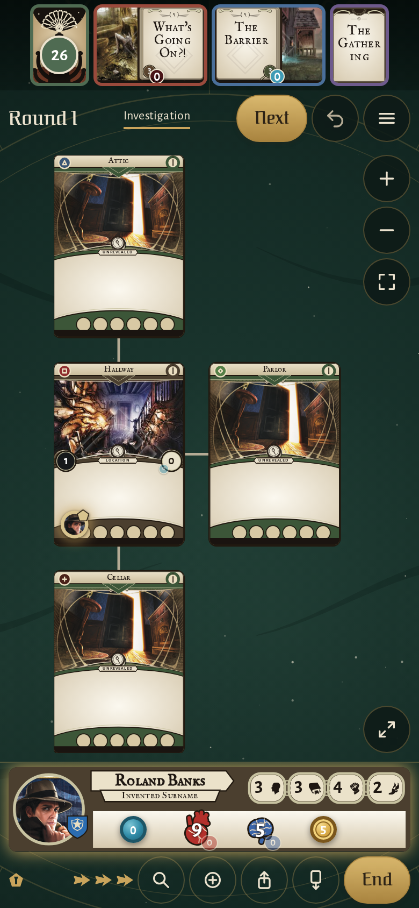

<!-- screencasts:start -->

_Recorded from f9f0b1c by the PR preview workflow; updated on every push that changes `apps/web`._

## Screenshots

### the house map with Roland Banks in the Hallway

<table>
<tr><th>Desktop</th><th>Phone</th></tr>
<tr><td></td><td></td></tr>
</table>

## Screencasts

### see what the mythos phase did above the dialog it opens

[Play with pause and speed controls](https://macandy13.github.io/arkham-companion/pr-preview/pr-934/screencasts/player.html?flow=see-what-the-mythos-phase-did-above-the-dialog-it-opens&v=f9f0b1c&speed=0.25)

<!-- screencasts:end -->