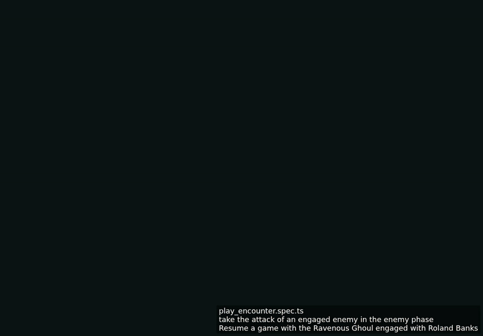

<!-- screencasts:start -->

_Recorded from ebaa1f2 by the PR preview workflow; updated on every push that changes `apps/web`._

## Screencasts

### take the attack of an engaged enemy in the enemy phase

[Play with pause and speed controls](https://macandy13.github.io/arkham-companion/pr-preview/pr-935/screencasts/player.html?flow=take-the-attack-of-an-engaged-enemy-in-the-enemy-phase&v=ebaa1f2&speed=0.25)

<!-- screencasts:end -->