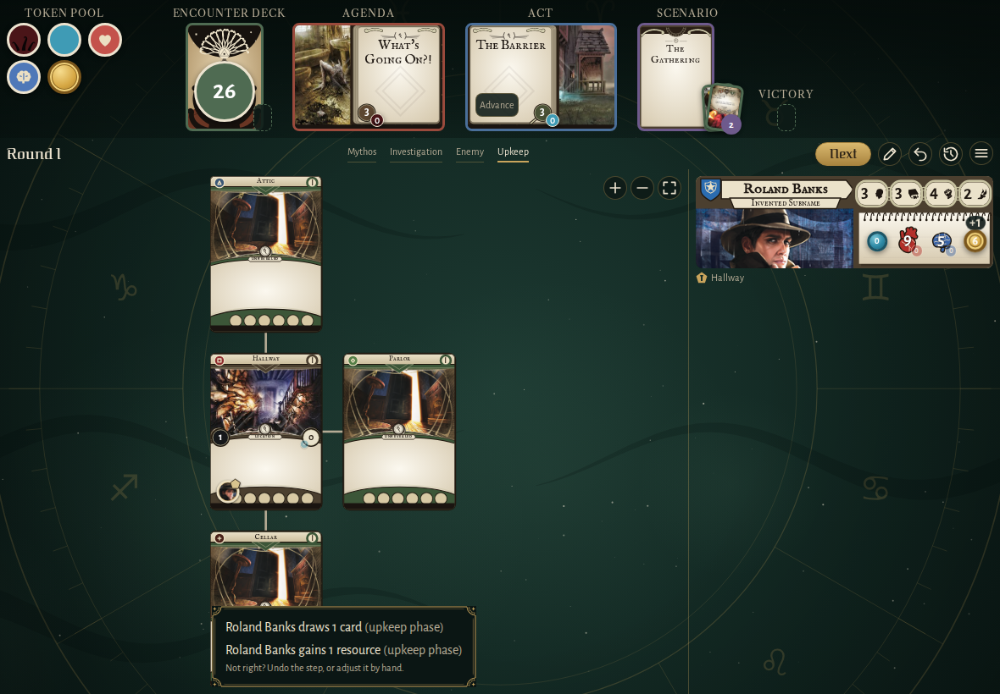
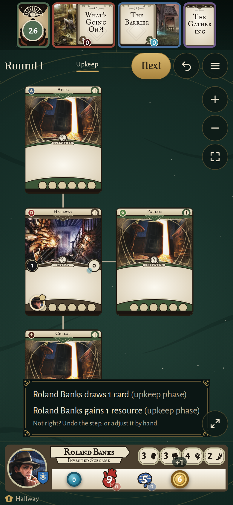
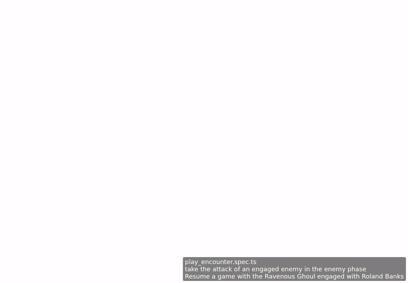
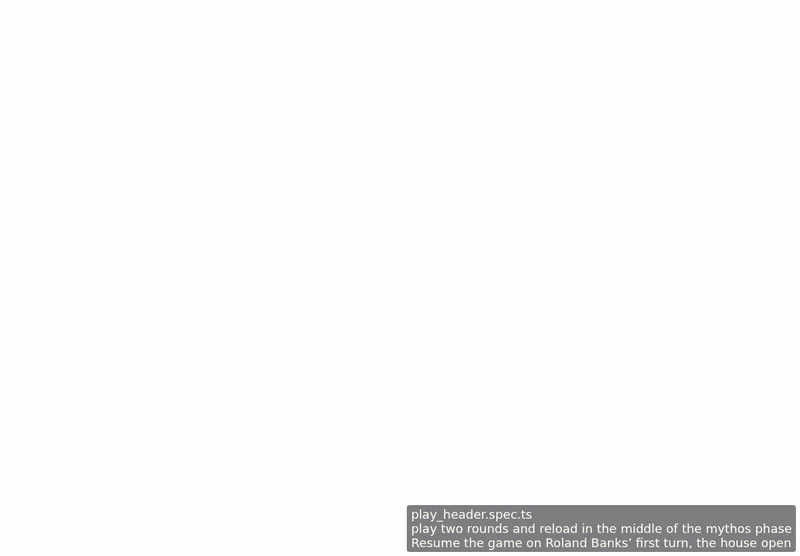

<!-- screencasts:start -->

_Recorded from e34153a by the PR preview workflow; updated on every push that changes `apps/web`._

## Screenshots

### the upkeep's notice of what the game did, its cause and how to set it right

<table>
<tr><th>Desktop</th><th>Phone</th></tr>
<tr><td></td><td></td></tr>
</table>

## Screencasts

### take the attack of an engaged enemy in the enemy phase

[Play with pause and speed controls](https://macandy13.github.io/arkham-companion/pr-preview/pr-937/screencasts/player.html?flow=take-the-attack-of-an-engaged-enemy-in-the-enemy-phase&v=e34153a&speed=0.25)

### play two rounds and reload in the middle of the mythos phase

[Play with pause and speed controls](https://macandy13.github.io/arkham-companion/pr-preview/pr-937/screencasts/player.html?flow=play-two-rounds-and-reload-in-the-middle-of-the-mythos-phase&v=e34153a&speed=0.25)

<!-- screencasts:end -->