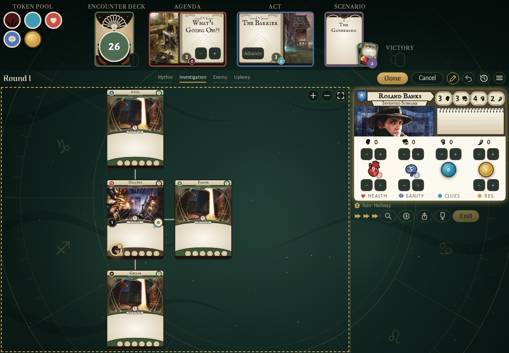
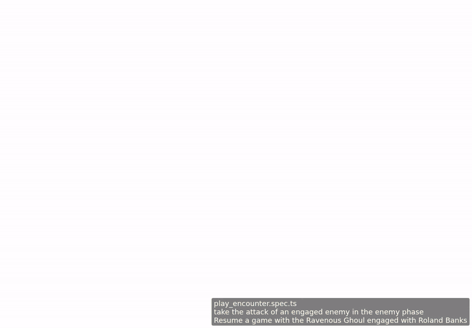

<!-- screencasts:start -->

_Recorded from 9b31867 by the PR preview workflow; updated on every push that changes `apps/web`._

## Screenshots

### Roland Banks’ card while the players adjust the board, its steppers out

<table>
<tr><th>Desktop</th><th>Phone</th></tr>
<tr><td></td><td>Not taken: the spec failed, see the E2E check.</td></tr>
</table>

## Screencasts

### take the attack of an engaged enemy in the enemy phase

[Play with pause and speed controls](https://macandy13.github.io/arkham-companion/pr-preview/pr-938/screencasts/player.html?flow=take-the-attack-of-an-engaged-enemy-in-the-enemy-phase&v=9b31867&speed=0.25)

<!-- screencasts:end -->