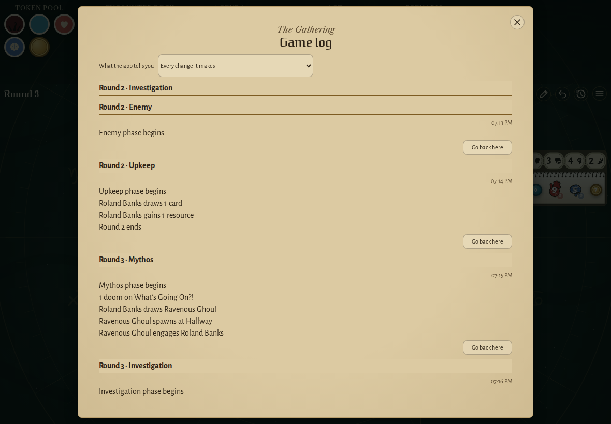
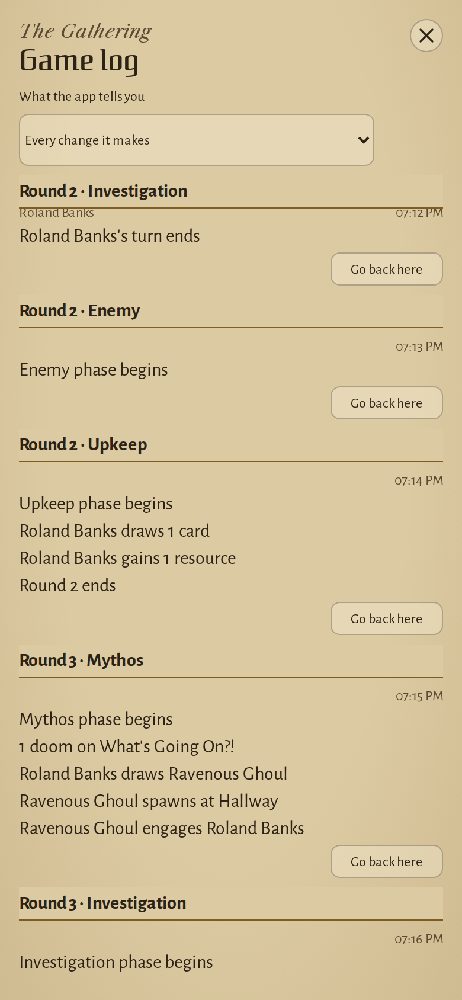
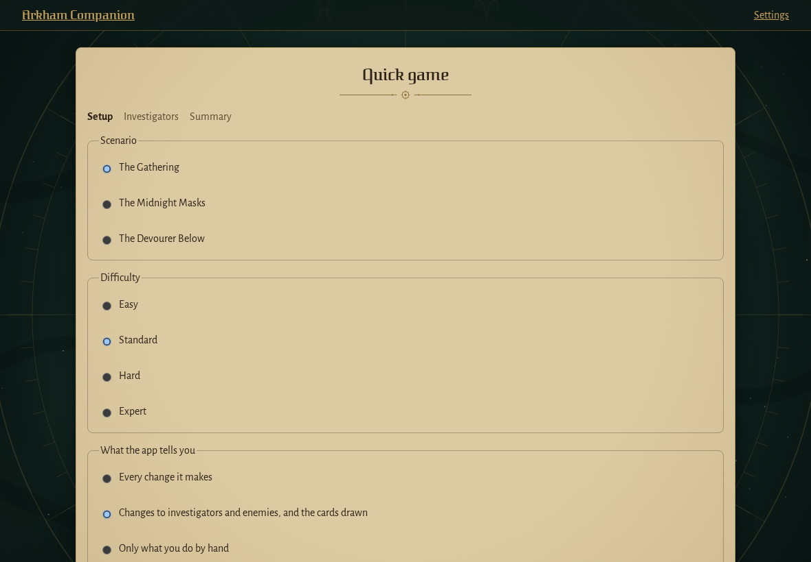
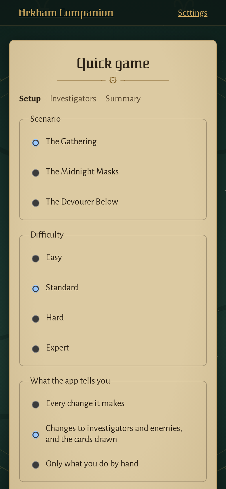
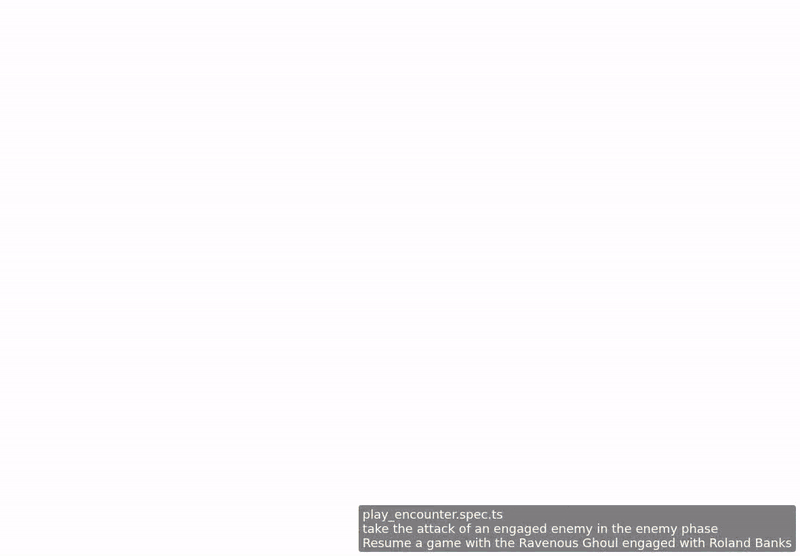

<!-- screencasts:start -->

_Recorded from c4e88fa by the PR preview workflow; updated on every push that changes `apps/web`._

## Screenshots

### the game log after two rounds, scrolled to the newest step under its round and phase, what the app tells the players above

<table>
<tr><th>Desktop</th><th>Phone</th></tr>
<tr><td></td><td></td></tr>
</table>

### a quick game's setup step: the scenario, the difficulty and what the app tells the players

<table>
<tr><th>Desktop</th><th>Phone</th></tr>
<tr><td></td><td></td></tr>
</table>

## Screencasts

### take the attack of an engaged enemy in the enemy phase

[Play with pause and speed controls](https://macandy13.github.io/arkham-companion/pr-preview/pr-940/screencasts/player.html?flow=take-the-attack-of-an-engaged-enemy-in-the-enemy-phase&v=c4e88fa&speed=0.25)

<!-- screencasts:end -->