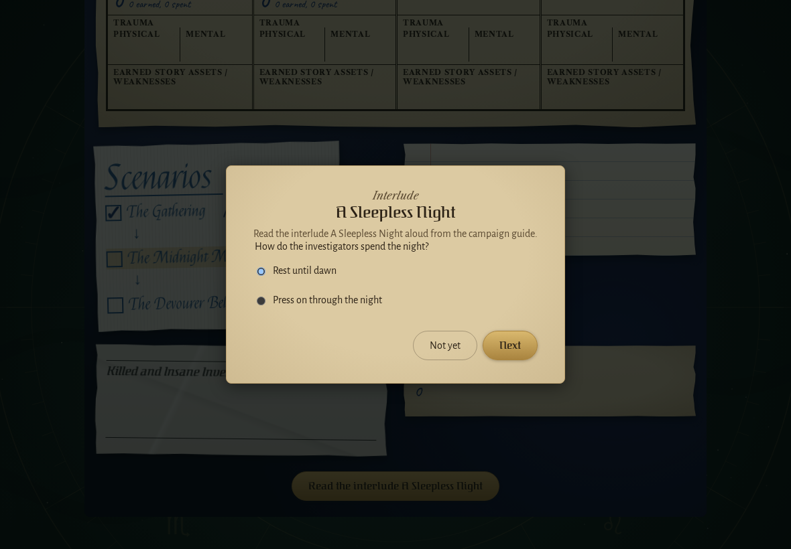
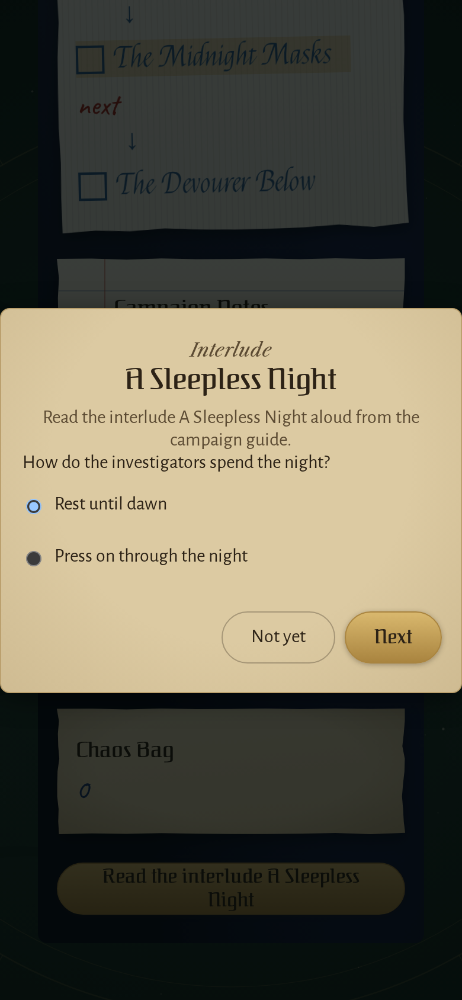
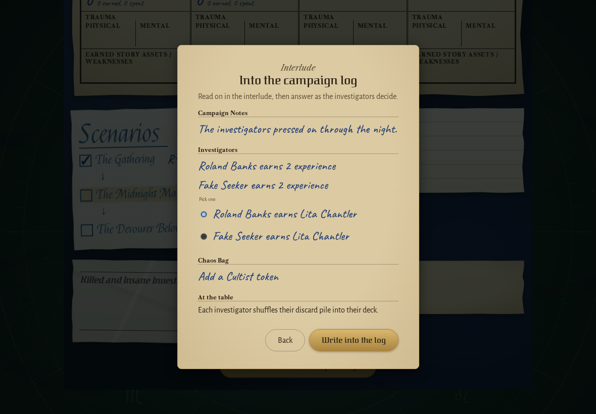
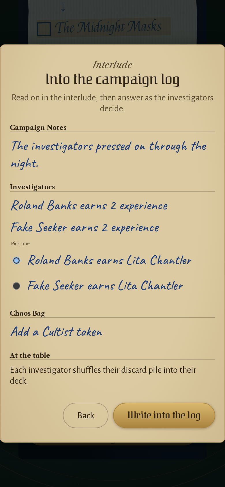
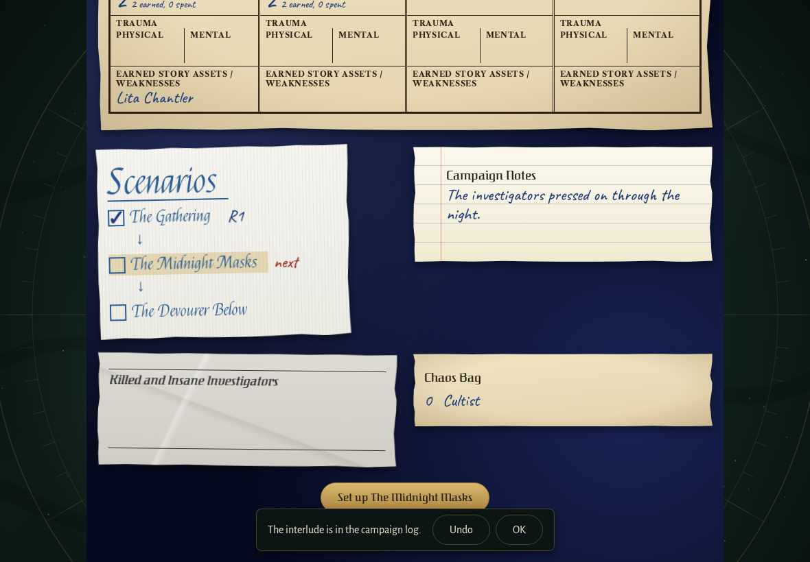
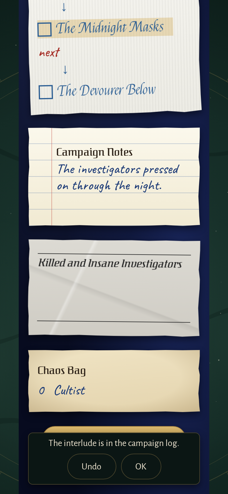

<!-- screencasts:start -->

_Recorded from 0f98796 by the PR preview workflow; updated on every push that changes `apps/web`._

## Screenshots

### the decision of an interlude

<table>
<tr><th>Desktop</th><th>Phone</th></tr>
<tr><td></td><td></td></tr>
</table>

### what an interlude writes into the log

<table>
<tr><th>Desktop</th><th>Phone</th></tr>
<tr><td></td><td></td></tr>
</table>

### the log after an interlude was written

<table>
<tr><th>Desktop</th><th>Phone</th></tr>
<tr><td></td><td></td></tr>
</table>

<!-- screencasts:end -->