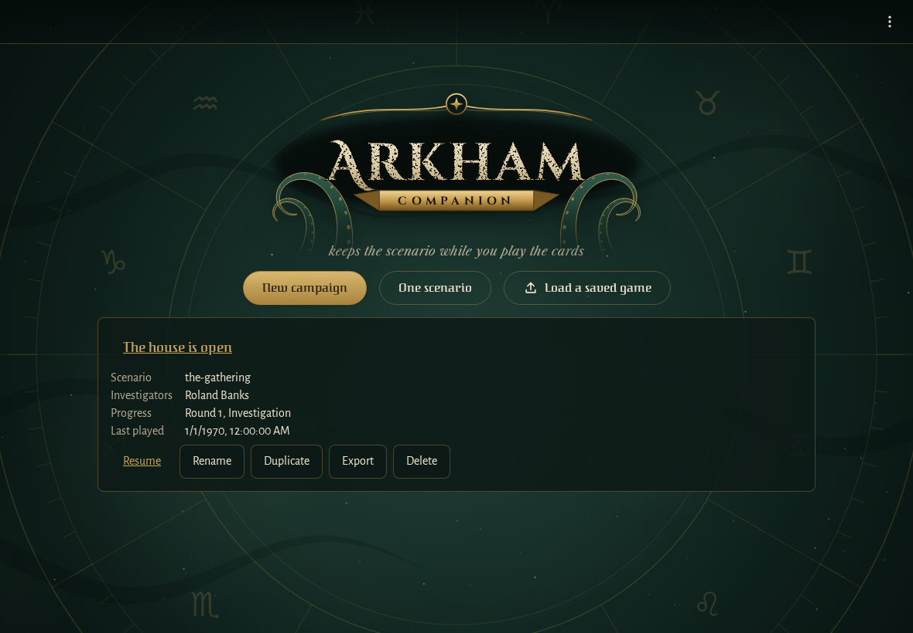
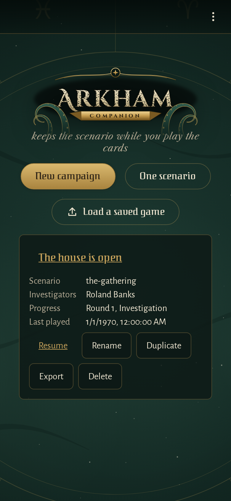
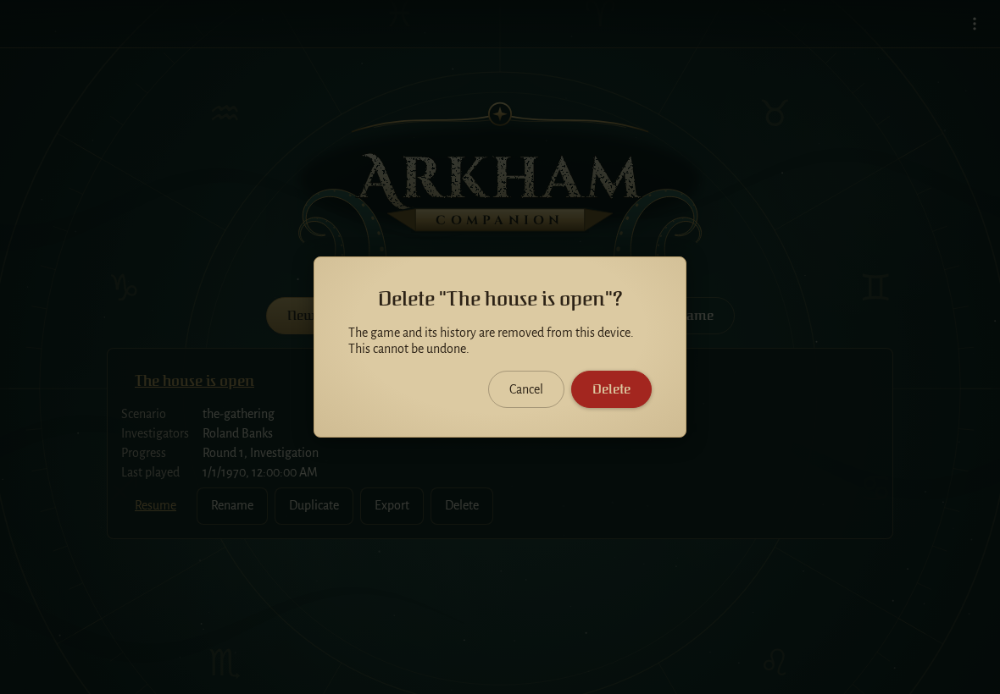
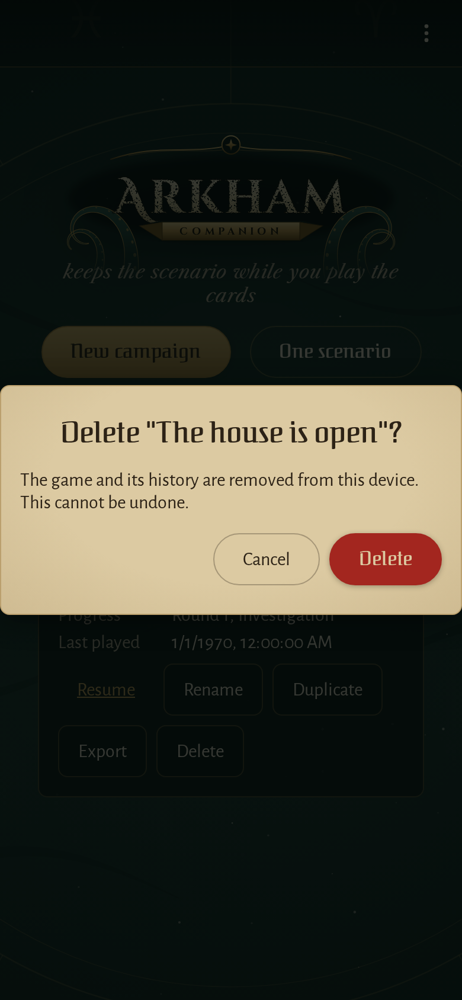
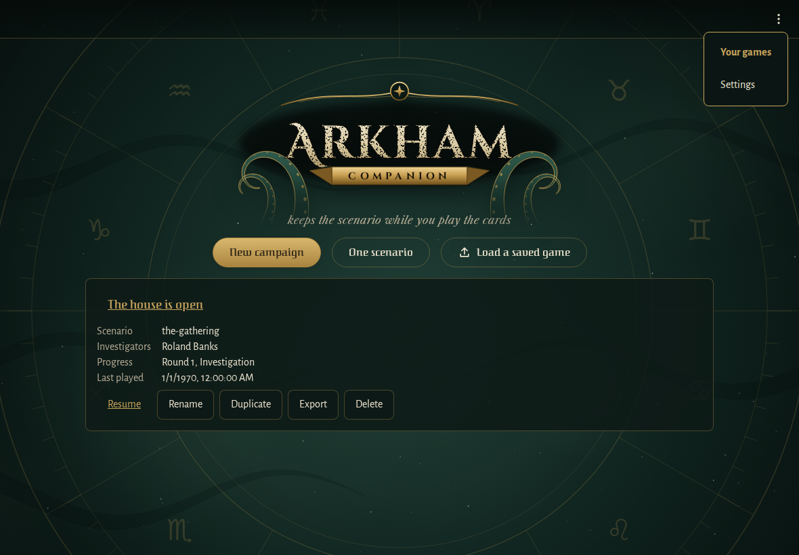
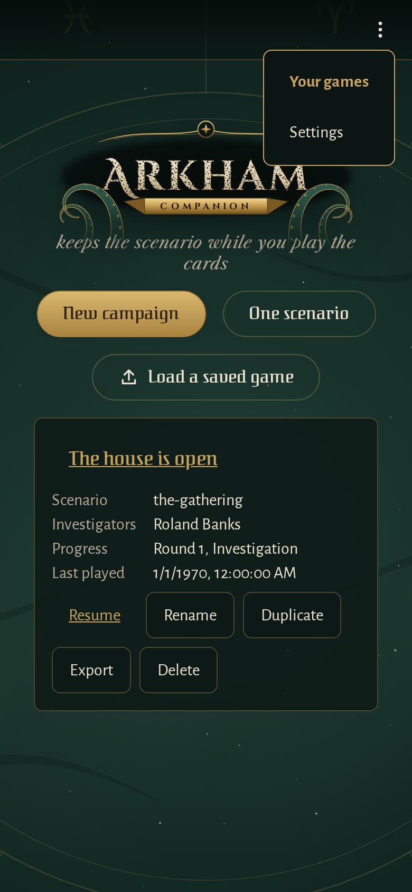

<!-- screencasts:start -->

_Recorded from e0e1da7 by the PR preview workflow; updated on every push that changes `apps/web`._

## Screenshots

### the game list with one saved game

<table>
<tr><th>Desktop</th><th>Phone</th></tr>
<tr><td></td><td></td></tr>
</table>

### the question before a saved game is deleted

<table>
<tr><th>Desktop</th><th>Phone</th></tr>
<tr><td></td><td></td></tr>
</table>

### the app bar's menu open over the game list

<table>
<tr><th>Desktop</th><th>Phone</th></tr>
<tr><td></td><td></td></tr>
</table>

## Screencasts

### a game is started, resumed, managed and backed up

[Play with pause and speed controls](https://macandy13.github.io/arkham-companion/pr-preview/pr-962/screencasts/player.html?flow=a-game-is-started-resumed-managed-and-backed-up&v=e0e1da7&speed=0.25)

<!-- screencasts:end -->