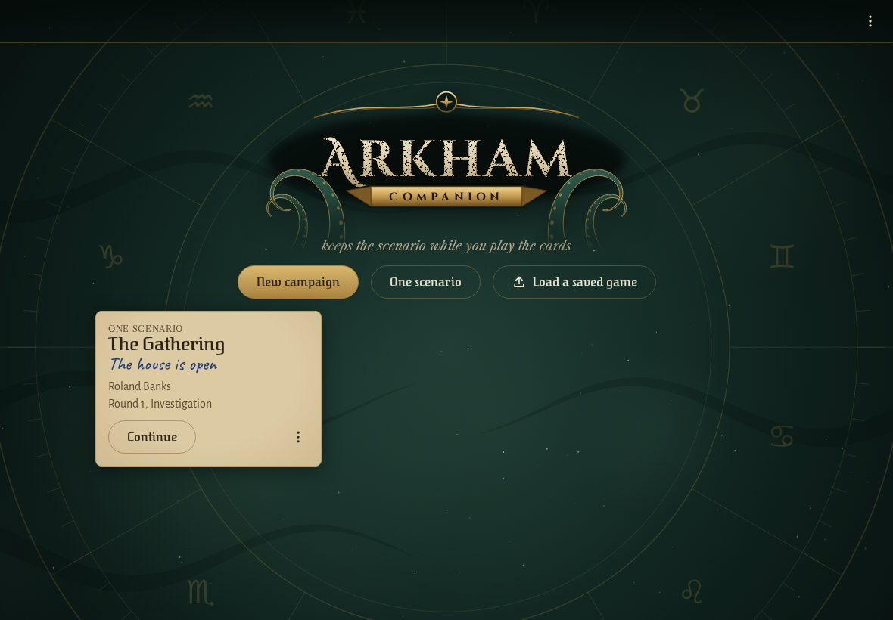
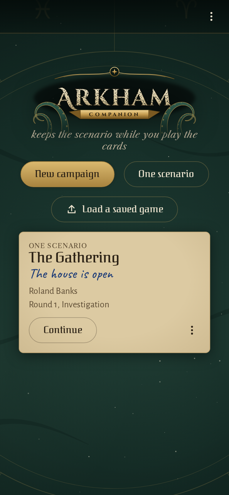
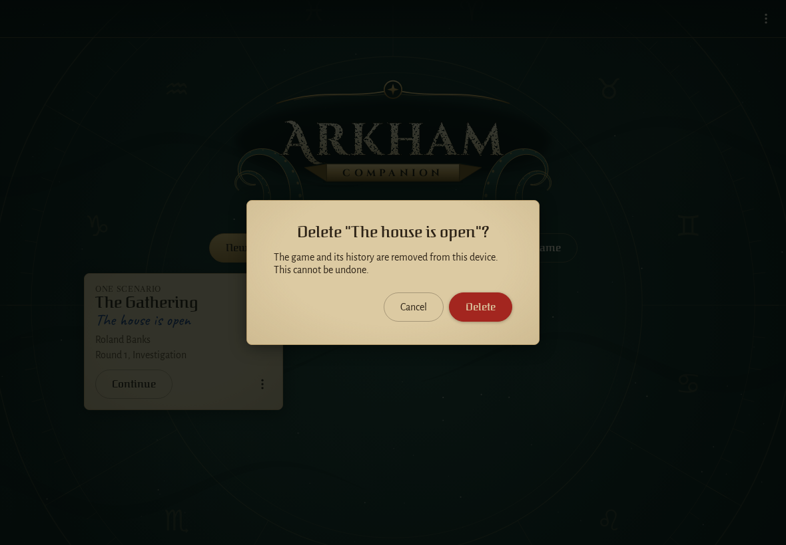
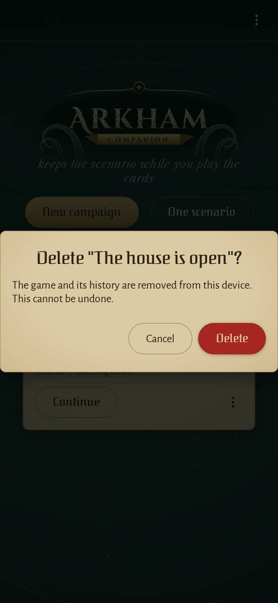
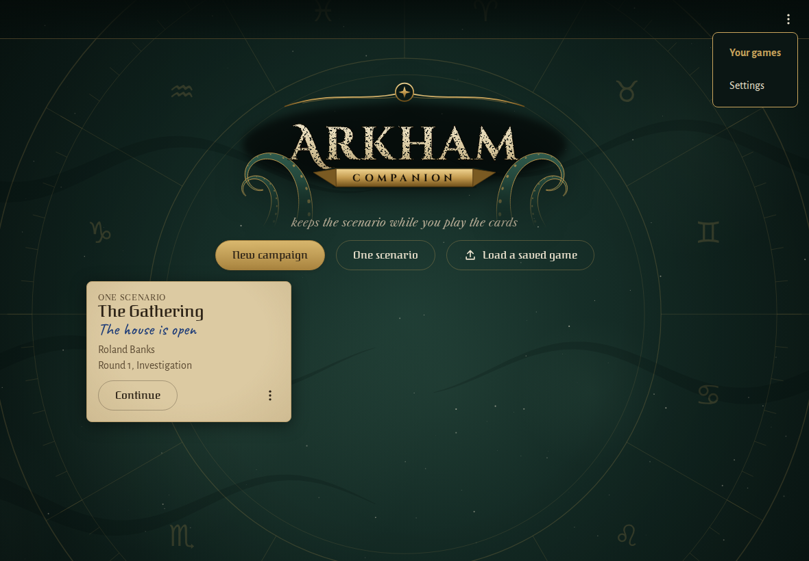
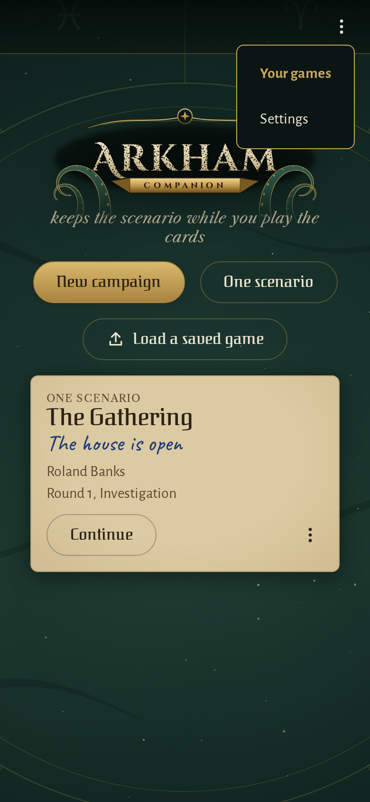

<!-- screencasts:start -->

_Recorded from de41bd7 by the PR preview workflow; updated on every push that changes `apps/web`._

## Screenshots

### the game list with one saved game

<table>
<tr><th>Desktop</th><th>Phone</th></tr>
<tr><td></td><td></td></tr>
</table>

### the shelf with a campaign waiting for its second chapter beside a game of one scenario

<table>
<tr><th>Desktop</th><th>Phone</th></tr>
<tr><td></td><td></td></tr>
</table>

### a game’s menu open on its cover

<table>
<tr><th>Desktop</th><th>Phone</th></tr>
<tr><td></td><td></td></tr>
</table>

### the question before a saved game is deleted

<table>
<tr><th>Desktop</th><th>Phone</th></tr>
<tr><td></td><td></td></tr>
</table>

### the app bar's menu open over the game list

<table>
<tr><th>Desktop</th><th>Phone</th></tr>
<tr><td></td><td></td></tr>
</table>

## Screencasts

### a game is started, resumed, managed and backed up

[Play with pause and speed controls](https://macandy13.github.io/arkham-companion/pr-preview/pr-969/screencasts/player.html?flow=a-game-is-started-resumed-managed-and-backed-up&v=de41bd7&speed=0.25)

### start a campaign and resume it from its log

[Play with pause and speed controls](https://macandy13.github.io/arkham-companion/pr-preview/pr-969/screencasts/player.html?flow=start-a-campaign-and-resume-it-from-its-log&v=de41bd7&speed=0.25)

<!-- screencasts:end -->