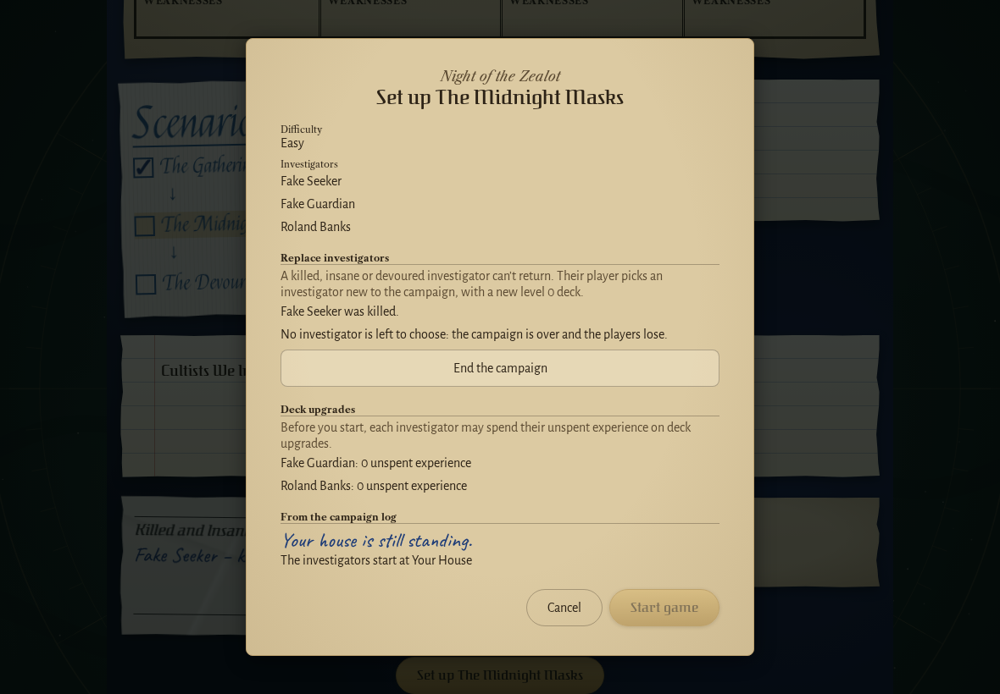
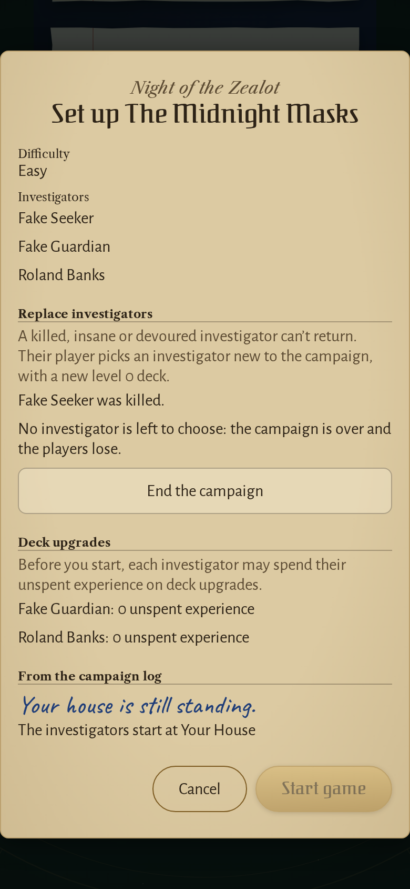
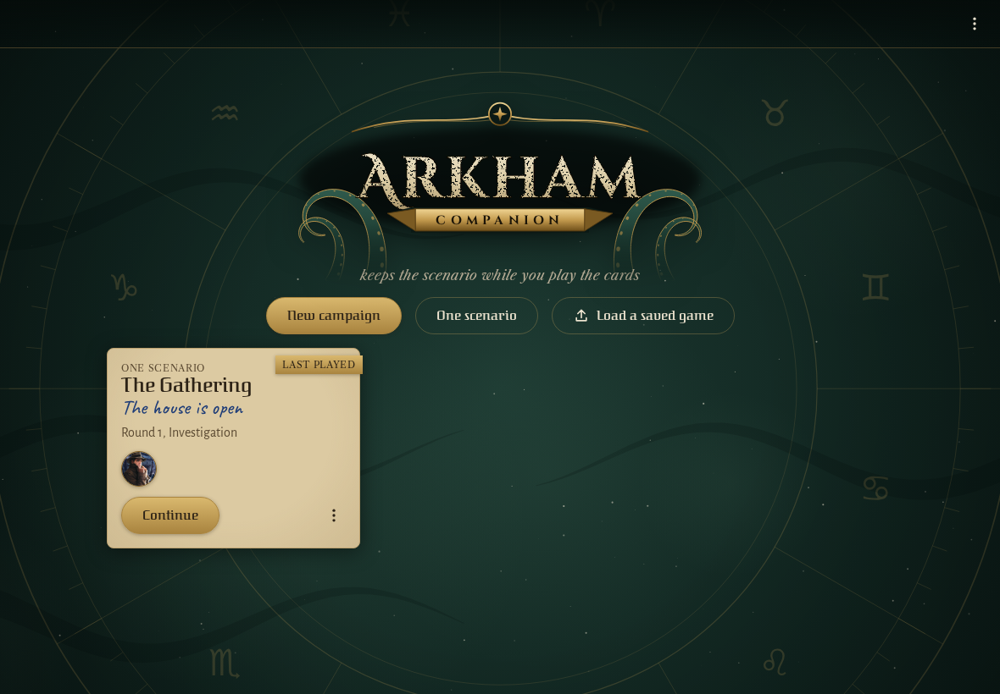
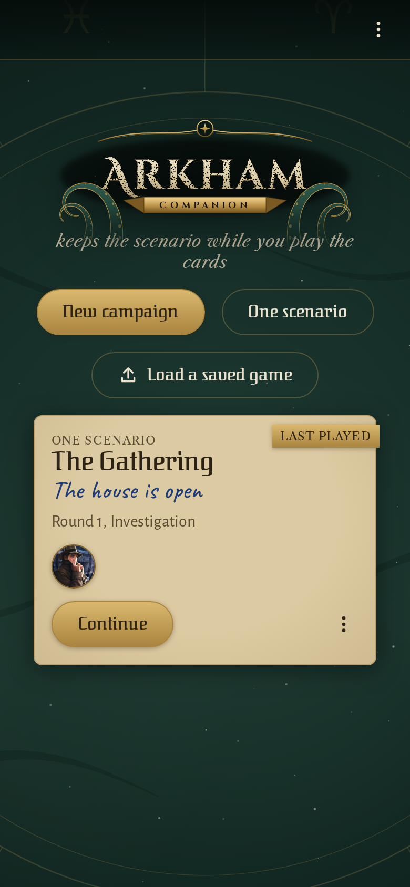
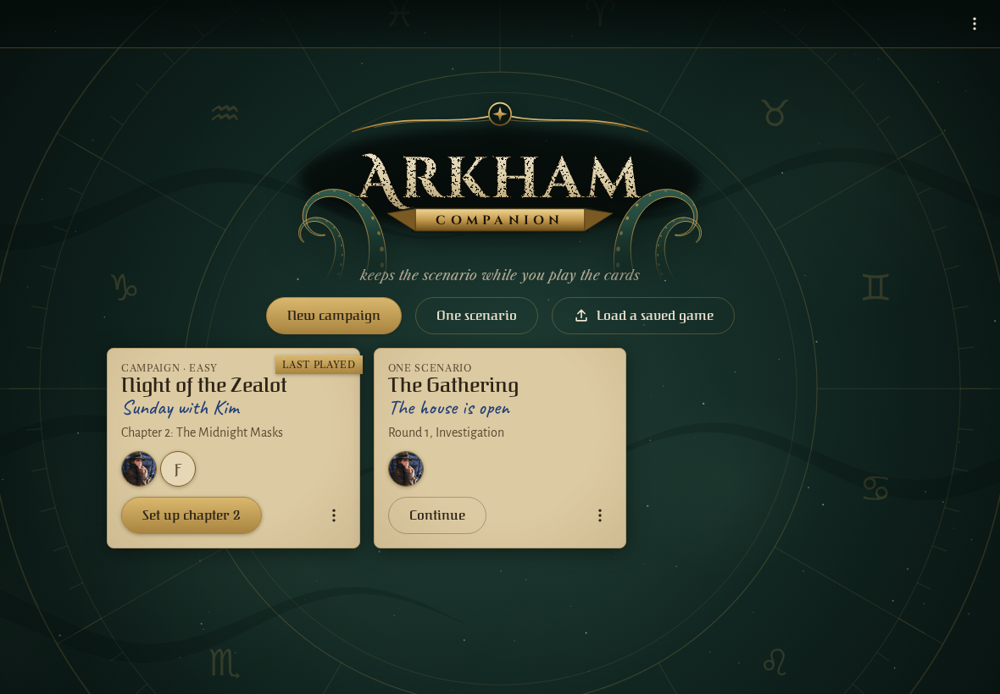
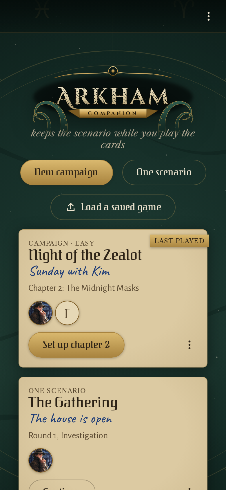
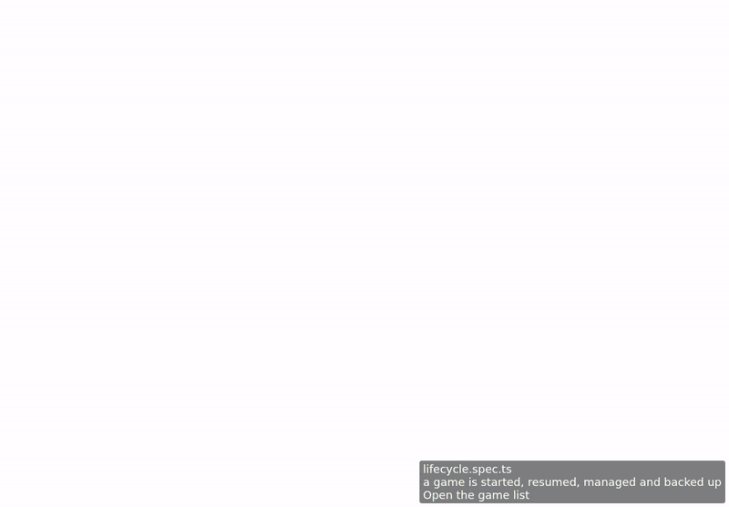

<!-- screencasts:start -->

_Recorded from 0fe9abf by the PR preview workflow; updated on every push that changes `apps/web`._

## Screenshots

### the setup preview with nobody left to replace Fake Seeker

<table>
<tr><th>Desktop</th><th>Phone</th></tr>
<tr><td></td><td></td></tr>
</table>

### the game list with one saved game

<table>
<tr><th>Desktop</th><th>Phone</th></tr>
<tr><td></td><td></td></tr>
</table>

### the shelf with a campaign waiting for its second chapter beside a game of one scenario

<table>
<tr><th>Desktop</th><th>Phone</th></tr>
<tr><td></td><td></td></tr>
</table>

## Screencasts

### a game is started, resumed, managed and backed up

[Play with pause and speed controls](https://macandy13.github.io/arkham-companion/pr-preview/pr-976/screencasts/player.html?flow=a-game-is-started-resumed-managed-and-backed-up&v=0fe9abf&speed=0.25)

<!-- screencasts:end -->