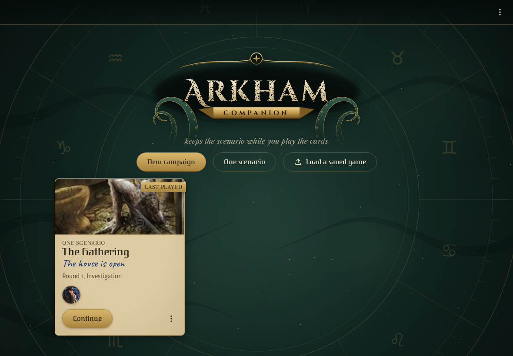
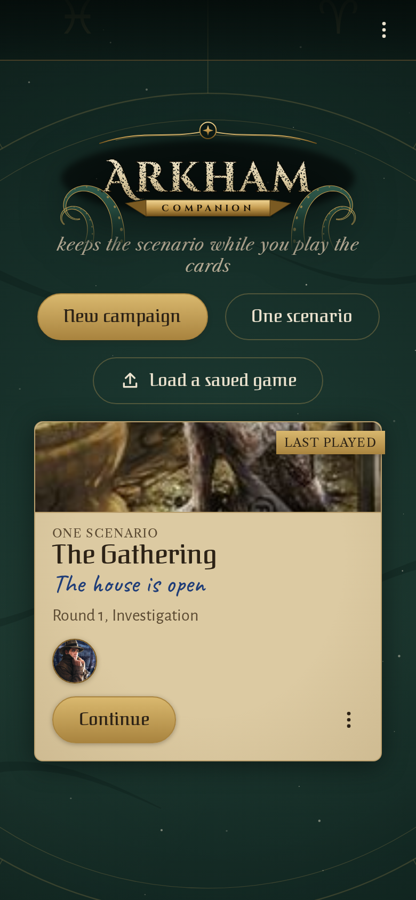
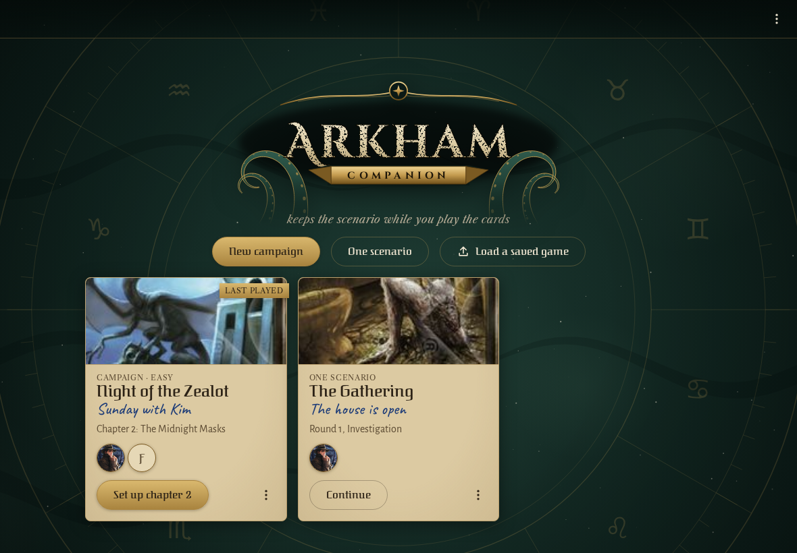
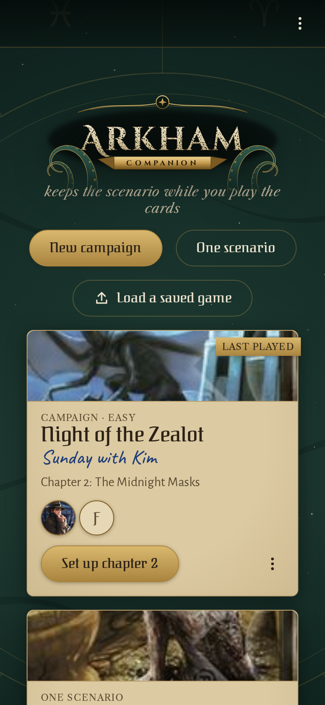
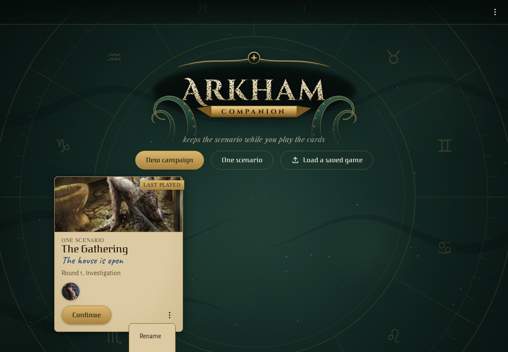
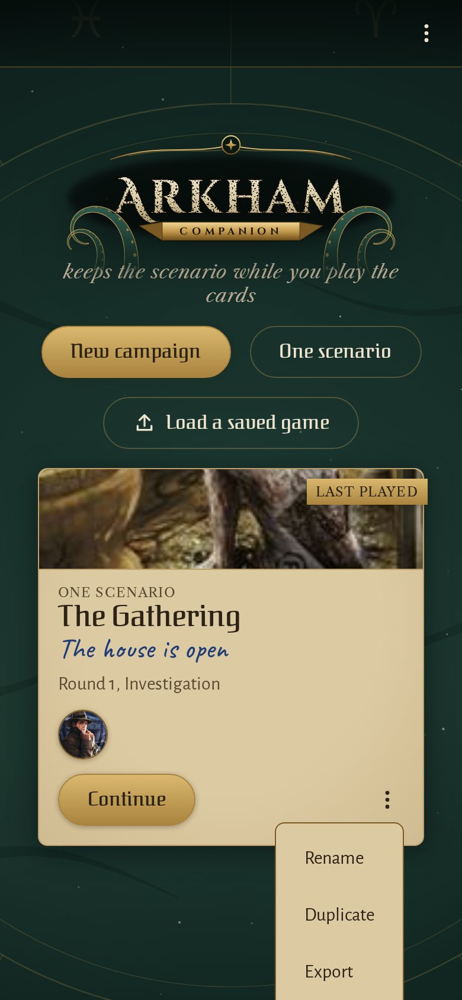

<!-- screencasts:start -->

_Recorded from 4f4c99c by the PR preview workflow; updated on every push that changes `apps/web`._

## Screenshots

### the game list with one saved game

<table>
<tr><th>Desktop</th><th>Phone</th></tr>
<tr><td></td><td></td></tr>
</table>

### the shelf with a campaign waiting for its second chapter beside a game of one scenario

<table>
<tr><th>Desktop</th><th>Phone</th></tr>
<tr><td></td><td></td></tr>
</table>

### a game’s menu open on its cover

<table>
<tr><th>Desktop</th><th>Phone</th></tr>
<tr><td></td><td></td></tr>
</table>

<!-- screencasts:end -->